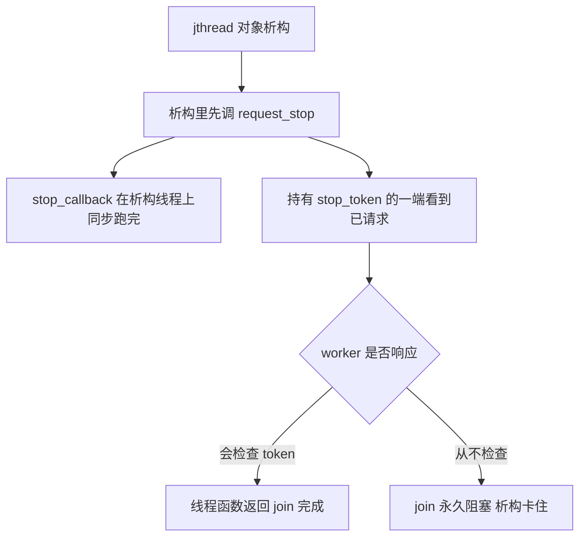
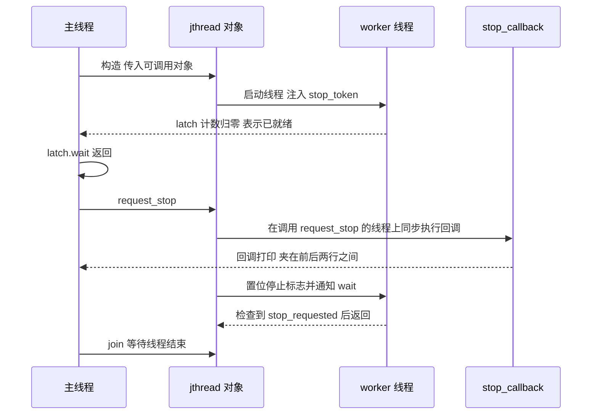

# std::jthread 与 stop_token：会自己收尾的线程

`std::jthread` 是 `std::thread` 的 C++20 修订版。它只做两件事，但这两件事正好是手写线程最容易忘的：**析构时先请求停止，再等线程结束**；以及**内建一套协作式取消的通道**（`stop_source` / `stop_token` / `stop_callback`）。

线程本身没有变化——没有抢占式终止，`request_stop()` 也不会强杀任何人。变化的是"停止请求"终于有了标准的位置可放，不用每个项目自己发明一个 `std::atomic<bool>` 标志。

## 动机

`std::thread` 有三个坑，而且它们会互相放大：

1. **析构时必须已经 `join()` 或 `detach()`。** 还 joinable 就析构，标准要求直接 `std::terminate()`，没有警告、没有栈展开、没有日志。
2. **异常路径会漏掉 `join()`。** 函数中间抛出去，`join()` 那行根本执行不到，于是回到第 1 条。要修就得写 `try` / RAII 包装。
3. **没有任何"请你停下"的机制。** 标准库不提供通道，你只能自己造一个标志。

自己造标志大致长这样：

```cpp
std::atomic<bool> stop_flag{false};

std::thread worker([&stop_flag] {
    while (!stop_flag)
        do_one_unit_of_work();
});

// ... 业务代码 ...
stop_flag = true;   // 请求停止
worker.join();      // 但还是要自己记得 join
```

这段代码能跑，代价是四件事全落在你头上：

- `stop_flag` 的生存期必须长于线程，否则线程读的是悬垂引用；
- 仍然要手动 `join()`，异常路径还得自己兜；
- worker 一旦阻塞在 `condition_variable` 或 `semaphore` 上，设标志根本叫不醒它——要么额外 `notify_all()`，要么再引入一个"停止"哨兵任务；
- 每个等待点、每个 worker 都要把这个约定重写一遍，写漏一处就少一条退出路径。

`std::jthread` 把第 1、2 条交给析构函数，把第 3 条交给 `stop_token`。

| | `std::thread` | `std::jthread` |
| --- | --- | --- |
| 析构行为 | joinable 时 `std::terminate` | 先 `request_stop()`，再 `join()` |
| 停止通道 | 无，自备标志 | 内建 `stop_source` / `stop_token` |
| 线程函数的额外参数 | 无 | 能以 `stop_token` 作第一个参数 |
| `detach()` | 有 | **没有** |
| 对象大小（本机实测） | `sizeof` = 8 | `sizeof` = 16，多出的是停止状态 |
| 适合 | 需要 detach、或完全手动管理时 | "我创建、我负责收尾"的绝大多数场景 |

## 最小示例

下面这个程序分四段，把 `jthread` 的四种用法一次跑完，输出完全确定：

<<< @/snippets/concurrency/jthread.cpp

编译并运行（本机 clang 23.1.4 + libc++ 23）：

```powershell
clang++ -std=c++23 -Wall -Wextra -O0 -fno-diagnostics-color docs/snippets/concurrency/jthread.cpp -o $env:TEMP\jthread.exe
```

输出里有四条线，分别对应四段：

1. **`[1]` 轮询型 worker。** 线程函数声明了 `std::stop_token` 参数，`jthread` 自动注入。主线程用 `std::latch`（一次性倒计数，见 [latch / barrier / semaphore](/concurrency/sync-primitives)）等到 worker 真的跑起来，再 `request_stop()`，worker 在循环里看到 `stop_requested()` 为真后打印退出原因。`[1]` 的最后一行证明 `request_stop()` 是**一次性**的：第二次调用返回 `0`。
2. **`[2]` 阻塞型 worker。** 没有任务时它睡在 `condition_variable_any` 上，`wait(lock, token, pred)` 在收到停止请求后醒来，返回 `false`。这一行是整个页面的重点：普通 `wait` 在睡着的状态下收不到任何信号。
3. **`[3]` `stop_callback`。** 回调注册后由主线程调用 `request_stop()`，回调里的那一行**夹在 `request_stop` 前后的两行之间**打印，并且 `same_thread_as_main=1`——同步执行，就在调用者线程上。
4. **`[4]` 三件套的状态矩阵。** 不涉及线程，只看 `stop_possible()` / `stop_requested()` 的变化，以及默认构造的 `stop_token`。

四段之间靠 `join()` 和 `latch` 排序，没有一处依赖"睡多久"来决定打印顺序，所以连跑 40 次输出一模一样。

页内其余代码块都是说明性片段，只有上面这份文件经过 `npm run verify` 的编译与输出比对。

## 机制与语义

### 析构函数到底做了什么

`std::jthread` 内部比 `std::thread` 多持有一个 `std::stop_source`（共享状态，引用计数）。析构时它做两件事，顺序不能反：

```cpp
~jthread() {
    if (joinable()) {
        request_stop();   // 先广播"请停下"
        join();           // 再等线程真的走完，期间阻塞
    }
}
```



关键在最后那个分支：**析构里的 `join()` 是阻塞的**。如果线程函数从不检查 token、也不在任何可被唤醒的等待上，析构就会永远挂在那里——这比 `std::terminate` 更难查，因为程序只是"不动了"。

### 三件套：source / token / callback

| 类型 | 角色 | 关键接口 |
| --- | --- | --- |
| `std::stop_source` | 开关端，持有"请求停止"的权力 | `request_stop()` 返回 `bool`；`stop_requested()`；`get_token()` |
| `std::stop_token` | 只读观察端，拷贝很便宜（共享状态，不复制数据） | `stop_requested()`；`stop_possible()`；可注册回调 |
| `std::stop_callback` | 挂在 token 上的回调 | 构造即注册，析构即注销 |

`request_stop()` 的返回值只有两种含义：**这次调用是否真的发出了请求**。已经请求过、或者根本没有关联的停止状态，都返回 `false`。所以它天然适合"谁先到谁负责收拾"的写法：

```cpp
if (worker.request_stop())
    std::printf("this call actually raised the flag\n");
```

`stop_possible()` 和 `stop_requested()` 经常被混为一谈，实测的状态矩阵是这样的：

| 状态 | `stop_possible()` | `stop_requested()` |
| --- | --- | --- |
| 有 `stop_source` 活着，没人请求过 | `true` | `false` |
| 已经请求过停止 | `true` | `true` |
| 所有 `stop_source` 都已销毁，且从未请求 | `false` | `false` |
| 默认构造的 `stop_token`（不与任何状态关联） | `false` | `false` |

一句话区分：**`stop_requested()` 只回答"已经发生了吗"**。而 `stop_possible()` 为 `false` 只有两种情况：token 不与任何停止状态关联，或者所有 `stop_source` 都已销毁且从未请求过。所以**请求过停止之后它仍然返回 `true`**——它不能当"还没停"来用，判断停止请一律用 `stop_requested()`。

### token 怎么进到线程函数里

两种方式，选一种就好：

```cpp
// 方式一：jthread 自动注入
std::jthread a([](std::stop_token token) {
    while (!token.stop_requested()) { /* ... */ }
});

// 方式二：从外部拿
std::jthread b([] { /* ... */ });
std::stop_token  token  = b.get_stop_token();    // 只读
std::stop_source source = b.get_stop_source();   // 能请求停止
```

注入规则很简单：**可调用对象能以 `stop_token` 作为第一个参数被调用，就注入；否则按原样调用。** 这条规则很宽松，也埋了一个坑——lambda 少写一个 `token` 参数不会报错，只会静默地拿不到 token（见"常见坑"第 6 条）。

方式一适合"线程自己管退出"；方式二适合"外部组件负责停机"，比如一个持有 `jthread` 的服务器对象，在 `shutdown()` 里调 `request_stop()` 再 `join()`。

### 与 condition_variable_any 配合

标准库只给 `std::condition_variable_any` 加了带 `stop_token` 的 `wait` 重载，`std::condition_variable` 没有。需要"睡着时也能被停止请求叫醒"的地方，就得用 `_any` 版本——代价是它比 `condition_variable` 略重一些，因为它要支持任意锁类型。线程间同步的其余原语见 [latch / barrier / semaphore](/concurrency/sync-primitives)。

```cpp
std::mutex mtx;
std::condition_variable_any cv;
std::optional<task> slot;

std::jthread worker([&](std::stop_token token) {
    std::unique_lock lock(mtx);
    // pred 为假时挂起并释放锁；token 被请求时也会醒来
    const bool has_work = cv.wait(lock, token, [&] { return slot.has_value(); });
    if (!has_work)
        return;             // 是被停止请求叫醒的
    // ... 处理 *slot ...
});
```

返回值就是"被谁叫醒的"：`true` 表示 `pred` 成立（有任务），`false` 表示停止请求生效。

有一处必须写对：**请求停止时最好持有同一把锁**。

```cpp
{
    std::lock_guard lock(mtx);   // 和 worker 抢同一把
    worker.request_stop();
}
worker.join();
```

不持锁的话，worker 可能正好卡在"`pred` 已经检查过、还没真正挂起"的窗口里：停止请求在这个窗口里到达，`notify_all()` 通知了一个还没有睡下的线程，于是它睡下去，再没人叫醒它。持锁请求可以把这个窗口关掉——worker 要么在锁外等待，要么在锁内检查 `pred`。

### stop_callback 的执行时机



三条规则：

- **回调在调用 `request_stop()` 的那个线程上同步执行**，不是在新线程、不是异步、不排队。示例里 `[3]` 的三行顺序就是证据。
- **如果 token 已经停止过，再注册回调会立即在构造 `stop_callback` 的那个线程上执行**。所以"注册回调时假设它不会被立刻调用"是错的。本机实测这种注册期执行的 `same_thread_as_main` 结果是 `1`。
- **回调里不要拿锁、不要做重活。** `request_stop()` 的调用者可能正持有一把锁（比如把 `request_stop()` 写进持锁的 `shutdown()` 里），回调再去拿就是自己等自己，死锁；退一步说，即使不死锁，回调的耗时也会直接拖慢 `request_stop()`，进而拖慢析构。

## 常见坑

**1. 停止是协作的，`request_stop()` 不会强杀线程。** 它只置位共享状态、跑回调、通知等待中的 `condition_variable_any::wait`。线程函数不检查 token，它就继续跑；C++ 里没有 `Thread.stop()`。

**2. 析构里的 `join()` 会阻塞。** 一个不检查 token、也不在可唤醒等待上的 worker，会让 `jthread` 的析构永远卡住。反过来说，`jthread` 的析构**不是**"尽力而为"的清理，它是一次真正的等待——和手写 `join()` 一样会等。

**3. `jthread` 没有 `detach()`。** 这是有意为之：自动 `join()` 的前提就是"线程的所有权不会脱手"。需要 detach 的场景请继续用 `std::thread`，并且自己承担第 1 条动机里的三个坑。

**4. `stop_token` 按值传，拷贝很便宜。** 它内部只是一个指向共享状态的指针（本机 `sizeof` = 8），拷贝不复制任何数据。所以放心把它发给线程池里的任务、塞进队列、存进 `std::function`，不需要 `const&`。

**5. 在 `stop_callback` 里再 `request_stop()` 是允许的，但语义要想清楚。** 此时请求已经生效，内层调用返回 `false`；如果回调里调的是**另一个** `stop_source`，就是一条合法的级联取消链——注意它会同步执行对方的回调，链条一长，`request_stop()` 的调用栈会越陷越深。

**6. 忘了在 lambda 参数里写 `stop_token`。** 注入规则是"能注入就注入"，写漏了不报错、不警告，worker 只是永远拿不到 token。表现就是"程序退出时卡住"。写完之后对着线程函数的签名核对一遍参数。

**7. 把 `stop_token` 当"重启开关"。** 停止是一次性的，没有 `reset()`。要让一批工作重新开始，就新建一个 `std::stop_source`，或者干脆新建一个 `jthread`。

**8. 用 `std::condition_variable` 而不是 `_any`。** 普通 `condition_variable` 没有 `wait(lock, token, pred)` 重载，只能退回到"标志 + `notify_all`"，也就是回到动机里那段手写代码。要用 token，就得换 `condition_variable_any`。

**9. 取消之后如何报告"没做完"。** `request_stop()` 只表达"请停下"，不携带任何结果。若上层需要知道"这次是被取消的"，让 worker 把结果写进 `std::expected<T, cancel_reason>` 之类的返回值（见 [std::expected](/cpp23/expected)），而不是让调用方从"线程有没有打印日志"里猜。

## 编译器支持

本机实测（clang 23.1.4 / libc++ 23，`_LIBCPP_VERSION == 230104`）：

| 项目 | 实测值 |
| --- | --- |
| `__cpp_lib_jthread` | `201911L` |
| `__cpp_lib_latch` | `201907L` |
| `-std=c++20` 编译 | 退出码 0，`-Wall -Wextra` 零警告 |
| `-std=c++23` 编译 | 退出码 0，`-Wall -Wextra` 零警告 |
| 运行退出码 | 0 |

已在本机逐一跑通：`std::jthread`、`std::stop_source`、`std::stop_token`、`std::stop_callback`、`get_stop_source()` / `get_stop_token()`、`request_stop()` 的两次调用返回值、`condition_variable_any::wait(lock, token, pred)`、`std::latch`、`sizeof(std::jthread) == 16`。MSVC STL 与 libstdc++ 本机未验证。

代码里用特性宏挡一下比较稳妥：

```cpp
#include <version>

#if defined(__cpp_lib_jthread) && __cpp_lib_jthread >= 201911L
    // jthread / stop_token 可用
#else
    // 退回 std::thread + 自备 std::atomic<bool> 标志
#endif
```

注意 `stop_token` 是 C++20 特性，但在 C++23 下编译同样没问题；本页的 snippet 头写的是 `c++20`，两个标准都实测通过。更细的版本矩阵见 [编译器支持矩阵](/reference/compiler-support)。

## 与 learncpp 的关系

learncpp 的主线停在 Ch28（I/O），没有并发章节——`std::thread`、`join()` / `detach()`、`std::mutex` 和 `lock_guard` 这套它也没有系统讲过。所以本页的起点不是"它讲过的线程"，而是大多数人从别处学来的写法：起一个 `std::thread`，用一个 `std::atomic<bool>` 标志请求停止，最后手动 `join()`。

于是读者会卡在一个很实际的地方：**程序要退出时，那些跑着长循环的线程怎么办？** 原子标志能表达"请停下"，但解决不了"睡着收不到信号"，也解决不了"异常路径漏掉 `join()` 就 terminate"。

把这三个缺口对应过去，整个模型的补法就清楚了：

- 手写的 `std::atomic<bool>` 标志 → `std::stop_token`（标准通道，能唤醒 `wait`）
- 手写的 `join()` → `jthread` 的析构（异常安全）
- 多数教程没讲的"如何在等待中被唤醒" → `condition_variable_any::wait(lock, token, pred)`

另外一点：`stop_token` 是**线程**的取消机制，不能直接塞进协程。协程的取消要自己设计（通常是"协程内部检查 token，或者由调度器 co_await 一个可取消的操作"），相关背景见 [协程：手写一个惰性 task](/cpp20/coroutines)。如果你还要看 `span` 这类零拷贝视图在把任务数据交给 worker 时的用法，[span 与 mdspan](/stdlib/span) 是配套阅读。

## 小练习

1. **改写轮询 worker。** 把示例的 `[1]` 改成三阶段流水线：每个阶段一个 `jthread`，前一段的 `stop_callback` 负责向后一段 `request_stop()`，观察级联取消的调用栈深度。
2. **给线程池加上停机。** 写一个 `thread_pool`，内部用 `std::vector<std::jthread>` 加阻塞队列；`~thread_pool()` 里遍历调用 `request_stop()`，再依赖析构里的 `join()`。用一个 `std::latch` 保证所有 worker 已经进入等待再开始停机。
3. **制造一次析构卡死。** 写一个完全忽略 `stop_token` 的 worker（改成 `while (true) { do_one_unit(); }`），在主线程里让 `jthread` 离开作用域，用调试器观察它停在 `join()` 上。再用 `stop_callback` 打印日志，证明 `request_stop()` 确实先执行了。
4. **对比 `condition_variable`。** 把 `[2]` 改成 `std::condition_variable` 加一个布尔标志，测量两种写法的代码行数与一次停机需要多久（用 `std::chrono::steady_clock` 计时，注意别把时间写进期望输出）。
5. **给取消结果分类。** 让 worker 返回 `std::expected<int, std::string>`，区分"正常完成"、"被取消"、"内部错误"三种情况，并在 `main` 里分别打印——注意线程的返回值要靠 `std::promise` / `std::future` 或共享变量取回。
