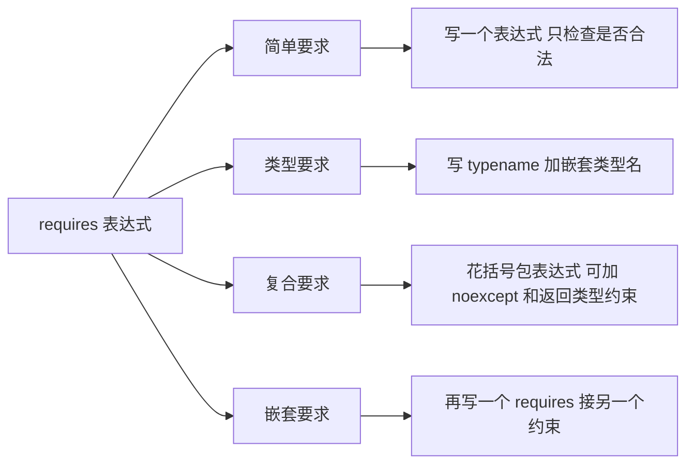
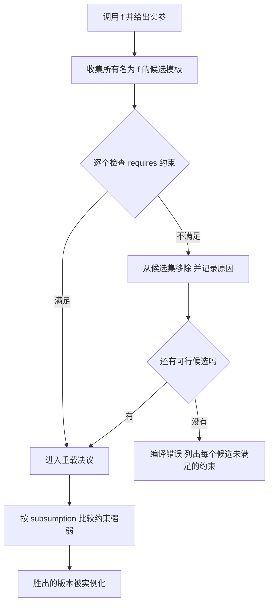

# concepts 与 requires：让模板报错说人话

模板的参数类型是"什么都能塞"的。塞错了，编译器不会在你的调用点骂你，而是先认真地实例化下去，直到某一行库代码里两个类型加不起来，才回头甩给你一屏 `in instantiation of ...`。concepts 解决的就是这件事：**把"这个类型得满足什么"从函数体深处提到签名上**，让不满足的类型在重载决议阶段就被挡掉。

## 动机：报错发生在实例化深处

先看一段没有任何约束的代码，以及本机 clang 的真实输出（已截断，路径与部分模板参数已省略）：

```cpp
#include <algorithm>
#include <vector>

struct Item { int id; };

int main() {
    std::vector<Item> v{{1}, {2}};
    std::sort(v.begin(), v.end());
}
```

```text
In file included from sort.cpp:1:
In file included from .../c++/v1/algorithm:1895:
In file included from .../c++/v1/__algorithm/adjacent_find.h:13:
.../c++/v1/__algorithm/comp.h:42:18: error: invalid operands to binary expression
      ('const Item' and 'const Item')
   42 |     return __lhs < __rhs;
note: in instantiation of function template specialization
      'std::__less<>::operator()<Item, Item>' requested here
note: in instantiation of function template specialization
      'std::__sift_down<...>' requested here
note: in instantiation of function template specialization
      'std::__make_heap<...>' requested here
note: in instantiation of function template specialization
      'std::__partial_sort_impl<...>' requested here
...
```

真正的原因只有一句：`Item` 没有 `operator<`。但你得先穿过四五层 `__make_heap` / `__sift_down`，报错位置还落在 `comp.h` 里，跟你的 `main` 隔了一整个标准库。

把同样的前提写成 `requires`，报错立刻回到调用点：

```cpp
#include <concepts>

struct NoAdd {};

template <typename T>
    requires requires(T v) { v + v; }
T twice(T v) { return v + v; }

int main() { twice(NoAdd{}); }
```

```text
good.cpp:6:14: error: no matching function for call to 'twice'
    6 | int main() { twice(NoAdd{}); }
note: candidate template ignored: constraints not satisfied [with T = NoAdd]
    5 | T twice(T v) { return v + v; }
note: because 'v + v' would be invalid: invalid operands to binary expression
      ('NoAdd' and 'NoAdd')
```

第一行就是你的调用点，最后一行直接说出缺什么。这就是"说人话"。

## 最小示例

下面这个程序可以在本机直接编译运行，覆盖了自定义 concept、约束函数模板、`static_assert` 检查和重载选择：

<<< @/snippets/cpp20/concepts.cpp

输出：

```text
HasSize<string> = true
HasSize<int> = false
Numeric<int> = true
Numeric<string> = false
twice(21) = 42
twice(1.5) = 3
describe: 3 items
kind(7) = integral
kind(2.5) = numeric
box holds 42
print_num: 7
```

注意 `kind(7)` 和 `kind(2.5)` 走了不同重载：两个版本都满足约束，但整型那个约束更强，于是赢了。这是后文的 subsumption。

## concept 与 requires 表达式

### 定义一个 concept

```cpp
template <typename T>
concept HasSize = requires(const T& value) {
    { value.size() } -> std::convertible_to<std::size_t>;
};
```

语法就三块：`template <...>` + `concept 名字 =` + 一个 `bool` 常量表达式。这个表达式通常写成 `requires` 表达式，但也可以直接写已有约束：

```cpp
template <typename T>
concept Numeric = std::integral<T> || std::floating_point<T>;

template <typename T>
concept SmallNumeric = Numeric<T> && (sizeof(T) <= 4);
```

`requires` 表达式本身是 `bool` 类型的常量表达式，可以脱离 concept 单独使用：

```cpp
static_assert(requires(int a, int b) { a + b; });   // true，int 能相加
```

它**不求值**，只回答"这些表达式和类型在语法上成立吗"。所以 `requires` 里写 `a + b` 不会真的执行加法，也不会产生运行期开销。

### 四种要求

```cpp
template <typename T>
concept Demo = requires(T a, T b, const T& c) {
    a + b;                                              // 1. 简单要求
    typename T::value_type;                             // 2. 类型要求
    { c.size() } -> std::convertible_to<std::size_t>;   // 3. 复合要求
    requires std::is_object_v<T>;                       // 4. 嵌套要求
};
```



| 形式 | 写法 | 检查什么 |
| --- | --- | --- |
| 简单要求 | `a + b;` | 表达式合法即可，不看结果类型 |
| 类型要求 | `typename T::value_type;` | 嵌套类型存在且可访问（C++20 起 `typename` 可省） |
| 复合要求 | `{ expr } noexcept -> Concept;` | 表达式合法；写了 `noexcept` 还要求不抛；`->` 后面要求结果类型满足该 concept |
| 嵌套要求 | `requires Constraint;` | 另一个约束成立；不会去实例化表达式 |

复合要求里的 `->` 只能接一个**类型约束**，也就是 concept 或 concept 的组合，不能写 `-> int`。想表达"结果就是 `int`"，写 `-> std::same_as<int>`。`noexcept` 是可选的，写了就要求该表达式在编译期被判定为不抛异常。

嵌套要求最常见的用途是把约束组合起来，并让 subsumption 能看见结构：

```cpp
template <typename T>
concept SizedRange = std::ranges::range<T> && requires(const T& c) {
    { c.size() } -> std::convertible_to<std::size_t>;
};
```

## 约束函数模板与类模板

约束可以写在这几个位置，效果等价：

```cpp
// A. requires 子句：模板参数表之后，返回类型之前
template <typename T>
    requires Numeric<T>
T twice(T v);

// B. 把 concept 直接写进模板参数表
template <Numeric T>
T twice(T v);

// C. 尾置 requires 子句：声明符之后
template <typename T>
T twice(T v) requires Numeric<T>;
```

类模板同理，而且约束会传递给它的成员：

```cpp
template <typename T>
    requires Numeric<T>
class Box {
public:
    explicit Box(T value) : value_(value) {}
    T get() const { return value_; }

    // 成员函数可以再加一层约束：只有 T 是整型时这个重载才存在
    void scale_by(T factor) requires std::integral<T> {
        value_ *= factor;
    }

private:
    T value_;
};
```

`Box<std::string>` 在写出来的那一刻就报错，而不是等到某次 `value_ += factor`。约束放在类上，等于给整个类模板签了一份契约。

> C++23 的显式对象参数（deducing this）也能挂约束，`void f(this Self&& self) requires ...`。细节见 [deducing this](/cpp23/deducing-this)。

## 缩写函数模板

把 concept 写在 `auto` 前面，就是隐式模板参数：

```cpp
void f(std::integral auto x);               // 就是这一行的形态
void print_num(std::integral auto value);   // 等价于 template <std::integral T> void print_num(T value)
void push(std::convertible_to<int> auto v);

template <typename T>
void mix(T first, std::integral auto second);  // 显式参数 + 隐式参数可以混用
```

规则与坑：

- 每个「concept + `auto`」引入**一个**按出现顺序排列的隐式模板参数。
- 一个占位符只能挂一个 concept。想加两个条件，定义新 concept 或者改用 `requires` 子句，别写 `std::integral std::floating_point auto`。
- 它也能用在变量和返回值上：`std::integral auto n = 42;`、`std::integral auto make();`（后者要求所有 `return` 的类型一致地满足约束）。
- 取 `&print_num` 得到的是一个模板，只有赋给参数类型确定的函数指针时才会实例化。

## 标准 concepts 一览

`<concepts>` 和 `<iterator>` / `<ranges>` 里已经有一批常用货：

| concept | 含义 | 备注 |
| --- | --- | --- |
| `std::integral<T>` | 整数类型 | 含 `bool`、`char`，别拿它当"数值"用 |
| `std::floating_point<T>` | 浮点类型 | `float` / `double` / `long double` |
| `std::same_as<T, U>` | `T` 与 `U` 是同一类型 | 双向要求，cv 与引用都算数：`same_as<int, const int>` 为 false |
| `std::convertible_to<From, To>` | `From` 能隐式转成 `To` | 还要求 `static_cast` 合法；`explicit` 转换不满足 |
| `std::ranges::range<R>` | `R` 有可用的 `begin` / `end` | ranges 算法的入口条件，见 [ranges 与 views](/cpp20/ranges) |

顺手可用的还有 `std::derived_from`、`std::constructible_from`、`std::assignable_from`、`std::equality_comparable`、`std::totally_ordered`、`std::invocable`、`std::predicate`、`std::copyable`。写库代码时先翻一遍，别急着自己拼 requires 表达式。

几个容易误判的点：

```cpp
static_assert(std::same_as<int, int>);
static_assert(!std::same_as<int, long>);
static_assert(!std::same_as<int, const int>);          // cv 不同就不是同一类型
static_assert(std::convertible_to<int, double>);        // 隐式转换
static_assert(std::convertible_to<double, int>);        // 也是 true：double 能隐式转 int
static_assert(std::convertible_to<int*, void*>);
static_assert(!std::convertible_to<void*, int*>);       // void* 不能隐式转回 int*
```

注意 `double` 到 `int` 那一行：隐式转换合法，但会截断。`convertible_to` 只看"能不能转"，不看"转得安不安全"。想禁止窄化，得自己写 concept。

## 重载与 subsumption

当多个候选都满足约束时，编译器按**约束的强弱**做偏序（partial ordering by constraints）：如果 A 的约束蕴含 B 的约束，就说 A 更受约束，A 优先。

```cpp
template <typename T>
    requires Numeric<T>
std::string kind(T) { return "numeric"; }

template <typename T>
    requires Numeric<T> && std::integral<T>
std::string kind(T) { return "integral"; }

kind(7);     // integral
kind(2.5);   // numeric
```

第二个版本的约束是第一个的超集，所以整型实参选第二个，浮点实参只有第一个可行。



偏序只认**语法上的原子约束**，不认逻辑等价：

- 原子约束相同（同一个 concept-id、同一个表达式），才能比较包含关系。
- `requires !C<T>` 里的 `!C<T>` 是一个独立的原子约束，它和 `C<T>` 谁也包含不了谁。
- 判定依据是定义里的表达式，不是 concept 的名字：`std::integral<T>` 和 `std::is_integral_v<T>` 写法不同，就是两个不同的原子约束，互不蕴含；反过来，两条逐字相同的定义会被当成同一个原子约束，可能让重载变成歧义。

实践建议：**把可复用的约束命名成 concept**，用 `&&` 组合，让 subsumption 有结构可循。

## 常见坑

### 1. concept 不是类型

concept 只能出现在约束位置。它不能当类型参数、基类、成员类型或变量类型：

```cpp
std::integral x = 1;                 // 错：concept 不是类型
std::vector<std::integral> v;        // 错
bool b = std::integral<int>;         // 对：concept-id 是 bool 常量表达式

std::integral auto y = 1;            // 对：约束占位符
template <std::integral T> void f(); // 对：约束模板参数
```

需要"运行期拿到 concept 的值"时，直接用 concept-id 就行，它本身就是常量表达式。

### 2. `requires` 子句的位置写错

```cpp
template <typename T>
T requires Numeric<T> twice(T v);          // 错：子句插在返回类型和函数名之间

template <typename T> requires Numeric<T>
class Box;                                 // 对：类模板的约束在 template 之后

template <typename T>
auto twice(T v) -> T requires Numeric<T>;  // 对：尾置返回类型之后

void f() requires true;                    // 错：非模板函数不能有 requires 子句
```

一条声明只能有一个 `requires` 子句；约束写多了就合成一个 concept，或者用 `&&` 串起来。类模板的成员函数可以额外加约束，因为它是"templated entity"，但类模板自己的约束必须挂在 `template<...>` 后面。

### 3. 不要把运行期 `if` 和 `requires` 混为一谈

`requires` 表达式在编译期求值，用来**选择重载**或做 `static_assert`；函数体里按条件走不同实现，用的是 `if constexpr`：

```cpp
template <typename T>
void show(const T& value) {
    if constexpr (requires { value.size(); }) {
        std::cout << "size = " << value.size() << '\n';
    } else {
        std::cout << "no size\n";
    }
}
```

反过来，在函数体里写 `if (requires { ... })` 意义不大：条件虽然是编译期常量，但普通 `if` 的两个分支都必须是合法代码，不成立的那支不会因为条件为 false 就消失。要按条件丢弃分支必须用 `if constexpr`；而要约束重载集，只能在声明上写 `requires` 子句。

### 4. 约束只管签名，不管函数体

concept 通过之后，函数体里的错误照样是实例化深处的错误。约束能覆盖的，只有你能用 `requires` 表达式写出来的前提：

```cpp
template <HasSize T>
void describe(const T& c) {
    std::cout << c.size();      // 合法
    std::cout << c[0];          // 如果 T 没有 operator[]，这里照样炸
}
```

想连下标一起要求，就把 `c[0]` 也写进 concept。契约写得越完整，报错越靠近调用点。

### 5. `requires` 里写死不依赖模板参数的非法表达式

"检查失败就变 false"只发生在**模板参数替换**的语境里。直接写死一个非法表达式，是硬错误：

```cpp
static_assert(requires(int a) { a.size(); });   // 错：int 没有 size，直接报错
```

因为这里根本没有模板参数需要替换，`requires` 表达式无从"降级为 false"。这类检查要放进模板：

```cpp
template <typename T>
concept HasSize2 = requires(T a) { a.size(); };

static_assert(!HasSize2<int>);   // 对：替换 T = int 失败，得到 false
```

本机 clang 的实测行为就是这样：`requires(int a) { a.size(); }` 会在 `a.size()` 处直接报 `member reference base type 'int' is not a structure or union`。这不是 bug，是标准语义。

### 6. `same_as` 比你想的严格

```cpp
template <typename T>
    requires std::same_as<T, int>
void f(T);            // f(1) 可以，f(1L) 不行

template <typename T>
    requires std::convertible_to<T, int>
void g(T);            // f 的宽松版
```

`same_as<int, int&>`、`same_as<int, const int>` 都是 false。需要"去掉 cv 和引用再看"时，用 `std::remove_cvref_t` 或换成 `convertible_to`。

### 7. 约束失败时，报错仍可能很长

候选多的时候，编译器会把每个候选为什么被淘汰都列出来。这不代表 concept 没用，而是提示你：**把大约束拆成小块并命名**。`requires Sortable<T> && Copyable<T> && Loggable<T>` 的诊断，永远比一坨内联表达式好读。

## 编译器支持

| 特性 | GCC | Clang | MSVC |
| --- | --- | --- | --- |
| `concept` 定义、`requires` 表达式与子句 | 10 | 10 | 19.30（VS 2022 17.0） |
| 缩写函数模板 | 10 | 10 | 19.30 |
| 约束类模板、subsumption | 10 | 10 | 19.30 |

早期实现有细节 bug（尤其 Clang 10–11 的 subsumption 与缩写模板），生产环境建议 GCC 11+ / Clang 12+ / MSVC 19.30+。完整对照表见 [编译器支持矩阵](/reference/compiler-support)。

本页 snippet 在本机 clang 23.1.4（MSYS2 clang64，libc++）上用 `-std=c++20` 与 `-std=c++23` 各编译一次，均无警告通过，输出与 `expect` 一致。

## 与 learncpp 的关系

learncpp 第 11 章把函数模板讲到非类型模板参数，第 26 章讲类模板与特化，但"模板参数必须满足什么"始终只写在注释和文档里。concept 把这份契约搬进签名：不满足的实参在重载决议阶段就被挡掉，而不是在实例化深处报错。读第 11 章时留意 11.6–11.10 的推导规则，那些规则正是 `requires` 表达式检查的对象。

## 小练习

1. **写一个 `Container` concept**：要求 `T::value_type`、`begin`、`end` 都在，并且 `begin` 的结果能解引用。然后用它约束一个 `print_all` 函数模板。提示：`std::ranges::range` 已经覆盖了大部分场景，先在它的基础上加条件。
2. **用 subsumption 排三个重载**：`describe(T)` 的兜底版、`describe(Numeric T)` 数值版、`describe(Integral T)` 整型版，验证 `describe(1)`、`describe(1.0)`、`describe("x")` 各选哪个。
3. **改写一段 SFINAE**：找一段用 `std::enable_if_t<...>` 写的旧代码，换成 concept + `if constexpr`，对比改前改后的报错行数。
4. **让 `twice` 也接受 `std::string`**：`s + s` 是合法的，所以不加约束时它本来就能编译；加上 `Numeric` 约束反而会拒绝。请解释这个"收紧"是否符合预期，以及什么时候该用 `requires { v + v; }` 这种结构化约束代替具名 concept。
