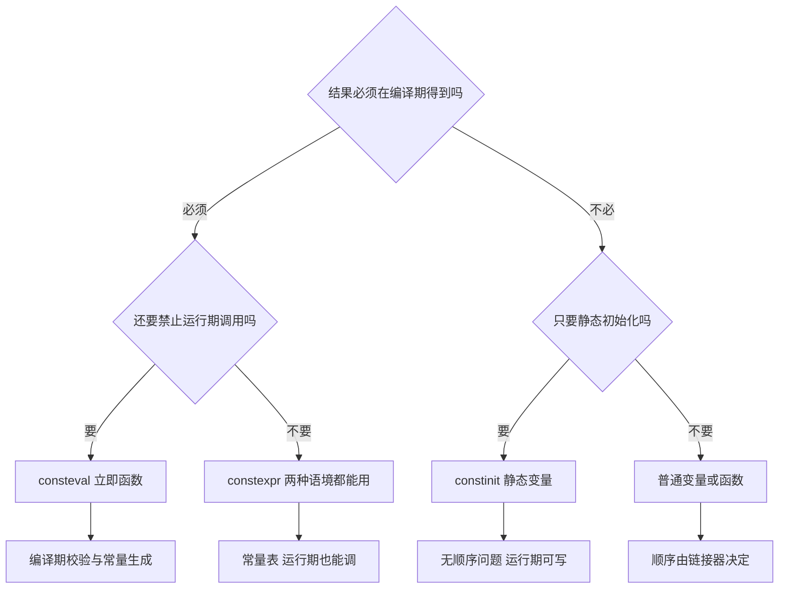

# consteval、constinit 与 if consteval

`constexpr` 被当成"编译期"的同义词用了很多年，但它只承诺"可以"，不承诺"必须"。C++20 与 C++23 把这件事拆成了三个独立的工具：`consteval` 说"只能在编译期算"，`constinit` 说"初始化必须发生在编译期，但变量之后可以改"，`if consteval` 说"这次求值发生在编译期还是运行期，我在这里分叉"。本页把三者的边界、组合方式和实测限制讲清楚。

## 动机：`constexpr` 说的是"可以"，不是"必须"

这一节讲两个动机：编译期校验落不到实处，以及静态初始化没有顺序保证。前者引出 `consteval`，后者引出 `constinit`。

写下一个 `constexpr` 函数，只代表它**允许**出现在常量表达式里。它照样可以在运行期被调用，编译器也没有义务替你算：

```cpp
constexpr unsigned checksum(const char* text);   // 只声明，示意

int main(int argc, char** argv) {
    unsigned runtime = checksum("abc");          // 合法：运行期算一遍
    unsigned from_argv = checksum(argv[1]);      // 也合法：输入是运行期数据
}
```

于是"编译期校验"变成了愿望。tag 名字写错时，你希望编译失败；但只要调用点不是常量表达式，错误就推迟到运行期。`static_assert` 也帮不上忙，它只能断言自己那一行里的常量表达式。

想堵死运行期这条路，就得换成立即函数：

```cpp
consteval unsigned checksum(const char* text);

int main(int argc, char** argv) {
    unsigned bad = checksum(argv[1]);   // 编译错误：实参不是常量表达式
}
```

本机 clang 23 的报错是 `call to consteval function 'checksum' is not a constant expression`，下面跟一条 note：`function parameter 'argv' with unknown value cannot be used in a constant expression`。错误发生在调用点，而不是某次深夜的运行期。

第二个动机是初始化顺序。全局变量的动态初始化在不同翻译单元之间的顺序是未指定的：

```cpp
// a.cpp
int g_total = compute_total();   // 动态初始化，运行期才赋值

// b.cpp
extern int g_total;
int g_doubled = g_total * 2;     // 可能读到 0，也可能读到算好的值
```

这就是 static initialization order fiasco。`constinit` 要求初始化器是常量表达式，于是初始化被挪进数据段，根本没有"顺序"可言。

三个关键字回答三个不同问题，选错的典型症状是：该编译期失败的没失败（用了 `constexpr`），或者运行期该改的改不了（用了 `consteval`），或者顺序问题依旧（忘了 `constinit`）。

## 最小示例

<<< @/snippets/cpp20/consteval-constinit.cpp

输出：

```text
fnv1a("learncpp") runtime     = 2856973362
const_hash("learncpp") compile = 2856973362
where() compile-time branch   = compile-time
where() runtime branch        = runtime
constinit global start        = 0
constinit global after += 7   = 7
constinit static start        = 100
constinit static after += 3   = 103
constinit static after += 5   = 108
constexpr twice(21) runtime   = 42
constexpr twice(21) compile   = 42
```

这份程序里五样东西各司其职：

- `fnv1a` 是 `constexpr` 函数，所以它既能被 `const_hash` 在编译期调用，也能在 `main` 里用运行期数据再跑一遍，两行输出的哈希值必须相同。
- `const_hash` 是 `consteval`，`learncpp_hash` 的初始化器必须能在编译期求值，`static_assert` 因此是真正的编译期校验，而不是事后自查。
- `where()` 用 `if consteval` 分叉：存进 `constexpr` 变量的那次求值走编译期分支，`main` 里的普通调用走运行期分支，两行输出就是两条路径的标记。
- `global_hits` 和 `local_hits` 都是 `constinit`，初始化不需要任何运行期代码；但它们不是 `const`，`+=` 照样能改，改完的值还能跨调用保留。
- `twice` 是 `constexpr` 函数，`static_assert` 证明它能为编译期所用，`twice(input)` 证明它也能吃运行期变量 —— 这就是"may"。

> 本页 snippet 标的是 `c++23`，唯一原因是 `if consteval` 在 clang 里属于 C++23 特性（见下文）。`consteval` 和 `constinit` 本身都是 C++20。

页内其余代码块都是说明性片段，只有上面这份文件经过 `npm run verify` 的编译与输出比对。

## 机制与语义

这一节分五块：先用一张表把三者摆在一起，再逐个展开 `consteval`、`constinit` 和 `if consteval`，最后看它们怎么组合。

### 三者对照表

三者的差别集中在四个维度：能不能在运行期使用、要不要常量表达式、作用在什么对象上、典型用途是什么。

| | `constexpr` | `consteval` | `constinit` |
| --- | --- | --- | --- |
| 能否在运行期使用 | 能。能不能在编译期算由调用语境决定 | 不能。每一次调用都必须是常量求值 | 不是函数；变量在运行期可读可写 |
| 是否要求常量表达式 | 不要求。只有当它修饰变量时，初始化器才必须是常量表达式 | 要求。实参与调用语境都必须是常量表达式 | 要求。初始化器必须是常量表达式（常量初始化） |
| 作用对象 | 函数、构造函数、成员函数、变量、lambda 的调用运算符 | 函数与构造函数（析构函数、`operator new` 不行） | 静态存储期变量：命名空间作用域、`static` 局部、`static` 数据成员，含 `thread_local` |
| 典型用途 | 库函数"顺便"支持编译期；常量表、编译期可读可写的工具函数 | 编译期校验、编译期生成数据、把错误提前到调用点 | 消除静态初始化顺序问题；运行期计数器、缓存 |

一句话记法：`constexpr` 是**may**，`consteval` 是**must**，`constinit` 管的是**when**（初始化时机），不是"能不能改"。



这张图只做初筛：第一问是结果要不要在编译期拿到，第二问是要不要禁止运行期调用；每一支的具体边界在下面三小节展开。

### `consteval`：立即函数

带 `consteval` 的函数叫**立即函数**（immediate function）。它每次调用都是一个立即调用（immediate invocation），必须在常量求值里完成；这一点和 `constexpr` 函数不同，后者允许退回运行期。

它因此可以出现在任何要求常量表达式的位置，而且失败会直接变成编译错误：

```cpp
#include <cstddef>
#include <string_view>

consteval unsigned hash_of(std::string_view text) {
    unsigned hash = 2166136261u;
    for (char ch : text) {
        hash ^= static_cast<unsigned char>(ch);
        hash *= 16777619u;
    }
    return hash;
}

constexpr unsigned learncpp_hash = hash_of("learncpp");   // 变量初始化
static_assert(learncpp_hash == 2856973362u);              // 静态断言
int table[hash_of("x") % 4 + 1];                          // 数组长度
template <unsigned N> struct Fixed {};
Fixed<hash_of("tag")> box;                                // 模板实参
```

上面四种用法都在本机 clang 23（`-std=c++23`）上编译通过。反过来说，"编译期校验"就是：写错一个字符，`static_assert` 当场失败，不需要跑起来才知道。

不能做的事（都在本机实测过）：

```cpp
consteval int f() { return 1; }
consteval int g(int x) { return x; }

int main() {
    auto p = &f;      // 错：cannot take address of consteval function 'f'
                      //     outside of an immediate invocation
    int n = 1;
    return g(n);      // 错：call to consteval function 'g' is not a
}                     //     constant expression
```

取不到地址是设计的一部分：立即函数没有运行期实体，函数指针无从指向它。同理，它不能有运行期输入 —— 实参本身也必须是常量表达式。

递归和循环受两条编译器限制，都摸得到：

- 递归深度。clang 默认 512 层，超出后 `static_assert` 报 `constexpr evaluation exceeded maximum depth of 512 calls`。
- 求值步数。clang 默认 1048576 步，可用 `-fconstexpr-steps=N` 调整。把 `-fconstexpr-steps=100` 加到一个 1000 次循环的 `constexpr` 函数上，报错是 `constexpr evaluation hit maximum step limit; possible infinite loop?`；在 `-std=c++20` 下它还会给函数定义挂一条 `-Winvalid-constexpr`（C++23 放宽了这条规则，只留下调用点的错误）。

这两条不是 `consteval` 专属，`constexpr` 函数的常量求值同样受限；但立即函数没有"退回运行期"这个选项，所以撞上限制就是硬错误。GCC 有 `-fconstexpr-depth` / `-fconstexpr-loop-limit` 一类开关，本机没装 GCC，名字与行为未验证。

### `constinit`：只保证"初始化发生在编译期"

`constinit` 管的是"初始化发生在什么时候"，不是变量的可变性；这是本节最容易被名字带偏的一点。先看它允许作用在哪些变量上。

`constinit` 只能修饰**静态存储期**的变量：命名空间作用域的变量、函数里的 `static` 局部变量、类的 `static` 数据成员，以及 `thread_local`（实测后者也接受）。写成普通局部变量是硬错误：

```cpp
int main() {
    constinit int x = 1;   // 错：local variable cannot be declared 'constinit'
}
```

它保证的是**常量初始化**：初始化器必须是常量表达式，值在链接期就写进数据段，运行期不执行任何初始化代码。这就是它对 static initialization order fiasco 的回答 —— 没有运行期初始化，也就不存在"谁先谁后"。

但它**不是** `const`：

```cpp
constinit int global_hits = 0;                 // 命名空间作用域

int bump_static(int step) {
    static constinit int local_hits = 100;     // static 局部，常量初始化
    local_hits += step;                        // 合法：可以改
    return local_hits;
}
```

`global_hits` 每次 `+=` 都会留下痕迹，`local_hits` 跨调用保留；两者都不允许在初始化器里调用运行期函数。

初始化器不满足常量表达式时，报错长这样（实测）：

```text
error: variable does not have a constant initializer
note: required by 'constinit' specifier here
```

还有一条容易忘：`constinit` 不能和 `constexpr` 叠加，`constinit constexpr int k = 7;` 报 `cannot combine with previous 'constinit' declaration specifier` —— `constexpr` 变量本来就有常量初始化，不需要也不允许再声明一次。要看"能改"的效果，用 `constinit`；要"只读的编译期常量"，用 `constexpr`。

`constinit` 不改变变量的类型，也不出现在类型系统里：`constinit int x` 的类型就是 `int`。

### `if consteval`：语法层面的分叉

`if consteval` 是 C++23 的核心语言特性（P1938R3）。它的语义很直接：如果当前这次求值发生在常量求值里，走第一支；否则走 `else` 支。

```cpp
constexpr const char* where() {
    if consteval {
        return "compile-time";
    } else {
        return "runtime";
    }
}
```

还有取反写法 `if !consteval`，等价于"把两支对调"，适合运行期是主路径、编译期只是特例的场合。

实用价值在于**同一份接口、两份实现**：

```cpp
#include <string_view>

unsigned fnv1a_runtime(std::string_view text);   // 运行期版本，定义略

constexpr unsigned hash_of(std::string_view text) {
    if consteval {
        unsigned hash = 2166136261u;              // 编译期：朴素循环
        for (char ch : text) {
            hash ^= static_cast<unsigned char>(ch);
            hash *= 16777619u;
        }
        return hash;
    } else {
        return fnv1a_runtime(text);               // 运行期：另一份实现
    }
}
```

在 `constexpr` 函数里调用非 `constexpr` 函数是允许的（本机编译通过），只要不在常量求值的时候走到那条分支。但要注意：**两支都必须是合法代码**。`if consteval` 不像 `if constexpr` 那样在模板实例化时丢掉不成立的一支，它本质上仍是一个普通的 `if`，只是条件由编译器判断，两支都要通过完整的语义检查。

它和 C++20 的 `std::is_constant_evaluated()` 判据相同 —— 都问"这次求值是不是常量求值"—— 差别在形态：

| | `if consteval` | `std::is_constant_evaluated()` |
| --- | --- | --- |
| 标准 | C++23（clang 在 C++20 模式给扩展警告） | C++20 |
| 形态 | 语句，条件不可拆走 | 返回 `bool` 的普通函数，需要 `<type_traits>` |
| 误用方式 | 基本没有；条件写死在语法里 | 存进变量、传给别的函数、与其它条件混写，读者和编译器都看不出它约束了什么 |
| 取反 | `if !consteval` | 自己写 `!` |

`std::is_constant_evaluated()` 最大的坑是"它能被搬走"：`bool flag = std::is_constant_evaluated();` 在运行期调用里永远是 `false`，你无法从这个 `bool` 反推出"调用点处在什么语境"。`if consteval` 把这件事约束在语法里，不存在被搬走、被合并、被误解的余地。

另外一个实测细节：在 `consteval` 函数里写 `if consteval` 恒为真，clang 会警告 `consteval if is always true in an immediate context [-Wredundant-consteval-if]`。这不是错，但说明这段分支是多余的。

注意 `if consteval` 不是 `if constexpr`：前者分"求值语境"，后者分"模板实例化的类型分支"。想按类型走不同实现，仍然要用 [concepts 与 requires](/cpp20/concepts) 加 `if constexpr`。

### 组合：编译期哈希 + 运行期计数器

最小示例的代码就是这四件事的组合，拆开看每部分承担什么：

1. **算法只写一份**。`fnv1a` 是 `constexpr`，编译期和运行期都能调，避免"编译期版本"和"运行期版本"算出不同结果 —— 这是手写两份实现最常见的 bug。
2. **编译期闸门用 `consteval` 包一层**。`const_hash` 本身没有新逻辑，它的作用是让"在运行期调用"变成编译错误；`learncpp_hash` 的初始化因此成为真正的校验点。
3. **两份实现真的需要不同时，才用 `if consteval`**。运行期版本可以加边界检查、分块处理、甚至接上 [ranges 与 views](/cpp20/ranges) 的惰性管道；编译期版本必须保持朴素，因为常量求值里不能分配内存、不能有运行期副作用。
4. **计数器用 `constinit`**。运行期要自增的东西不能是 `constexpr`；但只要初始化器是常量表达式，`constinit` 就能让它免于动态初始化的顺序风险。

一个常见变体是"编译期生成表、运行期查表"：用 `consteval` 造出 `std::array`，再用 `constinit` 或 `constexpr` 保存。表本身是常量，查表函数可以是普通函数。

## 常见坑

八条坑里，第一条讲 `constexpr` 的 ODR-use，第二、三条是 `consteval` 的边界，第四、五条是 `constinit` 的限制，最后三条属于 `if consteval`、编译期 `new` 和编译器差异。

### 1. `constexpr` 变量被 ODR-use 时需要定义

类内 `static constexpr` 成员在 C++14 里只是**声明**。一旦被 ODR-use（绑引用、取地址、按引用传参），就必须在类外再定义一次；只写类内初始化器会链接失败：

```cpp
#include <cstdio>

struct Config { static constexpr int retries = 3; };
int use(const int& value) { return value; }

int main() { std::printf("%d\n", use(Config::retries)); }   // 按引用传参 = ODR-use
```

本机 clang 23 实测：`-std=c++14` 链接报 `undefined symbol: Config::retries`；同一份代码 `-std=c++17` 编译链接通过，输出 `3`。C++17 起类内 `static constexpr` 隐式 `inline`，问题消失。今天还在写 C++14 的代码库要记得补那一行类外定义。更详细的语言差异见 [编译器支持矩阵](/reference/compiler-support)。

### 2. `consteval` 不能取地址，也不能有运行期输入

上一节的两条报错都是硬错误，而且位置就在调用点。想让"同一个函数偶尔也能运行期调"，就只能用 `constexpr` —— 两者不能同时满足：`constexpr` 允许运行期调用，`consteval` 禁止。

### 3. `consteval` 不能修饰析构函数和 `operator new`；虚函数别这么写

```cpp
struct S {
    consteval ~S() {}                                  // 错：destructor cannot be
                                                       //     declared consteval
    consteval static void* operator new(std::size_t);  // 错：'operator new' cannot
                                                       //     be declared consteval
};
```

虚函数的情况更微妙。本机 clang 23 **接受**这样的声明：

```cpp
struct Base { virtual consteval int value() const { return 1; } };
```

但一旦真的通过虚调用，就报 `call to consteval function 'Base::value' is not a constant expression`，附注是 `virtual function called on object 'b' whose dynamic type is not constant`。也就是说，这个组合在 clang 上"能声明、不能用"，属于应当避免的写法。GCC / MSVC 是否也接受这种声明，本机没有那两套工具链，未验证。

### 4. `constinit` 只作用于静态存储期变量

普通局部变量不行（`local variable cannot be declared 'constinit'`），`new` 出来的对象也不行。它管的是"初始化什么时候发生"，所以对象必须有一个静态的存储位置。

另外 `constinit` 与 `thread_local` 可以叠加，实测编译通过；但 `constinit` 只保证**初始化**是常量初始化，不保证之后的并发访问安全。多线程里的计数器仍然要用 [同步原语](/concurrency/sync-primitives)，而不是指望 `constinit`。

### 5. `constinit` 不是 `const`，也不能和 `constexpr` 叠加

`constinit int x = 0;` 之后 `x = 1;` 完全合法；`constexpr int y = 0;` 之后 `y = 1;` 才是编译错误。`constinit constexpr int k = 7;` 则是 `cannot combine with previous 'constinit' declaration specifier`。需要"运行期可改的静态变量"就用 `constinit`，需要"只读常量"就用 `constexpr`，两者别混着写。

### 6. `if consteval` 不是 `if constexpr`

`if constexpr` 按类型丢弃分支，可以做模板特化；`if consteval` 只区分求值语境，两支都会被完整检查。想在编译期跳过"类型不支持"的代码，仍然要 `if constexpr (requires { ... })`。

另外它在 clang 上是 C++23 语法：`-std=c++20` 下能编译，但给出 `consteval if is a C++23 extension [-Wc++23-extensions]`；打开 `-Werror` 就失败。`__cpp_if_consteval` 也只在 C++23 模式里定义为 `202106L`。

### 7. `constexpr` 函数里的 `new` 必须在同一次常量求值里 `delete`

C++20 允许常量求值期间分配临时内存，但必须在同一次求值里释放：

```cpp
constexpr int leak() {
    int* p = new int(5);
    return *p;          // 没有 delete
}

static_assert(leak() == 5);   // 错：allocation performed here was not deallocated
```

本机 clang 23 的报错正是 `static assertion expression is not an integral constant expression`，附注 `allocation performed here was not deallocated`。这条错误不代表编译期不能用容器：libc++ 23 上 `std::vector` 在常量求值里可用（在同一求值里分配、扩容量、释放），我实测过 `constexpr` 函数里 `push_back` 后返回 `size()`。它只要求你**不要漏掉释放**，所以手写指针的编译期代码，每一处 `new` 都要找到对应的 `delete`。

### 8. 编译器的实现差异

本机只有 clang 23.1.4 + libc++ 23，能确认的 clang 侧行为是：

- `if consteval` 被当作 C++23 特性，C++20 模式给 `-Wc++23-extensions`。
- `consteval` 函数里再写 `if consteval` 会触发 `-Wredundant-consteval-if`。
- 虚 `consteval` 函数能声明、不能调用（见第 3 条）。
- `__cpp_consteval` 的实测值是 `202211L`，比最初的 `201811L` 大，说明实现里已经包含 P2564 那条"consteval 沿调用链向上传播"的修订：一旦某个常量求值里调用了立即函数，整条链都必须留在常量求值里，不能悄悄退回运行期。

MSVC 和 GCC 的行为本机未验证。要做跨编译器项目，先查 [编译器支持矩阵](/reference/compiler-support)，再自己用 `-dM -E` 确认 feature-test macro，别照抄博客里的版本号。

## 编译器支持

本机：clang 23.1.4（x86_64-w64-windows-gnu 目标）+ libc++ 23。snippet 的编译命令：

```powershell
clang++ -std=c++23 -Wall -Wextra -O0 docs/snippets/cpp20/consteval-constinit.cpp -o $env:TEMP\consteval-constinit.exe
```

| 特性 | 标准 | 本机 clang 23.1.4 | 备注 |
| --- | --- | --- | --- |
| `consteval` | C++20 | 通过，`__cpp_consteval` = `202211L` | 立即函数；取地址、运行期调用都是硬错误 |
| `constinit` | C++20 | 通过，`__cpp_constinit` = `201907L` | 命名空间变量、`static` 局部、`static` 成员、`thread_local` 均实测可用 |
| `if consteval` | C++23 | 通过，`__cpp_if_consteval` = `202106L` | C++20 模式报 `-Wc++23-extensions`；该宏只在 C++23 模式定义 |
| 常量求值递归深度 | — | 默认 512 层，超出即报错 | 报错文本含 `exceeded maximum depth of 512 calls` |
| 常量求值步数 | — | 默认 1048576 步，`-fconstexpr-steps=N` 可调 | 报错文本含 `hit maximum step limit` |

`-std=c++20` 编译本页 snippet 只会产生一条警告（`if consteval` 的扩展警告），其余代码全部符合 C++20；把 `if consteval` 换成 `std::is_constant_evaluated()` 就能完整降级到 C++20。工具链的选型与版本对照见 [本机工具链与标准选择](/guide/toolchain)。

## 与 learncpp 的关系

learncpp 把 `constexpr` 变量放在 Ch5，把 `constexpr` 函数单独做成附录 F（F.1–F.4）。F.3 已经介绍过 `consteval`，也提到了 `if consteval`，所以本页不是第一次讲这两个关键字。那几节的重心是"能不能在编译期求值"这套 C++11/14/17 模型；本页补的是它没有展开的部分：`consteval` 的取地址禁令、递归深度与求值步数上限、`if consteval` 与 `std::is_constant_evaluated()` 的分工，以及 **F.3 全文没提的 `constinit`**——它才是 static initialization order fiasco 的正面解法。

learncpp 讲作用域、存储期和全局变量时提到过 static initialization order fiasco，给出的建议通常是"别用会互相依赖的全局对象"。`constinit` 是标准后来给的正面解法：让初始化变成常量初始化，顺序问题从根上消失。

这三块内容和 learncpp 是接续关系，不是替代关系：`constexpr` 的基础仍然要打牢，本页只是把"may / must / when / which world"这四件事分开。同属 C++20 的 [concepts 与 requires](/cpp20/concepts) 常常和 `consteval` 配合（用 concept 描述"这组实参能算出常量"），而 [ranges 与 views](/cpp20/ranges) 通常出现在 `if consteval` 的运行期分支里。

## 小练习

五个练习依次摸边界、验证分叉、复现顺序问题、撞限制、换写法：

1. **给哈希加"编译期白名单"**：写一个 `consteval bool is_known_tag(std::string_view)`，用 `static_assert` 拒绝未知 tag。然后故意在调用点传一个运行期 `std::string`，观察报错停在哪一行。
2. **两份实现，一个结果**：给 FNV-1a 写一个运行期版本（可以加边界检查），用 `if consteval` 分叉，验证两条路径的哈希值一致。接着故意让运行期版本算错，看 `static_assert` 能不能发现 —— 解释为什么不能。
3. **复现 static init order fiasco**：写两个翻译单元，一个用动态初始化、一个在初始化器里读它，观察实际读到的值；再把两个都改成 `constinit`，说明为什么问题消失了（提示：常量初始化的变量在 `main` 之前就有确定值）。
4. **摸一摸限制**：写一个 10000 次循环的 `constexpr` 函数，用 `-fconstexpr-steps=1000` 编译，读一遍报错；再把函数改成 `consteval` 并从 `main` 里直接调用，看看错误信息有什么不同。
5. **换成 `std::is_constant_evaluated()`**：用它在 `constexpr` 函数里重写 `where()` 的分叉，分别在 `constexpr` 变量初始化和普通调用里观察返回值，再试着把结果存进 `bool` 变量，说明为什么这个写法更容易出错。
