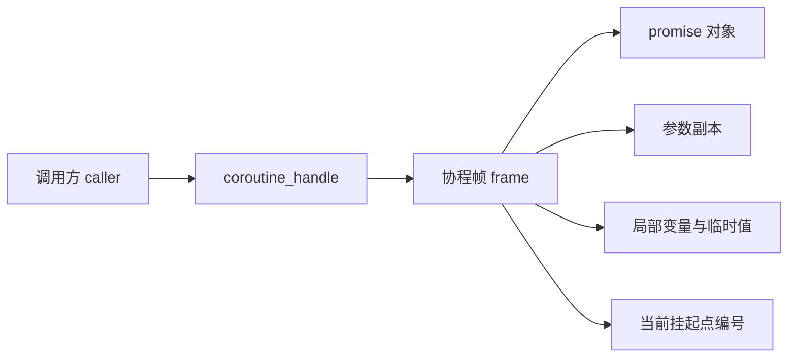
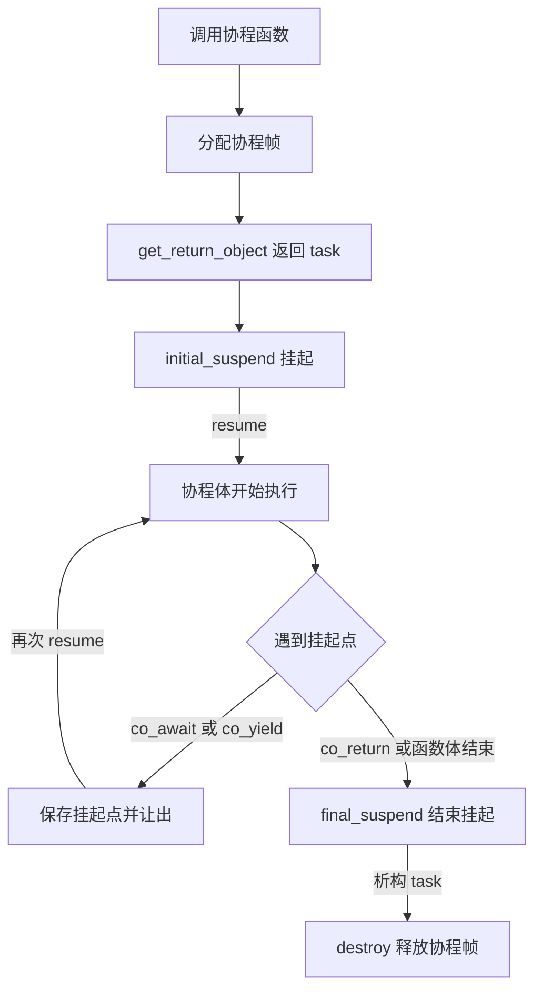
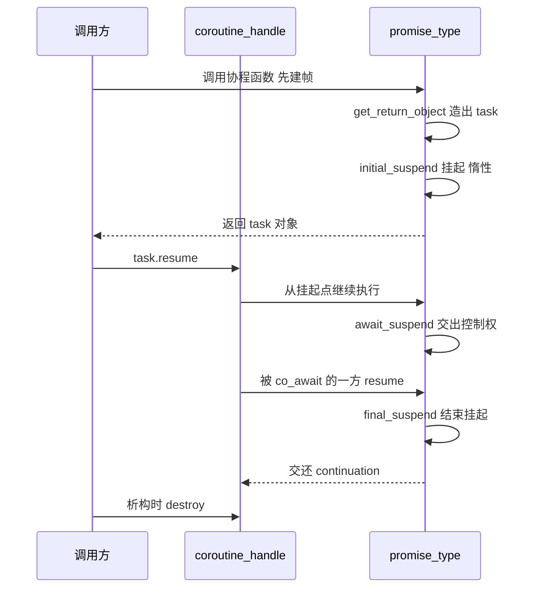

# 协程：手写一个惰性 task

普通函数只有一种走法：被调用 → 一直跑到 `return` → 回到调用点。中途想停一下、把 CPU 让给别人、等会儿再回来，你只能把状态打包成对象、再写一层回调。协程把这条路修出来了：函数体可以在任意一个**挂起点**停下，把执行状态留在自己的协程帧里，之后从同一个位置继续跑。

理解协程最容易走偏的一点是把它当成并发工具。它不是。`co_await` 只是"把控制权交出去"，交出去之后谁、什么时候、在哪个线程恢复它，全靠你写的代码——没有调度器，协程就只是同步的、会中途返回的函数。

## 动机：回调、future 链和线程成本

假设有三步异步操作要串起来，传统写法是层层嵌套：

```cpp
// 回调风格：真正的逻辑埋在最里面
load_config([](Config cfg) {
    connect(cfg, [](Session session) {
        query(session, "select 1", [](Row row) {
            print(row);   // 到这里已经缩进三层，错误处理还没写
        });
    });
});
```

future 链能把缩进压平，但每一步都要额外配一个 lambda，值在步骤之间传来传去：

```text
自动推导的 future 风格
load_config().then(connect).then(query_one).then(print)
```

还有一条路是开线程：把每一步丢进线程，用条件变量接回来。代价是线程自带一份不小的栈（通常是 MB 量级），创建和切换都要进内核，几百个并发任务就开始吃内存和调度开销。

协程的账不一样：一个协程帧（frame）通常只有几百字节，挂起就是一次普通函数返回，恢复就是一次跳转。**它省的是"暂停一个计算"的成本，不是"同时跑多个计算"的成本**。想要真并行，仍然得把这些帧交给线程池或者事件循环，那部分见 [jthread 与 stop_token](/concurrency/jthread)。

## 最小示例

下面这个程序只用 `<coroutine>`、`<cstdio>`、`<utility>` 这类稳定头，手写了惰性 `task<T>` 和 `generator<T>`，并在每个挂起点上计数，用来证明"什么时候才开始执行"：

<<< @/snippets/cpp20/coroutines-task.cpp

输出：

```text
== lazy task ==
after create: suspends=2 resumes=0
[add_one] body entered
[one] body entered
[add_one] co_await returned
after resume: suspends=5 resumes=3 value=42
== generator ==
after create: suspends=6 resumes=3
[gen] body entered
yield #1 -> 1 (suspends=7 resumes=4)
yield #2 -> 2 (suspends=8 resumes=5)
yield #3 -> 3 (suspends=9 resumes=6)
[gen] body finished
after loop: suspends=10 resumes=7
```

这几行数字连起来读，就是协程的全部时间线：

- `add_one(one())` 只是建了两个帧、各挂起一次（`suspends=2`），两个函数体一个字都没执行——`[add_one] body entered` 这行还没出现。
- 一次 `resume()` 之后，`add_one` 先跑，`co_await` 把控制权直接交给 `one`；`one` 跑到 `co_return 41` 进结束挂起点，再把控制权还给 `add_one`。三条 `body` 打印的顺序，就是这个交还顺序。
- `generator` 每 `next()` 一次，函数体才从上次 `co_yield` 的位置继续跑一格；`co_yield` 本身不是"循环"，是"存值 + 挂起"。

页内其余代码块都是说明性片段，只有上面这份文件经过 `npm run verify` 的编译与输出比对。

## 机制：编译器替你生成了什么

### 三个关键字

```cpp
task<int> answer() { co_return 42; }                          // 结束并带出一个值
generator<int> small() { co_yield 1; co_yield 2; }            // 交出一个值并挂起
task<int> chain() { int v = co_await answer(); co_return v; }  // 等另一个 awaitable
```

判定规则只有一条：**函数体里出现 `co_await`、`co_yield`、`co_return` 中的任意一个，这个函数就是协程**。这是编译期决定，没有运行期标记，也没有额外的关键字去"声明"协程。随之而来几条硬规定：

- 返回类型必须能提供 `promise_type`（直接嵌套类型，或通过 `std::coroutine_traits` 特化）。写 `int f() { co_return 1; }` 直接编译失败。
- 协程里**不能出现 `return`**。本机 clang 的原话是 `error: return statement not allowed in coroutine; did you mean 'co_return'?`。
- `main` 不能是协程，构造函数和析构函数也不能。

`co_yield x` 是语法糖，等价于 `co_await promise.yield_value(x)`；`co_return` 则被翻译成 `promise.return_value(x)`（或 `return_void()`）加一次结束挂起。

### 协程帧与 promise 对象

协程调用时不走普通调用栈：编译器先分配一块**协程帧**（frame），把参数副本、局部变量、当前挂起点编号，以及一个由你定义的 **promise 对象**全放进去。调用方拿到的不是栈上的返回值，而是 `get_return_object()` 造出来的对象——本页就是 `task`，它里面只包了一个 `coroutine_handle`（指向帧、可复制可传递的句柄，本身不是指针类型）。



`coroutine_handle` 本身不含状态，它只是帧的地址。`handle.resume()` 让帧从挂起点继续跑，`handle.done()` 问它是不是停在结束挂起点，`handle.destroy()` 手动释放帧。`promise` 里存的是"这个协程的返回值和约定接口"，`awaitable` 里存的是"这一次等待的上下文"，三者职责要分清。

编译器在几个固定位置回调 promise：

| promise 成员 | 什么时候调 | 决定什么 |
| --- | --- | --- |
| `get_return_object()` | 建好帧、第一次挂起之前 | 返回给调用方的对象长什么样 |
| `initial_suspend()` | 函数体开始前 | 返回 `suspend_always` = 惰性；`suspend_never` = 立刻开跑 |
| `return_value(v)` / `return_void()` | `co_return` 时 | 值怎么存 |
| `yield_value(v)` | `co_yield` 时 | 值怎么存，并返回一个 awaiter 决定挂不挂起 |
| `final_suspend()` | 函数体正常结束或 `co_return` 之后 | 帧何时销毁、控制权交还给谁 |
| `unhandled_exception()` | 函数体抛出且没被捕获时 | 异常去哪；这个成员必须自己写 |

`final_suspend()` 返回的 awaiter 的 `await_suspend` 必须是 `noexcept` 的；顺序上它也是"最后一次能碰到帧"的机会。

把上面这些串成一条时间线，就是一个协程从生到死：



注意 `get_return_object` 在 `initial_suspend` **之前**：调用方总是先拿到一个可用的返回对象，然后才可能被挂起。这也是惰性 task 能成立的前提——对象先存在，函数体后执行。

### awaiter 三件套

`co_await x` 里的 `x` 只要能变成 awaiter 就行。awaiter 就是三个成员函数：

```cpp
struct answer_awaiter {
    bool await_ready() const noexcept { return false; }   // false：不急着给结果，去挂起
    void await_suspend(std::coroutine_handle<> me) const noexcept {
        // me 是"当前这个协程"；可以直接返回（挂起），也可以把它存起来丢给别处
    }
    int await_resume() const noexcept { return 42; }      // co_await 表达式的值
};
```

调用顺序是固定的：

| 步骤 | 返回什么 | 发生什么 |
| --- | --- | --- |
| `await_ready()` | `true` | 不挂起，直接进 `await_resume()` |
| `await_ready()` | `false` | 去调 `await_suspend(handle)` |
| `await_suspend()` 返回 `void` | — | 挂起，控制权回到调用者或当前恢复点 |
| `await_suspend()` 返回 `bool` | `false` | 其实不挂起，立刻继续执行 |
| `await_suspend()` 返回 `coroutine_handle` | 某个帧 | **对称转移**：直接跳去跑那个协程，不再压栈 |
| `await_resume()` | 任意类型 | 恢复后的结果；抛异常就从这里抛给 `co_await` 表达式 |

标准库给了两个现成的：`std::suspend_always`（`await_ready` 恒为 false，永远挂起）和 `std::suspend_never`（恒为 true，从不挂起）。它们足够写 `initial_suspend` / `final_suspend` 的开关：

```cpp
std::suspend_always initial_suspend() noexcept { return {}; }   // 惰性：创建后不动
std::suspend_never  initial_suspend() noexcept { return {}; }   // 急切：创建即开跑
```

这两种选择直接决定了你的 `task` 是什么语义，没有中间地带。`await_suspend` 返回 `bool` 这个冷门选项，是用来处理"检查完发现其实不用等"的：先做准备工作，发现结果已在手上，就返回 `false` 让协程继续。

### 最小 `task<T>`：惰性从哪来

先解决"结束时怎么把控制权还回去"。这段代码在结束挂起点被调用，它看一眼 promise 里的 `continuation`：有人在等就直接跳过去，没人在等就交给 `noop_coroutine`，等价于从 `resume()` 里正常返回：

```cpp
struct resume_continuation {
    bool await_ready() const noexcept { return false; }

    template <typename Promise>
    std::coroutine_handle<> await_suspend(std::coroutine_handle<Promise> handle) noexcept {
        std::coroutine_handle<> next = handle.promise().continuation;
        return next ? next : std::noop_coroutine();
    }

    void await_resume() const noexcept {}
};
```

再写 task 本体：

```cpp
template <typename T>
class task {
public:
    struct promise_type {
        T value{};
        std::coroutine_handle<> continuation{};     // 谁在 co_await 我

        task get_return_object() {
            return task{std::coroutine_handle<promise_type>::from_promise(*this)};
        }
        std::suspend_always initial_suspend() noexcept { return {}; }  // 惰性的开关
        resume_continuation final_suspend() noexcept { return {}; }

        void return_value(T v) { value = std::move(v); }
        void unhandled_exception() noexcept { std::terminate(); }
    };

    void resume() {
        if (done()) { return; }
        handle_.resume();
    }
    bool done() const noexcept { return !handle_ || handle_.done(); }
    T value() { return std::move(handle_.promise().value); }

    ~task() {
        if (handle_) { handle_.destroy(); }
    }

private:
    std::coroutine_handle<promise_type> handle_{};
};
```

上面是摘录：构造函数、move 语义和 `operator co_await` 都省掉了，完整版就是本页开头那段程序。开头那份为了把 `suspends=` / `resumes=` 的数字印出来，把 `initial_suspend` 和 `final_suspend` 换成了会自增计数的 awaiter（`counted_suspend` / `resume_continuation`），挂起语义与这里一致，只是多了计数副作用。

几个决定性的点：

- `initial_suspend` 返回 `suspend_always`，才是惰性的。函数体要等到第一次 `resume()` 才开始跑，所以"创建 task"和"执行任务"是两件事。
- `resume()` 是**同步**的：它让帧跑到下一个挂起点才返回，不是后台开跑。`done()` 为 true 之后不要再 `resume()`，那是未定义行为，所以上面加了判断。
- `return_value` 把结果存进 promise；`value()` 从 promise 里取。注意取值和销毁的先后，别在 `destroy()` 之后摸 promise。

`final_suspend` 的选择是新手最容易写错的地方：

| 选择 | 结果 | 代价 |
| --- | --- | --- |
| `suspend_always`（推荐） | 帧停在结束挂起点，`promise` 还活着；可以在 `await_suspend` 里恢复 `continuation`，也能安全读结果 | 必须有人调 `destroy()`，否则帧泄漏 |
| `suspend_never` | 函数体一结束帧就销毁 | `promise` 没了，`await_resume` 里再读 `value` 就是悬垂；也没机会把控制权交还给等你的人 |

也就是说：**要么自己管销毁，要么结果只能在结束挂起点之前被读走**。本页的 `task` 选了前者，析构函数负责 `destroy()`。

### 让 co_await 认识你的 task

`co_await other_task` 需要编译器能把 `task` 变成 awaiter。两条路：成员函数 `operator co_await`，或者让 `task` 自己带 `await_ready` / `await_suspend` / `await_resume`。前者更好写，也更明确：

```cpp
struct awaiter {
    handle_type inner;

    bool await_ready() const noexcept { return false; }

    std::coroutine_handle<> await_suspend(std::coroutine_handle<> caller) noexcept {
        inner.promise().continuation = caller;   // 记住谁在等我
        return inner;                            // 对称转移：直接去跑它
    }

    T await_resume() { return std::move(inner.promise().value); }
};

awaiter operator co_await() && noexcept { return awaiter{handle_}; }
```

`await_suspend` 返回对方的 handle，而不是返回 `void`，是为了**对称转移**：`add_one` 挂起的同时 `one` 开始跑，两者之间不再多压一层调用栈。串十个 `co_await` 也不会让栈长十层。

对方的 `final_suspend` 负责把控制权还回来——这就是 promise 里那个 `continuation` 的用处。整个来回的调用顺序：



注意 `operator co_await() &&` 上的 `&&`：它只接右值。要 await 一个具名 task，你得显式 `co_await std::move(t)`，等于当众承认"这个任务我交出去了、只消费一次"；左值不匹配，编译期就把重复消费挡住了。至于帧由谁销毁，上面的写法是**仍然由 task 对象自己负责**——awaiter 只借用 handle，`task` 的析构函数在协程回到结束挂起点之后才 `destroy()`，所以不会出现两个主人抢着释放。C++23 可以用显式对象参数把限定写得离参数更近（`this task&& self`），见 [deducing this](/cpp23/deducing-this)；这里为了 C++20 兼容用了传统写法。

### co_yield 与手写 generator

`co_yield` 的落地只有一句：调 `promise.yield_value(v)`，拿它返回的 awaiter 去挂起。所以 generator 的 promise 只要存值 + 挂起：

```cpp
template <typename T>
class generator {
public:
    struct promise_type {
        T current{};

        std::suspend_always initial_suspend() noexcept { return {}; }
        std::suspend_always final_suspend() noexcept { return {}; }

        std::suspend_always yield_value(T v) {
            current = std::move(v);
            return {};                 // 存好值就挂起，等下一次 resume
        }
        void return_void() noexcept {}
        void unhandled_exception() noexcept { std::terminate(); }
    };

    bool next() {                      // 驱动一步，跑到下一个 co_yield 或结束
        if (!handle_ || handle_.done()) { return false; }
        handle_.resume();
        return !handle_.done();
    }
    const T& value() const { return handle_.promise().current; }
};
```

这里必须澄清一件事：**`std::generator` 是 C++23 的库设施，不是语言特性**。`co_yield` 从 C++20 起语言层面就完整支持了，缺的只是一个标准库包装。本机 libc++ 23 实测 `#include <generator>` 报 `fatal error: 'generator' file not found`，所以本页手写。换成带该头的工具链，`std::generator` 还额外提供 range-for、引用元素和递归 yield；它接的就是 [ranges 与 views](/cpp20/ranges) 那套 range 协议，上面这个版本只够手动 `next()` 读值。

## 常见坑

### 1. 协程帧里存的是副本或者引用，不是你想象的那个对象

参数是引用，帧里存的就是引用；局部变量，帧里存的是它自己。挂起期间调用方那一侧可能早就退栈了：

```cpp
task<std::string_view> bad_name() {
    std::string local = "learncpp";
    co_return local;              // 返回的 view 指向 local
}                                 // 帧一销毁，调用方拿到的是悬垂 view
```

同一类问题还有"按引用接住临时对象"：

```cpp
task<void> step(std::string_view text) { co_await io(); use(text); }

step(std::string{"tmp"});   // 临时 string 活不到协程恢复的那一刻
```

规则很朴素：**任何要跨过挂起点使用的东西，都得保证活得比这个协程久**，或者按值复制进帧里。引用参数是最常见的悬垂来源，因为签名上看不出来。

### 2. task 只能 move，不能 copy

```cpp
auto t1 = one();
auto t2 = t1;               // 错：copy 构造函数被删了
auto t3 = std::move(t1);    // 对：handle 转移给 t3，t1 变空
```

原因很直接：两个 `task` 指向同一个帧，析构时会 `destroy()` 两次。所以传参一律 `std::move`，函数签名也写成接收值或右值引用。

### 3. 异常默认是直接崩

`unhandled_exception()` 是必须提供的成员，不写就编译不过；但写成 `std::terminate()`，协程体里任何异常都会让进程立刻死掉，调用方看不到任何异常。想传播，就存 `std::exception_ptr` 并在 `await_resume` 里重抛：

```cpp
// promise_type 里：把异常先收起来，别让它终止进程
void unhandled_exception() noexcept { error_ = std::current_exception(); }

// task 的 awaiter 里：恢复到调用方时再抛出去
T await_resume() {
    auto& promise = inner.promise();
    if (promise.error_) { std::rethrow_exception(promise.error_); }
    return std::move(promise.value);
}
```

注意 `await_resume` 抛出的异常会落在 `co_await` 表达式所在的位置，也就是**调用方的协程体里**，可以被它的 `try` 接住。另外 `final_suspend` 的 awaiter 不能抛异常，那是硬性要求。

### 4. 没有调度器，协程不会并发

```cpp
auto t = work();
t.resume();      // 同步调用：跑到下一个挂起点就返回，没有开线程
```

`resume()` 是普通函数调用。协程之所以看起来"并发"，是因为有人把 handle 交给了线程池、事件循环或者 IO 完成端口。裸写 `co_await` 而不接调度器，你得到的只是一个把代码切成几段的、单线程的、顺序执行的函数。想真的并行，见 [jthread 与 stop_token](/concurrency/jthread)。

### 5. 协程帧通常是一次堆分配

帧默认在堆上分配，所以"协程很轻"是相对线程而言，不是零成本。标准允许编译器在某些情况下省略这次分配（把帧放到调用方栈上），但那是优化，不能依赖。想控制分配，在 `promise_type` 里重载 `operator new`：

```cpp
struct promise_type {
    static void* operator new(std::size_t size) {
        ++g_allocations;
        return ::operator new(size);
    }
    static void operator delete(void* p, std::size_t size) noexcept {
        ::operator delete(p, size);
    }
    // ...
};
```

这条路和第 19 章讲的堆分配、重载 `new` 是同一套机制，也是做对象池、统计帧大小的入口。

### 6. 重复 resume、忘记驱动

`done()` 为 true 之后再 `resume()` 是未定义行为。惰性 task 还容易犯另一个错：创建了却从不 `resume()`，函数体永远不执行，程序静静地什么都不做。本页的 `task::resume` 加了 `done()` 判断，只是把常见错误变安全，不改变语义。

### 7. `coroutine_handle` 不拥有帧

`coroutine_handle` 不拥有帧，它的 `destroy()` 是手工释放。谁负责 `destroy()` 必须在设计时说清楚：本页是 `task` / `generator` 的析构函数负责，所以这些类型不能 copy、只能 move。

## 编译器支持

本机 clang 23.1.4 + libc++ 23 的实测结果：

| 项目 | 实测值 |
| --- | --- |
| `__cpp_impl_coroutine` | `201902` |
| `__cpp_lib_coroutine` | `201902` |
| `__cpp_coroutines`（旧 TS 宏） | 未定义 |
| `<coroutine>` 头文件 | 存在，`std::suspend_always` / `suspend_never` / `coroutine_handle` / `noop_coroutine` 均可用 |
| C++23 `<generator>` | **不存在**，`#include <generator>` 报 `'generator' file not found` |
| `-std=c++20` / `-std=c++23` 编译本页 snippet | 均通过，`-Wall -Wextra` 零警告 |

`__cpp_coroutines` 是当年 Coroutines TS 的宏；`-fcoroutines-ts` 那套语法和现在的标准不一样，新代码不要再用它。GCC 和 MSVC 的具体门槛本机没有装，无法实测，统一查 [编译器支持矩阵](/reference/compiler-support)。

## 与 learncpp 的关系

- **第 20 章（函数、lambda）**教你的是"调用 → 执行到 `return` → 回到调用点"。协程补上了第三条出路：执行到挂起点，把控制权交出去，之后从同一位置续跑。lambda 照旧能用，但它捕获的引用现在要跨过挂起点，风险比普通函数大得多。
- **第 19 章（动态分配）**讲的堆分配正好对应协程帧：帧通常是一次 `operator new`，`promise_type::operator new` 就是第 19 章那套重载 `new` 的又一个用法。理解了 `new`/`delete` 配对，才看得懂"为什么 `final_suspend` 用 `suspend_always` 就必须有人 `destroy()`"。
- **类的约定接口**：`promise_type` 是按名字查找的一组成员，编译器不认 concept、也不认继承，只认名字和签名。可以把它理解成 [concepts 与 requires](/cpp20/concepts) 里那种"编译期契约"，只是这份契约没写在类型系统里，写错时的报错也远没有那么友好。
- 调度、并发、同步原语这些"协程之外"的部分，learncpp 完全没讲，得靠 [jthread 与 stop_token](/concurrency/jthread) 和 [latch / barrier / semaphore](/concurrency/sync-primitives) 补。

## 小练习

1. **让 task 支持 void**：给 `promise_type` 加 `return_void()`，用 `if constexpr` 在 `value()` 里区分 `T = void`。提示：`await_resume` 的返回类型也要跟着变，先想清楚 `co_await void_task` 的表达式类型是什么。
2. **传播异常**：把 snippet 里的 `std::terminate()` 换成 `std::exception_ptr` 方案，写一个必定抛 `std::runtime_error` 的协程，在调用方用 `try` 接住并打印 `what()`。
3. **给 generator 加 range-for**：写一个 `iterator`，提供 `operator*` / `operator++` / `operator!=`，让 `for (int v : count_up())` 能编译。难点不在迭代器，而在 `begin()` 返回的迭代器被复制之后，谁拥有那个帧。
4. **把 handle 丢给另一个线程**：按 [jthread 与 stop_token](/concurrency/jthread) 讲的起一个 `std::jthread`，在另一个线程里 `resume()` 一个 task，用 `latch` 把打印顺序钉死，观察"协程本身不并发"这句话在什么条件下失效。
5. **数一数分配**：在 `promise_type::operator new` / `operator delete` 里计数，分别在 `-O0` 和 `-O2` 下跑同一个程序，看看帧的分配次数有没有变化。
