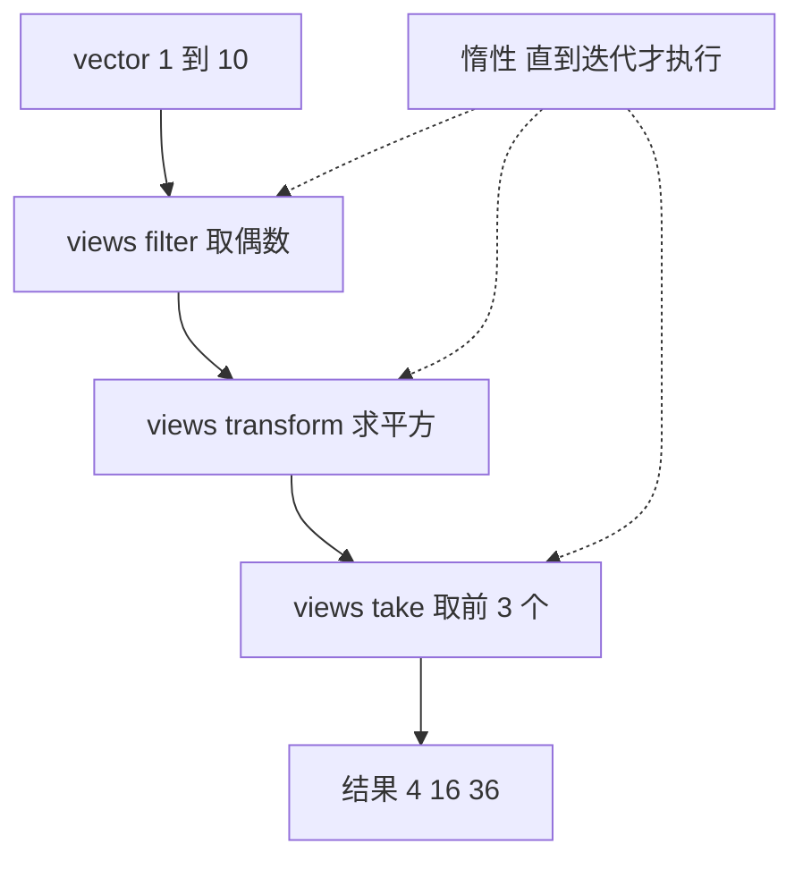
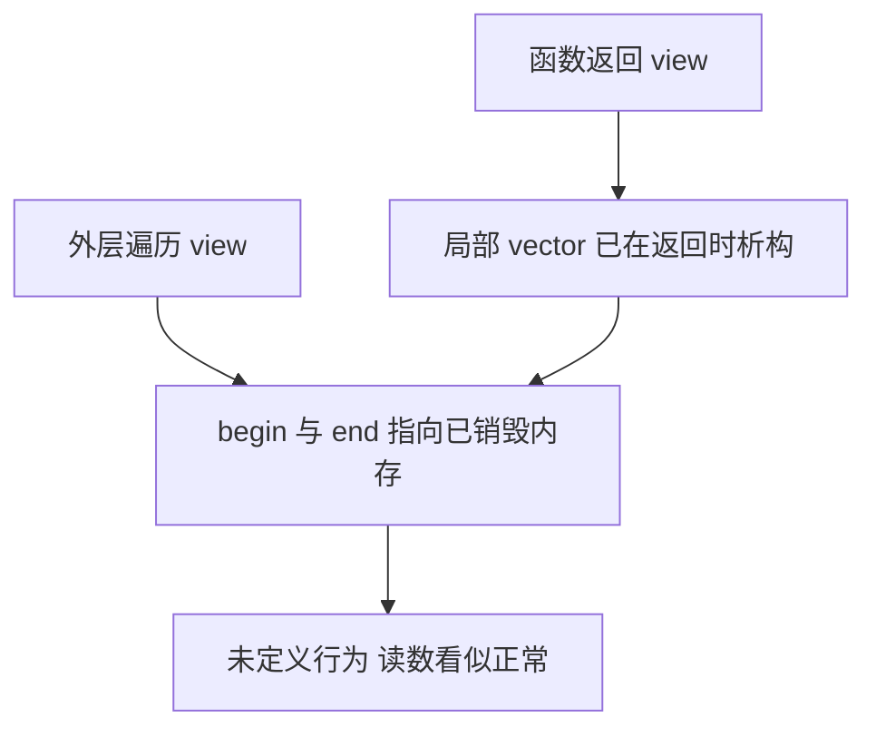

# ranges 与 views：把算法写成管道

`std::sort(v.begin(), v.end())` 是大多数人写下的第一个算法调用，也是第一次撞上这个别扭的抽象：算法要的是"一段东西"，标准库却让你把它拆成两个迭代器递进去。容器名写两遍，算法拿不到"这两个迭代器来自同一个容器"这条信息，`v1.begin()` 配 `v2.end()` 照样能编译，运行起来是未定义行为（undefined behavior，下称 UB）。

C++20 的 ranges 把"一段东西"收成一个参数，写成 `std::ranges::sort(v)`。这一步省掉的是重复和类型错配。真正改变写代码方式的是接在后面的 views：过滤、变换、取前几个被串成一条从左到右读的管道，中间不生成容器。

这一页按三块展开：管道怎么写、惰性求值在什么时候会咬人、以及把 view 落成容器的正确姿势。完整可编译的例子是 `docs/snippets/cpp20/ranges-basic.cpp`，下面引进来的就是它；其余代码块都是示意片段。

## 动机：迭代器对把容器拆成两半

learncpp 第 18 章教的经典写法，麻烦不在算法本身，而在调用方式。下面这段代码要从一堆数里取出偶数再求平方，每做一步就要一个中间 `vector`：

```cpp
// 示意片段，不参与站点编译验证
std::vector<int> evens;
std::copy_if(v.begin(), v.end(), std::back_inserter(evens),
             [](int x) { return x % 2 == 0; });

std::vector<int> squares;
std::transform(evens.begin(), evens.end(), std::back_inserter(squares),
               [](int x) { return x * x; });
```

这段代码有四个问题，从轻到重：

1. **重复**。每个容器名写两遍，`begin()` 和 `end()` 散落在参数表里。
2. **没有约束**。两个迭代器必须来自同一个容器，类型系统管不了这件事。混用是 UB，只有在标准库的调试模式（例如 `_LIBCPP_DEBUG`）下才会断言失败。
3. **不能组合**。想加一步"取前三个"，就得再写一个 `for` 循环或者再开一个容器。
4. **不能延迟**。`copy_if` 被调用时就把整个容器走完了，哪怕下游只要两个元素。

第 4 点最容易被忽略。读日志前几行、找第一个满足条件的元素，这类场景压根不需要遍历全部数据；迭代器的签名却把"描述要什么"和"现在就算出来"绑在一起，调用点没有推迟的余地。

ranges 把这两件事拆开了。`std::ranges::sort(v)` 解决第 1、2 点，views 解决第 3、4 点。

## 最小示例：一条完整的管道

这一段是全页唯一参与站点编译验证的代码：管道组装、短路、材料化、C++20 回退写法都在里面。

<<< @/snippets/cpp20/ranges-basic.cpp

输出与注释编号一一对应：

| 输出行 | 对应注释 | 说明 |
| --- | --- | --- |
| `build pipeline   : transform calls = 0` | 1 | 管道组装完成，但 `transform` 一次都没被调用 |
| `one pass         : sum = 56, transform calls = 3` | 2 | 只迭代一次就得到和；`take(3)` 拉满三个元素后停止上游 |
| `odd numbers desc : 5 3 1` | 3 | `reverse` 和 `drop` 同样惰性，接在同一根管道上 |
| `materialized size: 3` | 4 | `ranges::to` 立即迭代并落成 `vector` |
| `materialized     : 30 60 90` | 4 | 材料化之后是普通容器，可以反复遍历 |
| `c++20 fallback ok: true` | 5 | 迭代器对构造是 C++20 的等价写法 |

注意第 1 行和第 2 行的差别：`transform calls` 从 0 变成 3，不是变成 5。这说明两件事同时成立 —— 不迭代就不计算（惰性），`take` 满足之后不再往上游要数据（短路）。

## range 与 view：一个东西，还是两个

概念上先分清两层：range 管"有没有 `begin()` 和 `end()`"，view 在 range 之上又加了三条限制。后面所有适配器返回的都是第二层。

- **range** 就是"有 `begin()` 和 `end()` 的东西"。`std::vector` 是 range，`std::string` 是 range，C 数组也是。`std::ranges::range<T>` 这个 concept 只检查这一件事。
- **view** 是 range 的一个特化，要求三条：拷贝代价小、通常不拥有元素、迭代时才计算。标准用 `std::ranges::view` 约束它，并且要求它满足 `movable` 且析构不产生副作用。

`views::filter` 这类适配器返回的都是 view。它们内部一般只存两样东西：一个指向上游的 view（通常就是 `ref_view`，里面是一个指针），和一个你传进去的谓词或函数对象的副本。所以 `v | views::filter(p) | views::transform(f)` 无论 `v` 多大，这层壳都不复制元素。

| | 容器（`std::vector`） | view（`filter_view` 等） |
| --- | --- | --- |
| 拥有元素 | 是 | 通常不拥有，只引用 |
| 拷贝代价 | O(n) | 只复制几个指针和谓词 |
| 迭代时 | 直接读内存 | 可能现场计算（`transform`、`iota`） |
| 能否多次遍历 | 能 | 取决于上游；每次遍历都重新算 |
| 能否 `size()` | 能 | 只有 `sized_range` 才能，`filter_view` 不行 |
| 生命周期 | 自己管 | 依赖上游还活着 |

表格最后两行对应「常见坑」里的两个问题：能不能 `size()`，以及谁必须活得久。使用方式先讲完。

### `views::all` 与 `ref_view`

管道左边不一定非得是 view，写 `v | std::views::filter(...)` 时，编译器先做一次 `std::views::all(v)`：

- `v` 是左值容器 → 包成 `ref_view`，里面存指针。**不复制数据**，所以 `v` 必须活得比 view 长。
- `v` 是右值容器 → 包成 `owning_view`，把容器移动进去，view 自己拥有数据（P2415 之后的行为，`std::views::take(std::vector{1,2,3}, 2)` 这种写法因此是安全的）。

`views::all` 只接受左值或可移动的右值，传 `const` 临时量会被拒绝 —— 标准库在这里就挡掉了一批悬垂。这一步决定了 view 里存的是指针还是容器本身，后面的生命周期讨论全部从这里长出来。

## 管道与适配器

`|` 的语义很朴素：`r | adaptor(args...)` 等价于 `adaptor(args...)(r)`。`a | b | c` 就是 `c(b(a))`，只不过读起来是数据流动的方向，跟 UNIX 管道一个思路。

```cpp
// 示意片段，不参与站点编译验证
auto result = numbers
            | std::views::filter([](int x) { return x % 2 == 0; })
            | std::views::transform([](int x) { return x * x; })
            | std::views::take(3);
```

常用的五个适配器：

| 适配器 | 作用 | 代价与限制 |
| --- | --- | --- |
| `views::filter(pred)` | 只保留谓词为真的元素 | 遍历全部上游；`begin()` 要走到第一个匹配项 |
| `views::transform(f)` | 对每个元素做映射，类型可以变 | 每次解引用都调用 `f`，不缓存结果 |
| `views::take(n)` | 只取前 n 个 | 上游元素不足就提前结束；对无限 range 是必需的终止手段 |
| `views::drop(n)` | 跳过前 n 个 | `begin()` 时跳一次：随机访问上游 O(1)，forward 上游 O(n)；跳完不重复 |
| `views::reverse` | 反向遍历 | 要求上游是 `bidirectional_range`；`begin()` 要先走到末尾 |

写管道时把 `take` 放在**最后**。`take` 的意义是在上游"停止拉取"，放在中间只会截断数据流，救不了下游的完整遍历。

几个 C++20/23 里常用但这里不展开的：`views::iota` 生成序列（可以是无限的，必须配 `take`）、`views::keys` / `views::values` 处理 pair、`views::split` / `views::join` 处理嵌套区间、C++23 的 `views::zip` / `views::enumerate` / `views::chunk`（`views::chunk` 在本机 libc++ 23 上不可用，别照抄）。它们的模型完全一样，差别只在各自的边界条件。

## 惰性求值：没人迭代就不算

view 是**拉式**的：适配器只在有人调用 `begin()` / `++` / `*` 时才动作。管道组装完的那一刻，没有任何元素被读取、被过滤、被平方。



一次 `++` 要一个新元素时，请求从下游往上走，三个适配器依次接力：

1. `take` 的 `++` 说"我还要一个"。
2. `transform` 向上游要一个元素，拿到后调用一次函数。
3. `filter` 从 `vector` 往前读，直到谓词为真。

所以 `for (int x : numbers)` 这一圈循环实际是：读 2 → 平方成 4 → 交付；读 4 → 16；读 6 → 36；`take` 计数到 3，停止。`transform` 被调用三次，`vector` 里剩下的 8、10 从来没被读取过。这就是示例第 2 行输出 `transform calls = 3` 的原因。

惰性带来的三个必知后果：

- **重复遍历 = 重复计算**。同一个 view 走两遍，`transform` 就会调用两遍。如果你的函数有副作用（计数、写日志、读文件），你会看到两倍。
- **没有缓存**。`filter` 不会记住"上次算到哪"，第二次 `begin()` 从头开始。对 `std::vector` 不疼，对生成器或 IO 类 range 就是重跑一遍。
- **谓词与判断顺序**。`filter` 的 `begin()` 可能一口气推进很多次才找到第一个匹配项。`take(1)` 便宜的是停止条件，不是 `begin()`。

## 材料化：什么时候要真的算出来

view 不能传给"要容器"的地方：想排序、想返回、想存成成员，或者想对一个不是 `sized_range` 的 view 求 `size()`，都得先落成容器。

C++23 给了 `std::ranges::to`，一步到位：

```cpp
// 示意片段，不参与站点编译验证
auto v = xs
       | std::views::filter([](int x) { return x % 3 == 0; })
       | std::views::transform([](int x) { return x * 10; })
       | std::ranges::to<std::vector<int>>();
```

目标类型可以是任何能从 range 构造的容器：`std::ranges::to<std::deque<int>>()`、`to<std::set<int>>()`，甚至 `to<std::vector<std::string>>()`。元素类型写全最稳；本机 libc++ 23 也接受 `std::ranges::to<std::vector>()` 让 CTAD 推导元素类型，但不是所有实现都推得出来，写全类型不会错。

`to` 是**急切**的：它在你调用它的位置把整条管道走完。这是你要的结果，但别在循环里对无限 range 调它。

C++20 没有 `ranges::to`，两种等价写法。第一种是迭代器对构造：

```cpp
// 示意片段，不参与站点编译验证
auto tmp = xs | std::views::filter(pred) | std::views::transform(f);
std::vector<int> v(tmp.begin(), tmp.end());
```

这条路要求 `tmp` 是 `common_range`（`begin()` 和 `end()` 返回同一类型），否则编译不过 —— 这正是后面 `views::common` 那一节要解决的问题。

第二种对任何 range 都成立，代价是一次 `push_back` 循环：

```cpp
// 示意片段，不参与站点编译验证
std::vector<int> v;
std::ranges::copy(xs | std::views::filter(pred), std::back_inserter(v));
```

## 悬垂视图：view 里存的是引用

悬垂是 views 里最容易出错的一处，根源只有一句：`ref_view` 存的是指针，不是数据。只要 view 活得比它的上游长，指针就指向已销毁的内存。

```cpp
// 示意片段，不参与站点编译验证 —— 这段是错的
std::vector<int> make_scores();          // 函数返回临时容器

auto bad() {
    std::vector<int> local = make_scores();
    return local | std::views::take(3);  // 返回的 view 指着 local
}
```

`local` 在 `bad()` 返回时析构，返回的 view 里那对 `begin` / `end` 已经悬垂。更糟的是这类代码**能编译、常常能跑出数**。本机实测：同样的函数里对一个已销毁的 `vector` 求 `std::ranges::distance`，打印的是 `0`，看着像"空 view"而不是崩溃。这是标准的未定义行为，那个 `0` 不代表任何东西，换个优化等级或换台机器就是别的结果。



几个具体来源：

- **函数返回 view**。上面那段。要么让调用方把容器传进来，要么在函数里 `| std::ranges::to<std::vector<int>>()` 落成容器再返回。
- **成员变量是 view**。结构体里存一个 `filter_view`，而它引用的容器在别处被移动或销毁。
- **谓词按引用捕获**。`views::filter` 按值保存谓词，如果谓词是 `[&threshold]`，悬垂的是 `threshold`。`filter` 捕获的是引用，指的就是这一层。

安全的写法也有几条：

- `for` 循环里直接用临时容器是安全的：`for (int x : make_vec() | std::views::filter(p))` 中，range-for 会把临时容器的生命周期延长到循环结束。
- 右值容器交给 `views::all` / `views::take` 会生成 `owning_view`，view 自己拥有数据，不会悬垂。注意这只在你确实传了右值时才发生：先建 view、再 `std::move` 底层容器，view 看到的仍然是被搬空的那个对象。
- 拿不准就材料化。容器的析构顺序能读出来，悬垂 view 的错要等到某次遍历才现形。

## 常见坑

五个坑分两类：前三个是接口对不上（迭代器类别、`common_range`、`sized_range`），后两个是生命周期与状态（容器被改、谓词被复制）。

### `views::filter` 会丢掉随机访问

`filter` 遍历时得一个个判断谓词，没法 `+n` 直接跳，所以它的迭代器最多只到 bidirectional（上游是 forward range 时，结果也只是 forward）。本机实测：对 `std::vector` 的 `filter_view`，`std::bidirectional_iterator` 为真，`std::random_access_iterator` 为假。

后果是 `std::ranges::sort` 拒绝工作：

```text
error: no matching function for call to object of type 'const __sort'
note: because 'filter_view<...>' does not satisfy 'random_access_range'
```

`transform`、`take`、`drop` 会保留上游的迭代器类别（`take` / `drop` 对随机访问 range 仍然是随机访问），只有 `filter` 会降级。想排序就排原始容器，或者先 `to<vector>` 再排 —— 别指望在管道中间排序。

### `views::common`：C++20 API 要一对同类型迭代器

`take` 套在 `filter` 上时，`begin()` 返回 `counted_iterator`，`end()` 返回 `sentinel`，两者类型不同，不是 `common_range`。于是 C++20 风格的构造失败：

```text
error: no matching constructor for initialization of 'std::vector<int>'
note: no known conversion from 'counted_iterator<...>' to 'from_range_t'
```

加一个 `| std::views::common` 就把它变成 `common_range`：

```cpp
// 示意片段，不参与站点编译验证
auto tmp = xs | std::views::filter(pred) | std::views::take(2) | std::views::common;
std::vector<int> v(tmp.begin(), tmp.end());
```

同样地，任何还收 `first, last` 的旧接口（`std::accumulate`、`std::sort`、第三方 C API）前面都可能要垫一个 `views::common`。C++23 的 `ranges::to` 没这个要求，它内部按 range 处理。

### `ranges::size` 与 `ranges::distance`

`std::ranges::size` 只对 `sized_range` 有效。`filter_view` 不是，所以：

```text
error: no matching function for call to object of type 'const __size::__fn'
```

要么用 `std::ranges::distance(view)`，它是 O(n)，会真的走一遍（对无限 range 会挂住）；要么先材料化再 `size()`。`take` 套在 `sized_range` 上是 O(1) 的：本机实测 `std::ranges::size(v | std::views::take(2))` 直接给出 `2`。

这也是个设计提示：如果你在热路径上反复问"还剩几个"，说明你其实想要一个容器，早点 `to`。

### 建了 view 之后别改容器

`ref_view` 存的是指向容器的指针，`filter_view` 之类的适配器还会缓存 `begin()` 的结果。对底层 `vector` 做 `push_back` 触发重新分配，之前缓存或算好的迭代器就全部失效。要么先材料化，要么保证建 view 和用 view 之间容器不变。

### 有状态的谓词会被复制

适配器按值保存谓词。你传进去的 lambda 会被复制进 view；拷贝 view、把 view 传给函数，都可能再复制一份。指望"用一个计数器统计 filter 被调了几次"时要小心，统计到的是某一份副本。示例里用 `[&transform_calls]` 按引用捕获，就是为了让计数穿过这些复制 —— 引用本身很短命，在同一个函数作用域内是安全的。

## 编译器支持

本机环境：`clang 23.1.4`（x86_64-w64-windows-gnu 目标）+ libc++ 23，命令：

```powershell
clang++ -std=c++23 -Wall -Wextra -O0 docs/snippets/cpp20/ranges-basic.cpp -o $env:TEMP\ranges-basic.exe
```

| 特性 | 标准 | 本机 clang 23.1.4 + libc++ 23 | 备注 |
| --- | --- | --- | --- |
| `std::ranges::sort(v)` 等整 range 算法 | C++20 | 通过 | 需要 `<algorithm>` + `<ranges>` |
| 管道 `\|` 与 `views::filter/transform/take/drop/reverse` | C++20 | 通过 | `views::reverse` 要求 bidirectional |
| `<print>` 输出 | C++23 | 通过 | 在 libc++ 里可用；老标准库要退回 `std::cout` |
| `std::ranges::to<std::vector<int>>()` | C++23 | 通过 | 见下方宏检查 |
| `ranges::to<std::vector>()`（CTAD） | C++23 | 通过 | 别家实现可能推不出元素类型 |
| `views::zip` / `enumerate` | C++23 | 宏已定义，本页未示例 | 模型与本文相同；`views::chunk` 在本机 libc++ 23 上不可用，见 [编译器支持矩阵](/reference/compiler-support) |

GCC 和 MSVC 的版本门槛我没有第二套工具链可以验证，这里不编数字。请到 [编译器支持矩阵](/reference/compiler-support) 核对，或者自己查 feature-test macro —— 这是最可靠的办法：

```powershell
"#include <ranges>" | Set-Content m.cpp
clang++ -std=c++23 -dM -E m.cpp | rg "__cpp_lib_ranges"
```

本机输出里有 `__cpp_lib_ranges 202406L` 和 `__cpp_lib_ranges_to_container 202202L`：后者是 `ranges::to` 的开关，没有它就老老实实用迭代器对构造。找不到 `__cpp_lib_ranges` 说明标准库的 `<ranges>` 还没跟上，问题不在你的代码。

## 与 learncpp 的关系

learncpp 第 18 章讲的是迭代器与算法的基础：迭代器类别、`std::find` / `std::sort` / `std::for_each`、以及"算法收迭代器对"这个约定。那一章至今还挂着 under construction；即便补完，ranges 也不会出现在里面 —— 它是按 C++17 的算法库写的，没有 views 这一层。

这两块是接续关系，接口落在三处：

- 第 18 章给你**迭代器类别**这套词汇。这一页里"`filter` 会让随机访问降级成 bidirectional"这种话，只有先知道五种类别才有意义。
- 第 18 章给你**算法的语义**（排序、查找、累积）。ranges 没有发明新算法，只是把同一批算法改成收 range，并且加上了 view 这一层组合工具。
- 这一页补的是**组合方式**：怎么把几个算法拼成一条不产生中间容器的数据流，以及惰性和生命周期这两件第 18 章不会提的事。

读的顺序：先 Ch18 的前几节（迭代器类别、`std::sort` / `std::find`），再回来读这一页，然后去 [concepts 与 requires](/cpp20/concepts) 补约束语法 —— 这样你再看 `views::filter` 的签名里那堆 `requires` 就不至于发怵。

一个具体的对照：Ch18 教你写 `std::transform(evens.begin(), evens.end(), out.begin(), f)`，这一页教你写 `v | views::filter(p) | views::transform(f)`。前者是"对一段现成的数据做一件事"，后者是"描述数据要经过哪些加工"。后一种写法在出错处理上也有回报：管道里的每一步都只做一件事，出错时你知道是哪一段；而手写循环里，过滤、变换、截断常常挤在同一个 `for` 里。

本站 [std::expected](/cpp23/expected) 讲的是另一种"把步骤串起来"的写法（`and_then` / `transform` 那一套单子操作）。两者长得像，串的东西不同：ranges 串的是数据流，`expected` 串的是可能失败的计算。

## 小练习

1. **改写旧循环**。给一个 `std::vector<std::string>`，用一条管道取出长度大于 3 的元素、转成大写、取前两个并逐行打印。先想清楚 `take(2)` 应该放在哪一步，再动手。

2. **换目标容器**。把示例里的 `std::ranges::to<std::vector<int>>()` 换成 `std::ranges::to<std::list<int>>()`，跑一遍。然后回答：为什么 `to` 不需要 range 是 `common_range`，而 `std::list<int>(r.begin(), r.end())` 需要？

3. **制造一次悬垂**。写一个返回 `local | std::views::take(3)` 的函数，在 `main` 里遍历它。先不加任何检查跑一次（多半"正常"），再想想你为什么没法靠输出判断它对不对。如果工具链支持 ASan，用 `-fsanitize=address` 重跑同一份代码对比。

4. **看清 `size` 的边界**。分别对 `v | views::filter(p)`、`v | views::take(2)`、`v | views::transform(f)` 调用 `std::ranges::size`，记下哪几个能编译。不能编译的那些，改用 `std::ranges::distance` 再验证一遍数值是否一致，并解释为什么要多走一遍。
