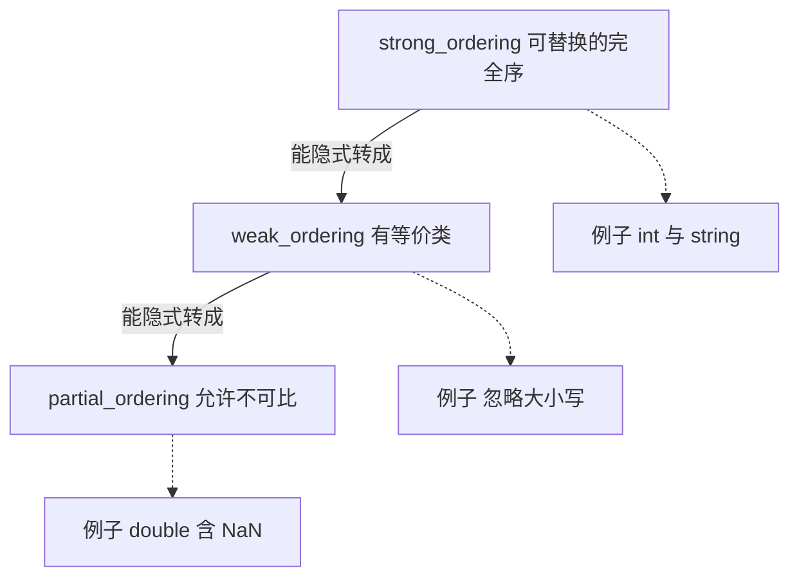

# 三路比较 <=>：一次写全六种比较

`a <=> b` 一次算出三种结果：小于、相等、大于。再配上编译器对 `<` `>` `<=` `>=` 的**重写**，一个运算符就替代了六个手写版本。这页分四块讲：它返回什么、`= default` 生成什么、哪些比较是白送的、哪些不是。

## 动机：手写六个运算符容易写歪

C++20 之前，让一个类型可比较有两条路，各有代价；C++20 之后多了第三条，只需要一行。先看前两条。

第一条是老老实实写六个运算符：

```cpp
#include <tuple>

struct Point {
    int x;
    int y;
};

bool operator==(const Point& a, const Point& b) { return std::tie(a.x, a.y) == std::tie(b.x, b.y); }
bool operator!=(const Point& a, const Point& b) { return !(a == b); }
bool operator<(const Point& a, const Point& b)  { return std::tie(a.x, a.y) <  std::tie(b.x, b.y); }
bool operator>(const Point& a, const Point& b)  { return b < a; }
bool operator<=(const Point& a, const Point& b) { return !(b < a); }
bool operator>=(const Point& a, const Point& b) { return !(a < b); }
```

六个函数必须**互相一致**：只要 `<=` 不是 `!(>)`，或者 `<` 和 `>` 不对称，`std::sort` 就有可能在某个输入上越界，而编译器一个字都不会说。`std::tie` 那几行还得手动把每个成员列一遍，加一个成员就要改三处。

第二条路是只写 `operator<` 和 `operator==`，然后用 `std::rel_ops` 补出剩下四个：

```cpp
#include <utility>

struct Item {
    int id;
    bool operator<(const Item& other) const { return id < other.id; }
    bool operator==(const Item& other) const { return id == other.id; }
};

using namespace std::rel_ops;   // 得到 != > <= >=，但只在这个作用域里生效
```

`rel_ops` 的问题很实在：它靠 `using namespace` 生效，作用域一扩散，所有类型都多出一堆模板候选；而且它补出来的运算符不会进入 ADL，别人在自己的命名空间里用你的类型时又得再 `using` 一次。

第三条路只写一行：

```cpp
struct Point {
    int x;
    int y;
    auto operator<=>(const Point&) const = default;
};
```

六个运算符全都有了，而且彼此一定一致，因为它们是同一个定义变出来的。一个定义派生六个运算符，接下来看它返回什么、凭什么保持一致。

## 最小示例

下面这个程序覆盖了默认 `<=>`、手写弱序、`std::sort`、浮点不可比，以及 `three_way_comparable` 的编译期检查。输出全部是 ASCII，顺序固定：

<<< @/snippets/cpp20/spaceship.cpp

输出：

```text
Point is three_way_comparable: true
(1,2) <=> (1,3) is less
(2,0) <=> (2,0) is equal
sorted points: (1,2) (1,3) (2,0) (2,5)
Name Alice <=> alice is equivalent
Name Alice == alice is false
sorted names: alice Bob Carol
1.0 <=> nan is unordered
nan <=> nan is unordered
1.0 <=> 2.0 is less
```

第 5、6 行故意让 `Name` 的两套比较不一致：`<=>` 忽略大小写，`==` 区分大小写。这种不一致正是 `weak_ordering` 要表达的东西，后文展开。

页内其余代码块都是说明性片段，只有上面这份文件经过 `npm run verify` 的编译与输出比对。

## 机制与语义

这一节分六块：三种返回类型、`= default` 的生成规则、重写规则、手写比较、concept 检查，以及和 `std::tie` 的对照。重写规则是最需要慢读的一块。

### 三种返回类型

`operator<=>` 的返回值要表达两件事：能不能分出大小、能不能表示不可比。标准库的做法是返回 `<compare>` 里的三种比较类别（comparison category）之一，三者的区别在于能表示多少种结果：



| 类型 | 可取值 | 承诺 | 典型场景 |
| --- | --- | --- | --- |
| `std::strong_ordering` | `less` / `equal` / `greater` | 相等 ⇒ **可替换**：`a == b` 时任何看到 `a` 的代码换成 `b` 结果不变 | `int`、`std::string`、默认 `<=>` 的聚合体 |
| `std::weak_ordering` | `less` / `equivalent` / `greater` | 允许"等价但可区分"，等价不意味着可以互换 | 忽略大小写的字符串、Unicode 规范化后的标识符 |
| `std::partial_ordering` | `less` / `equivalent` / `greater` / `unordered` | 允许两个值**无法比较** | `double` / `float`（NaN）、集合的包含关系 |

三者的包含关系是从强到弱：`strong_ordering` 能表示的一切 `weak_ordering` 都能表示，`weak_ordering` 能表示的一切 `partial_ordering` 都能表示。转换是单向的，本机实测：

```cpp
#include <compare>
#include <type_traits>

static_assert(std::is_convertible_v<std::strong_ordering, std::weak_ordering>);
static_assert(std::is_convertible_v<std::weak_ordering, std::partial_ordering>);
static_assert(!std::is_convertible_v<std::weak_ordering, std::strong_ordering>);
static_assert(!std::is_convertible_v<std::partial_ordering, std::weak_ordering>);
```

反方向不成立是有道理的：一个"可能不可比"的结果，硬塞进只有三种取值的类型里就会丢信息。

命名上有一处不一致，值得记牢：`strong_ordering` 的"相等"叫 `equal`，`weak_ordering` 和 `partial_ordering` 的"等价"叫 `equivalent`；`unordered` 只属于 `partial_ordering`。三者都能和字面量 `0` 比较（`a <=> b` 的结果 `< 0`、`== 0`、`> 0`），这是重写规则的基础。

选择原则很简单：**能不能用 `==` 把"相等"讲清楚**。能用就是 `strong_ordering`；只能判"等价于"，就是 `weak_ordering`；存在根本没法比的值，才用 `partial_ordering`。把弱序硬写成强序，是最常见的语义 bug（见后面的"常见坑"）。

### `= default` 生成什么

`auto operator<=>(const T&) const = default;` 让编译器按**声明顺序**逐成员比较，规则和聚合体的初始化顺序一致：

- 有基类时，先比较基类（从左到右），再比较成员；
- 数组成员逐元素比较，像 `std::array` 一样按字典序；
- 成员的比较结果取 `std::common_comparison_category_t`，也就是最弱的那个：成员里有 `double`，整个结果就是 `partial_ordering`；成员里有弱序类型，结果就是 `weak_ordering`；全是强序，结果才是 `strong_ordering`。

`<=>` **不会**被重写成 `==`，反过来也一样：`==` 永远来自 `operator==`。但有一个便利规则：写了 `= default` 的 `<=>` 之后，如果没有声明 `operator==`，编译器会**隐式声明一个 `= default` 的 `operator==`**。本机实测三种写法：

```cpp
struct P { int x; auto operator<=>(const P&) const = default; };   // 有 ==，有 <
struct Q { int x; std::strong_ordering operator<=>(const Q& o) const { return x <=> o.x; } };
struct R { int x; friend auto operator<=>(const R&, const R&) = default; };

template <class T>
concept HasEq = requires(const T& a, const T& b) { a == b; };

static_assert(HasEq<P>);    // 成立
static_assert(!HasEq<Q>);   // 不成立：手写 <=> 不带 ==
static_assert(HasEq<R>);    // 成立：非成员 friend 也行
```

注意 `requires` 表达式里"表达式非法"要变成 `false`，前提是它依赖模板参数；直接在命名空间作用域对具体类型写 `requires(const Q& a, const Q& b) { a == b; }` 是硬错误，所以这里包了一层 concept。

也就是说：**`= default` 的 `<=>` 顺带送你 `==`；手写的 `<=>` 一个都不送。** 手写 `<=>` 却忘了 `==`，类型会没有 `==`、`!=`，`std::three_way_comparable` 直接为 false。

另外，`= default` 的 `<=>` 要求 `<compare>` 被包含进来，忘了包含的报错长这样（本机实测）：

```text
error: cannot default 'operator<=>' because type 'std::strong_ordering' was not found; include <compare>
     auto operator<=>(const Bad&) const = default;
```

它不会在其他头文件里碰巧被带进来，`<compare>` 得自己写。

### 重写规则：`<` 是怎么来的

真正省事的地方在这里。当你写 `a < b`，而类型里只有 `<=>` 时，编译器会把表达式**重写**成一次 `<=>` 调用加一次和 `0` 的比较：

| 你写的 | 编译器重写成 | 备注 |
| --- | --- | --- |
| `a < b` | `(a <=> b) < 0` | 还有反向候选 `0 < (b <=> a)` |
| `a <= b` | `(a <=> b) <= 0` | 同上 |
| `a > b` | `(a <=> b) > 0` | 同上 |
| `a >= b` | `(a <=> b) >= 0` | 同上 |
| `a != b` | `!(a == b)` | 只要有 `==` 就有 `!=` |
| `a == b` | 不重写 | 必须有 `operator==` |

几个由此推出的结论，一共四条：

- 只写 `<=>`，`<` `>` `<=` `>=` 全都能用，`std::sort`、`std::map`、`std::set` 开箱即用（它们只要求 `<`）。本页 snippet 里 `std::sort(points)` 就是这么工作的。
- `==` 和 `!=` 是另一条线，来自 `operator==`。想让容器做等值查找（`std::find`、`unordered_map` 的 key），必须有 `==`，光有 `<=>` 不够。
- 重写是**重载决议阶段**发生的，改写后的表达式也是一个候选：如果类型自己写了 `operator<`，它和重写出来的候选一起参与决议，手写的那个优先。这条规则让老代码和 `<=>` 可以共存。
- 反向候选的意思是 `a > b` 既可以是 `(a <=> b) > 0`，也可以是 `0 < (b <=> a)`。两种写法只接受一个参数顺序的类型（比如某些只要 `int` 的异构 `<=>`）因此也能工作。

### 手写比较

需要"忽略大小写""按绝对值""按版本号段"这类逻辑时，就自己实现 `<=>`，返回你确定的类别。下面这段是本页 snippet 的简化版（省略了 `lower` 的细节）：

```cpp
#include <algorithm>
#include <cctype>
#include <compare>
#include <cstddef>
#include <string>
#include <utility>

// 忽略大小写的字典序：得到弱序
std::weak_ordering compare_ignoring_case(const std::string& a, const std::string& b) {
    const std::size_t common = std::min(a.size(), b.size());
    for (std::size_t i = 0; i < common; ++i) {
        const char ca = static_cast<char>(std::tolower(static_cast<unsigned char>(a[i])));
        const char cb = static_cast<char>(std::tolower(static_cast<unsigned char>(b[i])));
        if (ca != cb) {
            return ca < cb ? std::weak_ordering::less : std::weak_ordering::greater;
        }
    }
    return a.size() <=> b.size();   // strong_ordering 隐式转成 weak_ordering
}

class Name {
public:
    explicit Name(std::string text) : text_(std::move(text)) {}

    // 弱序：忽略大小写的字典序
    std::weak_ordering operator<=>(const Name& other) const {
        return compare_ignoring_case(text_, other.text_);
    }

    // 等价 != 相等：这里仍然区分大小写
    bool operator==(const Name& other) const { return text_ == other.text_; }

private:
    std::string text_;
};
```

写法上有五条硬要求：

- 返回类型应当是比较类别（`strong_ordering` / `weak_ordering` / `partial_ordering`）。`= default` 的版本写别的类型，会在**被使用的地方**报错（默认的比较运算符是惰性实例化的，只声明不使用可以编过），因为它要先算出成员的类别再 `static_cast` 到你的返回类型。本机把返回类型写成 `bool` 并真的比较一次：

  ```text
  error: no matching conversion for static_cast from 'std::strong_ordering' to 'bool'
       bool operator<=>(const Bad&) const = default;
  note: in defaulted three-way comparison operator for 'Bad' first required here
  ```

  写成 `int` 则是 `no matching conversion for static_cast from 'std::strong_ordering' to 'int'`。

- 手写的版本在语法上"能过"，但语义会坏掉：本机实测手写 `int operator<=>` 能编译，`a < b` 也照着重写成 `(a <=> b) < 0`，结果碰巧正确；写成 `bool` 时 `a < b` 变成 `(bool) < 0`，**永远为 false**（使用点还会冒出一条 `-Wtautological-constant-compare` 警告）。两种写法都让 `std::three_way_comparable` 变成 false。所以别赌，老老实实返回类别。
- 返回 `weak_ordering` 时用 `less` / `equivalent` / `greater`；返回 `partial_ordering` 时还多一个 `unordered`。`partial_ordering::equivalent` 和 `weak_ordering::equivalent` 名字一样，别写成 `equal`——`equal` 只存在于 `strong_ordering`（本机 `std::weak_ordering::equal` 直接报 `no member named 'equal'`）。
- 手写的 `<=>` **不会**带来 `==`，`==` 要单独写（这正是上面 `Name` 里两套比较并存的原因，也是它的语义一致性问题的来源）。
- 可以写成成员函数，也可以写成只接两个参数的 `friend`。`friend auto operator<=>(const R&, const R&) = default;` 实测可用，适合成员是私有、你又不想写成员函数的情况。

### 用 concept 检查

`<compare>` 提供两个 concept 做编译期检查，`snippet` 里就有一行 `static_assert(std::three_way_comparable<Point>)`：

```cpp
#include <compare>
#include <string>

struct Point { int x; int y; auto operator<=>(const Point&) const = default; };
struct NoEq  { int id; auto operator<=>(const NoEq&) const = default;
               bool operator==(const NoEq&) const = delete; };

static_assert(std::three_way_comparable<Point>);      // 成立
static_assert(!std::three_way_comparable<NoEq>);      // 不成立：== 被删了
static_assert(std::three_way_comparable_with<std::string, const char*>);  // 本机 libc++ 23 为 true
```

`three_way_comparable<T>` 要求 `T` 和 `T` 之间的六种比较都成立；`three_way_comparable_with<T, U>` 检查跨类型版本。它们**只检查语法**：能不能写出来、返回类型能不能转成类别，不检查你的比较逻辑和 `==` 是否语义一致。最后一条坑会再讲一次这个盲区。

把它当成模板的约束条件用，报错会落在调用点而不是实例化深处——这套思路和 [concepts 与 requires](/cpp20/concepts) 里讲的是同一套：

```cpp
template <std::three_way_comparable T>
const T& smaller(const T& a, const T& b) { return b < a ? b : a; }
```

### 和 `std::tie` 的旧写法对比

`std::tie` 的定位是"把成员打包成 tuple 再比"，它自己不做三路比较，只返回 `bool`（`<` 给你 `bool`，`==` 也给你 `bool`）：

| 维度 | `std::tie` | `operator<=>` |
| --- | --- | --- |
| 要写几个函数 | 至少 3 个（`==` `<` `!=`，或 6 个） | 1 个 `<=>` + 1 个 `==`（或两个 `= default`） |
| 结果类型 | `bool` | 三种比较类别，能表示"不可比" |
| 成员列表要重复吗 | 每个函数都写一遍 | 不写，按声明顺序自动 |
| 加一个成员 | 每个函数都要改 | 什么都不用改 |
| 和 `sort` / `map` 配合 | 能（只要求 `<`） | 能，且自动一致 |
| 支持 `double` 成员 | 能，但 NaN 下 `<` 和 `!=` 都为 false，逻辑很好笑 | 能，得到 `partial_ordering`，`unordered` 是显式的 |

`tie` 唯一还占优势的地方：它比较的是**你自己选的成员子集和顺序**。真要"按 id 比、忽略 name"，`= default` 做不到（它按声明顺序比全部），这时该写手写 `<=>`，而不是退回去写六个 `tie`。

## 常见坑

七条坑依次关于浮点 NaN、`<=>` 与 `==` 的区别、指针顺序、返回类型、异构比较、强弱序误用和 concept 的盲区。

### 1. 浮点：`partial_ordering` 与 NaN

`double` 的 `<=>` 返回 `partial_ordering`，因为 IEEE 754 里 NaN 和任何值（包括自己）都不相等：

```cpp
#include <compare>
#include <limits>
#include <type_traits>

const double nan = std::numeric_limits<double>::quiet_NaN();
static_assert(std::is_same_v<decltype(1.0 <=> nan), std::partial_ordering>);

(1.0 <=> nan) == std::partial_ordering::unordered;   // true
(nan  <=> nan) == std::partial_ordering::unordered;  // true
1.0 <=> 2.0;                                         // partial_ordering::less
```

本页 snippet 打印出来的就是这三行。由此产生的两个后果：

- `a <= b` 不再等于 `!(a > b)`：对 NaN 来说两个都是 false。用重写出来的关系运算符做区间判断时要当心。
- 别把 `<=>` 的结果直接当 `bool` 用。`if (a <=> b)` 不编译，本机报 `no viable conversion from 'std::strong_ordering' to 'bool'`；正确写法是 `if ((a <=> b) < 0)`，或者先存进变量：`if (const auto c = a <=> b; c < 0)`。

顺带一提：`<=>` 内部**不用** `==` 比较浮点，所以即使显式加上 `-Wfloat-equal`，本机对这个 snippet 也是零警告——手写 `operator==` 就没这么好运了。真要判断"两个 double 是否相等"，仍然得自己决定容差。

### 2. `a <=> b == 0` 不等于 `a == b`

`<=>` 的优先级高于 `==`，所以 `a <=> b == 0` 解析成 `(a <=> b) == 0`——这是合法且本机无警告的代码（clang 23 实测），但它问的是"三路比较的结果是不是相等"，不是"两个对象是不是 `==`"。

本页 snippet 里 `Name` 故意把两者做得不同：

- `Name("Alice") <=> Name("alice")` 得到 `equivalent`，即 `(a <=> b) == 0` 成立；
- `Name("Alice") == Name("alice")` 是 `false`。

这正是 `weak_ordering` 的用途（"等价类"里可以有多个不同的值）。但如果这个类型要用作 `std::map` 的 key，`map` 用的是 `<`（走 `<=>`），`std::find` 用的是 `==`，两者对同一对对象给出不同结论，查找结果就会出乎意料。**要么让两者一致，要么明确知道自己在做什么。** 加括号是习惯问题，理解语义才是刚需。

### 3. 指针：`strong_ordering`，但顺序由实现决定

```cpp
int arr[2];
int* p = arr;
int* q = arr + 1;
static_assert(std::is_same_v<decltype(p <=> q), std::strong_ordering>);  // 本机成立
```

结果的类型是强序，所以 `<=>` 下指针一定能分出大小、绝不会 `unordered`。但**谁大谁小**不是语言规定的：C++20 只要求它构成一个和偏序一致的全序，不同对象的相对顺序由实现决定（本机 x86-64 上基本就是地址数值比较）。所以别拿 `<=>` 的符号去推断"对象在内存里的位置"；想判断两个指针是否指向同一对象，用 `==`，别去看 `<=>` 的结果。

### 4. 返回 `bool` / `int` 的 `<=>`

`operator<=>` 的返回类型应当是比较类别，或者交给 `auto` 从 `= default` 推导。两种写法在本机的行为不一样：

- `= default` 的版本会去算成员的类别（`int` 给 `strong_ordering`），再转成你声明的返回类型。写成 `bool` 报 `no matching conversion for static_cast from 'std::strong_ordering' to 'bool'`，写成 `int` 报同样的 `... to 'int'`。这条是硬错误。
- 手写的版本能编译，但会得到一个"看起来像比较、实际不是"的函数：`a < b` 照样重写成 `(a <=> b) < 0`。返回 `int` 时碰巧算对；返回 `bool` 时 `(bool) < 0` 恒为 false，`a < b` 永远不成立，使用点还会出现 `warning: result of comparison of constant 0 with expression of type 'bool' is always false [-Wtautological-constant-compare]`。

手写的这两个版本，`std::three_way_comparable` 都是 false，因为返回类型不是比较类别。这是本页最典型的"能编译但错了"的坑：编译器只在 `= default` 时替你挡住。

### 5. 异构比较要显式转换

默认 `<=>` 的签名是 `const T&`，只接受 `T` 自己：

```cpp
struct V { int v; auto operator<=>(const V&) const = default; };

V a{1};
a <=> "x";     // 错
```

本机报错（含一条相关警告）：

```text
warning: result of comparison against a string literal is unspecified (use an explicit string comparison function instead) [-Wstring-compare]
error: invalid operands to binary expression ('V' and 'const char[2]')
note: candidate function not viable: no known conversion from 'const char[2]' to 'const V' for 1st argument
```

就算换成 `std::string`，在模板里也会翻车，因为两个参数的类型推导不一致：

```cpp
template <typename T>
auto cmp(const T& a, const T& b) { return a <=> b; }

cmp(std::string("a"), "b");
// error: no matching function for call to 'cmp'
// note: candidate template ignored: deduced conflicting types for parameter 'T'
//       ('std::string' (aka 'basic_string<char>') vs. 'char[2]')
```

`std::string` 和 `const char*` 在非模板语境下直接 `<=>` 是能比的（libc++ 23 实测 `three_way_comparable_with<std::string, const char*>` 为 true），问题出在"两边要被推导成同一个 `T`"的模板里。要跨类型比较，就得自己写 `<=>(const T&, const char*)`，或者先把实参显式转成同一个类型。这也是为什么标准库给异构比较单独准备了 `three_way_comparable_with`——它不做类型推导，只检查"这两个类型之间能不能比"。

### 6. `weak_ordering` 写成 `strong_ordering` 会撒谎

`strong_ordering` 承诺"相等即可替换"。如果你的比较忽略大小写，却声明成强序，那么 `Name("Alice") == Name("alice")` 为 true 之后，`unordered_map` 会把它们当同一个 key，而它们的内容并不相同。可替换性一旦破坏，标准库的容器、排序、去重都可能给出错误结果。判断标准：**两个"相等"的对象，所有可观察行为都一样吗？** 一样才是强序。

### 7. concept 只查语法，查不出语义矛盾

前面 `Name` 的 `<=>` 和 `==` 不一致，`std::three_way_comparable<Name>` 在本机**仍然是 true**。concept 检查的是"这两个运算符存在且返回类型合法"，不是"它们的语义一致"。别把 `static_assert(std::three_way_comparable<T>)` 当成正确性证明，它只保证能编译。

## 编译器支持

本机环境（MSYS2 clang64，clang 23.1.4 + libc++ 23）的实测结果：

```text
clang version 23.1.4
Target: x86_64-w64-windows-gnu
__cpp_impl_three_way_comparison = 201907
__cpp_lib_three_way_comparison = 201907
```

| 特性 | 本机 clang 23 + libc++ 23 | 本页验证方式 |
| --- | --- | --- |
| `<=>` 运算符本身（`__cpp_impl_three_way_comparison`） | ✅ 201907 | snippet 编译通过 |
| `<compare>` 与三种比较类别（`__cpp_lib_three_way_comparison`） | ✅ 201907 | `partial_ordering::unordered` 等常量可用 |
| `= default` 的 `<=>`、隐式生成的 `==` | ✅ | `static_assert` + 运行输出 |
| `three_way_comparable` / `three_way_comparable_with` | ✅ | `static_assert` 实测 true / false |
| 重写出的 `<` `>` `<=` `>=`、`std::sort` | ✅ | snippet 排序输出 |
| 浮点 `<=>` 得到 `partial_ordering`、NaN 为 `unordered` | ✅ | snippet 运行输出 |
| 指针 `<=>` 得到 `strong_ordering` | ⚠️ 只在独立探针里验证，未进 snippet | 单独编译确认 |

本页 snippet 用 `-std=c++20` 和 `-std=c++23` 各编译一次，`-Wall -Wextra` 均零警告，运行输出与 `expect` 一致。其他编译器本机未验证；业界普遍的最低门槛是 GCC 10 / Clang 10 / MSVC 19.30（VS 2022 17.0），更早的版本要么语言特性缺失，要么 libc++/libstdc++ 里的 `<compare>` 不完整。查表的完整版见 [编译器支持矩阵](/reference/compiler-support)。

## 与 learncpp 的关系

learncpp 第 21 章把运算符重载讲得很全：`operator==`、`operator!=`、`operator<`、`operator>`、`operator<=`、`operator>=` 逐个过了一遍，也演示了怎么用 `operator<` 和 `operator==` 推导出其他运算符，以及"排序时只需要 `<`"这个约定。那一章的内容到今天仍然全部有效，`<=>` 只是把"六个函数必须保持一致"这件事交给了编译器。

对照着看：

- 第 21 章手写六种比较运算符 → 本页的 `operator<=>(...) = default`，一个顶六个。
- 第 21 章"用 `operator<` 推导出 `>`"→ C++20 的**重写规则**，编译器自动做，而且还能带上 `<=` `>=`。
- 第 21 章没讲 `<=>`，也没讲比较类别；`weak_ordering` / `partial_ordering` 是全新的概念，读那一章时不会有任何铺垫。
- 传统的 `std::tie` 写法（`return std::tie(x, y) < std::tie(rhs.x, rhs.y);`）仍然可用，但只能返回 `bool`，也享受不到重写规则。

如果你的类型要和 ranges 算法配合，`<=>` 带来的"排序与相等分开定义"的模式会更常见——`std::ranges::sort` 用 `<`（即 `<=>`），`std::ranges::unique` 和 `std::ranges::find` 用 `==`。两者语义一致时最省心，相关背景见 [ranges 与 views](/cpp20/ranges)。另外，C++23 的显式对象参数（deducing this）让"一个 `<=>` 同时服务 `const` / 非 `const` 对象"写起来更自然，见 [deducing this](/cpp23/deducing-this)。

## 小练习

四个练习：一个验证返回类型，一个写手写比较，一个拆开弱序，最后一个替换 `tie`。

1. **给三维点加 `<=>`**：写 `struct Vec3 { double x, y, z; auto operator<=>(const Vec3&) const = default; };`，用 `static_assert` 检查它的 `<=>` 返回类型是 `partial_ordering` 而不是 `strong_ordering`，并解释为什么。提示：`std::is_same_v<decltype(std::declval<Vec3>() <=> std::declval<Vec3>()), std::partial_ordering>`。
2. **实现版本号比较**：`Version{major, minor, patch}`，手写 `<=>` 返回 `strong_ordering`，再补一个 `==`，验证 `std::sort` 与 `std::find` 都按预期工作。然后把 `==` 故意改成"只比 major"，观察 `std::find` 的结果怎么变。
3. **把弱序拆开验证**：给 `Name` 加一个成员函数 `bool same_text(const Name&) const`，比较 `<=> == 0`、`==`、`same_text` 三者在 `("Alice", "alice")` 和 `("Alice", "Alice")` 上的结果，写一张真值表。
4. **换掉 `tie`**：找一个你自己写过的、用 `std::tie` 实现的 `operator<`（六个运算符里任意一个），改成 `<=>` + `= default`，数一数少了多少行，再检查有没有成员顺序被悄悄改掉。
