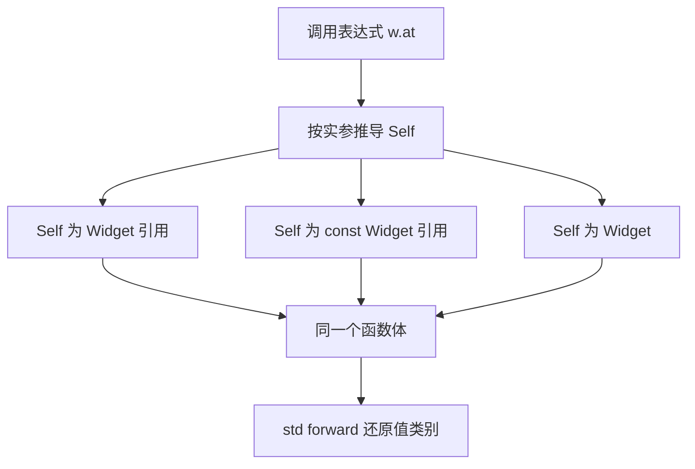
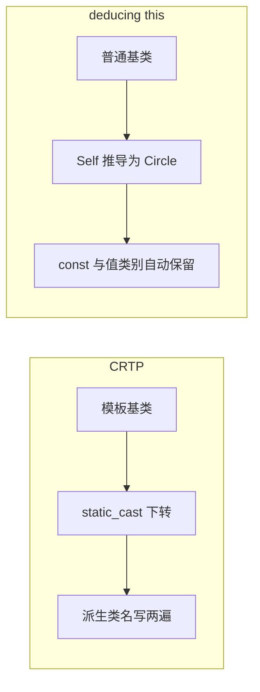

# deducing this：显式对象参数

C++23 允许成员函数把「隐式的 `this`」写成一个真正的参数：

```cpp
template <class Self>
auto&& f(this Self&& self);
```

这就是 **显式对象参数**（explicit object parameter，P0847R7）。因为 `Self` 靠推导得到，社区把它叫作 **deducing this**。

它一次解决三件本来要写很多代码的事：const / 非 const / 左值 / 右值的四套重载、CRTP 里的 `static_cast` 下转、以及「lambda 调用自己」。

## 动机：四套重载的样板代码

写一个带 `&&` 限定的访问器，把「在右值上可以搬走成员」这件事暴露出来，传统写法长这样：

```cpp
class Buffer {
public:
    std::string&       name() &       { return data_; }
    const std::string& name() const&  { return data_; }
    std::string&&      name() &&      { return std::move(data_); }
    const std::string& name() const&& { return data_; }   // 第四个，通常被漏掉

private:
    std::string data_;
};
```

问题不在长度，在于**同一份逻辑被抄了四遍**：

- 函数体一模一样，只有签名不同，改一处就要同步四处。
- `noexcept`、`[[nodiscard]]`、注释也要跟着复制。
- 四个里漏一个不会有编译错误，只会在某次调用时静默退化成拷贝、或者干脆匹配不上。
- 如果想在返回类型上还做点推导（`auto&&`），四个重载之间的类型必须手动保持一致。

更糟的是第二类场景：CRTP 的静态多态和递归 lambda，它们不是样板代码问题，而是「这件事根本写不出来」的问题。deducing this 把两类问题一起解决了。

## 最小示例

```cpp
struct Widget {
    std::string name{"widget"};

    template <class Self>
    constexpr auto&& at(this Self&& self) noexcept {
        return std::forward<Self>(self).name;
    }
};
```

三行签名，覆盖了全部情形：

- `w.at()` → `Self` = `Widget&` → 返回 `std::string&`
- `cw.at()`（const 对象）→ `Self` = `const Widget&` → 返回 `const std::string&`
- `std::move(w).at()` → `Self` = `Widget` → 返回 `std::string&&`

注意 `Self` 在右值情形下推导成 **值类型** 而不是 `Widget&&`，这和转发引用（`T&&` 配 `auto&&`）的规则完全一致：左值补引用、右值不加引用，见后文的推导表。

## 机制：`Self` 到底推导成什么

这张 flowchart 是这一页的核心，值得单独画一遍：



把四种调用摆在一起看更清楚（`Buffer` 里存 `std::string data_`）：

| 调用表达式 | `Self` 推导为 | 形参 `self` 的类型 | `std::forward<Self>(self)` 的结果 |
| --- | --- | --- | --- |
| `b.name()` | `Buffer&` | `Buffer&` | `Buffer&` |
| `cb.name()` | `const Buffer&` | `const Buffer&` | `const Buffer&` |
| `std::move(b).name()` | `Buffer` | `Buffer&` | `Buffer&&` |
| `std::move(cb).name()` | `const Buffer` | `const Buffer&` | `const Buffer&&` |

所以同一个函数体能取代四个重载：

```cpp
class Buffer {
public:
    template <class Self>
    constexpr auto&& name(this Self&& self) noexcept {
        return std::forward<Self>(self).data_;
    }

private:
    std::string data_;
};
```

`auto&&` 的返回类型跟着 `Self` 走，`const` 性和值类别都由推导自动带出来，没有一处需要手写。

::: tip 显式对象参数不是「语法糖式的 this」
`this Self&& self` 里的 `self` 是一个 **普通形参**，它有自己的名字、自己的类型，函数体里通过名字访问它。也因此函数体内禁止再用 `this` 关键字（见陷阱一节）。
:::

### 引用限定与完美转发

`self` 是具名形参，**它本身永远是左值**。想还原调用者传进来的值类别，只有一条正路：

```cpp
return std::forward<Self>(self);          // 正确：左值留左值，右值变 xvalue
return std::move(self);                   // 错误：左值调用也返回右值引用
```

`std::move(self)` 会把「在左值对象上调用」也变成 `T&&`，调用方拿到一个指向仍然存活对象的右值引用，很容易误搬。在 const 情形下它更糟：`std::move` 出来的是 `const T&&`，既不能移动也无法绑定到需要可变引用的位置，等于静默退化。

两条配套规则：

- 返回类型用 `auto&&` 或 `decltype(auto)`；写成 `auto` 会丢掉引用，变成一次拷贝。
- 想把某个值类别写成硬约束，用 `static_assert` 或 `requires`，而不是靠再写一个 `&&` 限定重载：

```cpp
class Buffer {
public:
    template <class Self>
    std::string take(this Self&& self) {
        static_assert(std::is_rvalue_reference_v<Self&&>, "take() requires an rvalue");
        return std::move(self.data_);
    }

    template <class Self>
        requires (!std::is_lvalue_reference_v<Self>)
    std::string take2(this Self&& self) { return std::move(self.data_); }

private:
    std::string data_;
};
```

`requires` 的好处是它参与重载决议（约束不满足时这个候选直接消失），`static_assert` 则是选中之后报一条清晰的错。两者的取舍和普通模板一样，详见 [concepts 与 requires](/cpp20/concepts)。

## 完整示例

下面这份 snippet 把四件事串在一起：`Widget` 的三态访问、编译期 `static_assert`、用 deducing this 替代 CRTP 的 mixin、递归 lambda。

<<< @/snippets/cpp23/deducing-this.cpp

几个值得停下来看的点：

- `at()` 返回 `auto&&`，三个 `static_assert` 在**编译期**钉死了 `std::string&` / `const std::string&` / `std::string&&` 三种返回类型，不需要运行期测试。
- `release()` 用 `static_assert(std::is_rvalue_reference_v<Self&&>)` 表达「只接受右值」，省掉一个 `&&` 限定重载。
- `category_name<Self>()` 用 `if constexpr` 把推导结果翻译成字符串，这是调试 deducing this 代码时最有用的技巧。
- `Drawable::print` 里的 `Self` 推导成 `Circle&`，静态分派直接命中派生类的 `shape_name()`。

## 替代 CRTP 的静态多态

CRTP（curiously recurring template pattern）是 C++ 里实现「静态多态」的老办法：

```cpp
template <class Derived>
struct Shape {
    void print() const { static_cast<const Derived*>(this)->draw(); }
};

struct Circle : Shape<Circle> {          // 派生类名写了两遍
    void draw() const { /* ... */ }
};
```

痛点很具体：

- 基类必须是模板，派生类必须把自己的名字当模板实参再写一遍，写错就是未定义行为。
- 基类里拿到的是 `Derived*`，`const` 性要靠 `const_cast` / 手写两个版本去维护。
- 基类没法是普通类，也没法和别的模板基类随便组合。

deducing this 的版本不需要模板基类，也不需要下转：

```cpp
struct Drawable {
    template <class Self>
    void print(this Self&& self) {
        std::forward<Self>(self).shape_name();   // 静态分派到 Circle
    }
};

struct Circle : Drawable {
    std::string_view shape_name() const { return "circle"; }
};
```

在 `Circle` 对象上调用 `c.print()` 时 `Self` 推导成 `Circle&`；换成 `const Circle` 对象，`Self` 就是 `const Circle&`——**const 性自动跟着走**，一行 `std::forward` 就够。这正是 mixin 想要的语义：基类只提供算法，具体类型由推导决定。



代价也要说清楚：deducing this 是**静态**分派，`Drawable&` 引用调用 `print()` 时 `Self` 就是 `Drawable&`，找不到 `shape_name()`——它不能替代虚函数，只能替代 CRTP。运行期多态仍然要用 `virtual`。

::: warning 不要混着用
一个类里同时存在 `void f() const` 和 `template <class Self> void f(this Self&&)` 时，重载决议的结果会很微妙：const 左值调用会选中**普通 const 成员函数**（转换序列相同时非模板优先），而 `std::move(x).f()` 一定选中模板版本。同一个名字上混用两种机制，读代码的人几乎不可能预测结果，选一种。
:::

## 递归 lambda

C++23 之前，lambda 想调用自己只有两条路：塞进 `std::function`（类型擦除，每次调用一次间接跳转，还可能分配），或者手写 Y 组合子。现在直接把闭包自己作为参数：

```cpp
auto fib = [](this auto&& self, int n) -> long long {
    return n < 2 ? n : self(n - 1) + self(n - 2);
};

std::println("fib(20) = {}", fib(20));   // 6765
```

`this auto&& self` 让闭包的 `operator()` 变成一个模板，`self` 就是闭包自身，`self(...)` 是一次普通的递归调用，没有类型擦除。

要点：

- `self` **必须是第一个参数**，`this` 只能出现在参数表最前面。
- `self` 是 `auto&&`，所以既能以左值也能以右值方式递归（`std::move(self)(n)` 语法上是允许的，一般用不到）。
- 想让递归调用走 const 版本，写 `this auto const& self`。
- 泛型 lambda 本来就带模板参数，两者可以共存：`[](this auto&& self, auto&&... args)`。

## 常见坑

以下每条都在 clang 23 上实际触发过，错误信息照抄。

### 1. 显式对象参数不能是 `static`

```cpp
struct A { template <class S> static void f(this S&&) {} };
// error: an explicit object parameter cannot appear in a static function
```

`static` 成员函数没有对象，而显式对象参数的存在意义就是描述对象，两者矛盾。

### 2. `this` 必须是第一个参数

```cpp
struct A { template <class S> void f(int, this S&&) {} };
// error: an explicit object parameter can only appear as the first parameter of the function
```

### 3. 不能再写 `const` / `volatile` / 引用限定符

```cpp
struct A { template <class S> void f(this S&&) const {} };
// error: explicit object member function cannot have 'const' qualifier

struct A { template <class S> void f(this S&&) && {} };
// error: explicit object member function cannot have '&&' qualifier
```

因为对象的 cv / 值类别**已经写在参数类型里**了，再加后缀限定符就是重复声明。想要「函数体内只能按 const 访问对象」（等价于 const 成员函数），把 const 写到参数上：

```cpp
struct A {
    template <class Self>
    void f(this Self const& self);   // 等价于 const 成员函数
};
```

### 4. 不能是虚函数

```cpp
struct A { template <class S> virtual void f(this S&&) {} };
// error: an explicit object parameter cannot appear in a virtual function
```

`Self` 会随静态类型变化，虚表里根本没有「一个」`this` 类型可登记。需要运行期多态就老实写 `virtual`。

### 5. 函数体内不能用 `this` 关键字

```cpp
struct A { template <class S> void f(this S&& s) { (void)this; } };
// error: invalid use of 'this' in a function with an explicit object parameter
```

对象就在 `s` 里，用 `s`。

### 6. `this Self&` 不等于「非 const 左值」

```cpp
struct A {
    template <class Self> void g(this Self& self);   // 不是 & 限定重载
};
```

看起来像 `&` 限定重载，实际上 `const A` 左值调用时 `Self` 推导成 `const A`，照样能调用；它只排除了右值。要真正限定非 const，写死类型 `this A& self`，或者加 `requires (!std::is_const_v<Self>)`。

### 7. `std::forward<Self>(self)`，不是 `std::move(self)`

前面已经说过，这是最常见的一类 bug：代码能编译，行为却偷偷把左值当成右值。

### 8. 取地址得到的是普通函数指针

非模板的显式对象成员函数，`&A::f` 的类型是普通函数指针：

```cpp
struct A { void f(this A& self); };
static_assert(std::is_same_v<decltype(&A::f), void (*)(A&)>);
```

它没有「成员函数指针」这个中间层，传给 C 风格回调反而更方便；但如果你在写依赖 `&T::member` 类型特征的泛型代码，这一点要留意。

### 最佳实践

- 一个成员函数要同时服务 const / 非 const / 左值 / 右值：用 deducing this，别写四个。
- 只需要固定的 cv / 值类别：直接写具体类型（`this T& self`），比写模板更易读、报错更友好。
- 需要约束（只要右值、只要某个 concept）：优先 `requires`，让候选在重载决议阶段就消失。
- 别和传统 `const` 成员函数混在同一名字上。
- 里层转发一律 `std::forward<Self>(self)`。

## 编译器支持

判定标准是特性宏，本机 clang 23.1.4 的值是 `202110`：

```cpp
#if defined(__cpp_explicit_this_parameter) && __cpp_explicit_this_parameter >= 202110
    // 可以用显式对象参数
#else
    // 退回四套重载 / CRTP
#endif
```

主流实现（以 cppreference 的 C++23 核心特性表为准）：

| 编译器 | 首个可用版本 | 备注 |
| --- | --- | --- |
| GCC | 14 | 完整支持 |
| Clang | 18 | 18 起可用，19 补全；`__cpp_explicit_this_parameter` = `202110` |
| MSVC | 19.32 | 早期为部分支持，19.43 起完整；以宏值为准 |
| Apple Clang | 未在表中给出统一版本 | 取决于 Xcode，一律以 `__cpp_explicit_this_parameter` 为准 |

本页的 snippet 用 `clang++ -std=c++23` 编译并运行通过，输出与页面上的 `expect` 块逐行一致。完整的编译器 / 标准库版本对照见 [编译器支持矩阵](/reference/compiler-support)；如果只是想先把输出跑起来，[std::format 与 std::print](/cpp23/print-format) 讲了 snippet 里用到的 `<print>`。

## 与 learncpp 的关系

learncpp 15.1 讲隐式 `this` 指针，第 21 章讲成员/非成员运算符重载，第 26 章讲类模板。四套 cv / 值类别重载、CRTP 的 `static_cast` 下转，在这三章里都是手写样板；deducing this（C++23）把它们收成一个模板参数，但它是静态分派，替代不了第 25 章的虚函数。

## 小练习

**练习 1：把四套重载收成一个**

给 `Buffer` 写 `name()` 的 deducing this 版本，然后用三个 `static_assert` 分别校验 `Buffer&`、`const Buffer&`、`Buffer&&` 三种调用下的返回类型。

::: details 提示
返回类型写 `auto&&`；`std::declval<Buffer&>()` 可以在不求值的情况下拿到左值表达式。
:::

**练习 2：写一个 `Comparable` mixin**

用 deducing this 给任意提供 `compare()` 的类型自动补上 `==` 和 `!=`，要求 const 对象和右值对象都能用（不必手写三个版本）。

::: details 提示
`template <class Self> bool operator==(this Self const& self, const Self& other)`，注意运算符的显式对象参数同样必须是第一个参数。为了让 `Self` 推导一致，两个操作数都从同一个 `Self` 出；再加一条 `requires` 要求 `self.compare(other)` 合法，mixin 才不会被任意类型误用（见 [concepts 与 requires](/cpp20/concepts)）。
:::

**练习 3：递归 lambda**

用 `this auto&& self` 写一个 `gcd`，再写一个「遍历到叶子就停」的小递归，比较它和 `std::function` 版本在可读性上的差别。最后把 lambda 存进 `auto` 之外的容器（例如 `std::vector`），观察会发生什么。

::: details 提示
递归 lambda 的类型是无法命名的闭包类型：这既是它相对 `std::function` 的优势（没有类型擦除），也是代价（不能直接写进某个容器的元素类型）。
:::

## 小结

- `this Self&& self` 把 `this` 变成可推导的形参，一个模板覆盖 const / 非 const / 左值 / 右值。
- 值类别靠 `std::forward<Self>(self)` 还原，返回类型用 `auto&&` / `decltype(auto)`。
- 它替代的是 CRTP 和「四套重载」，不是虚函数。
- 递归 lambda 是它最出人意料的副产品：`[](this auto&& self, ...) { self(...); }`。
- 记住几条硬约束：不能 `static`、不能 `virtual`、`this` 必须在第一位且不能带后缀限定符。
