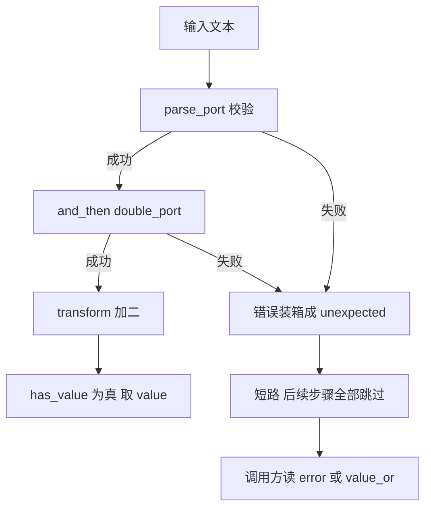

# std::expected：把错误写进返回类型

`std::expected<T, E>` 表示"要么是一个 `T`，要么是一个 `E`"，二者必居其一。它把"这次调用可能失败"从注释、文档和调用方的记忆里，搬进了函数签名。

它不是为了取代异常，而是给**可预期的失败**（用户输入非法、文件不存在、端口被占用）一个零分配、可检查、能进 `noexcept` 函数的表达方式。

## 动机：三种错误处理方式

先看同一件事——把字符串解析成整数——用三种方式写，差别在哪。

| | 异常 | `std::optional<T>` | `std::expected<T, E>` |
| --- | --- | --- | --- |
| 签名里能看到失败 | 不能（只能靠文档） | 能 | 能 |
| 携带失败原因 | 能（异常对象） | **不能** | 能（`E`，任意类型） |
| 调用方是否被迫处理 | 否（不 catch 就静默传播） | 否（容易直接 `*opt`） | 否，但类型上时刻可见 |
| 典型开销 | 零成本模型，但有 unwinding 表；`throw` 路径昂贵 | 一个判别位 | 一个判别位，无堆分配 |
| 可用于 `noexcept` / `-fno-exceptions` | 否 | 是 | 是 |
| 控制流 | 非局部跳转 | 局部 | 局部 |
| 适合 | 不可恢复、构造失败、契约违反 | "有没有"本身就足够 | 可预期、需要理由的失败 |

三者的分界线其实很清楚：

- **`optional`** 回答"有没有"，不回答"为什么没有"。一旦你想打印或记录失败原因，它就不够了；`optional` 自己的链式写法见 [optional 的单子操作](/cpp23/optional-monadic)。
- **异常** 是带外的、非局部的：它适合"这一层处理不了、也不该在这里处理"的情况，代价是失败路径在代码里不可见。
- **`expected`** 把错误变成普通的返回值：可以 `switch`、可以放进容器、可以逐层 `return` 上传，也可以在 `noexcept` 函数里用。

如果你已经在用 range pipeline 把操作串起来（见 [ranges 与 views](/cpp20/ranges)），会发现 `expected` 的链式调用形式上很像——但它是**控制流**的串联，不是惰性求值的数据流。

## 最小示例

下面这个程序把"解析端口号 → 翻倍 → 加 2"串成一条链，并分别跑成功与失败两条路径：

<<< @/snippets/cpp23/expected-basic.cpp

编译并运行（本机 clang 23.1.4 + libc++ 23，`-std=c++23`，无警告）：

```powershell
clang++ -std=c++23 -Wall -Wextra -O0 docs/snippets/cpp23/expected-basic.cpp -o $env:TEMP\expected-basic.exe
```

输出里有三件事值得注意：

1. `[1]` 走通全链：`8080 → 16160 → 16162`。
2. `[2]` 在 `and_then` 里失败：`transform` 那一步**根本没被调用**，错误原样上传。
3. `[3]` 在第一步就失败：后面两步全被跳过，`value_or(1)` 给出兜底值而不抛异常。

最后两段单独演示了两个坑：`value()` 在无值时抛 `std::bad_expected_access`，以及 `expected<void, E>` 怎么写。

## 机制与语义

### 布局与构造

`expected` 内部是一个带判别位的联合体：`T` 和 `E` 占同一块存储，没有堆分配，`sizeof` 大致是 `max(sizeof(T), sizeof(E))` 加上对齐填充。它不继承任何基类，也不做类型擦除。

构造方式：

```cpp
std::expected<int, std::string> a = 42;                        // 直接给值
std::expected<int, std::string> b = std::unexpected("bad");    // 直接给错误
std::expected<int, std::string> c{std::in_place, 42};          // 就地构造 T
std::expected<int, std::string> d{std::unexpect, "bad"};       // 就地构造 E
std::expected<int, std::string> e;                             // 默认构造：T 值初始化
```

注意 `std::expected<int, std::string> e;` 是**成功**状态，值初始化为 `0`——前提是 `T` 可默认构造。如果 `T` 不可默认构造，这个默认构造函数就不参与重载。

### 观察接口

| 成员 | 语义 |
| --- | --- |
| `has_value()` / `operator bool` | 是否持有值 |
| `value()` | 取值；无值时抛 `bad_expected_access<E>` |
| `operator*` / `operator->` | 取值；**无值时是未定义行为**，不检查 |
| `error()` | 取错误；有值时是前置条件违反（UB） |
| `value_or(fallback)` | 有值给值，无值给兜底，从不抛 |
| `error_or(fallback)` | C++23：有错误给错误，有值给兜底 |

`value_or` 在左值上要求 `T` 可拷贝，在右值上要求可移动。`value()` 和 `operator*` 的区别就是"运行期检查 + 抛异常"与"零检查、后果自负"。

### 单子操作（C++23）

四个成员函数，把"成功继续、失败短路"这件事写成一行：

| 操作 | 传入的函数形状 | 结果类型 | 失败时 |
| --- | --- | --- | --- |
| `and_then(f)` | `T → expected<U, E2>` | `expected<U, E>` | 原样上传 error |
| `transform(f)` | `T → U` | `expected<U, E>` | 原样上传 error |
| `or_else(f)` | `E → expected<T, G>` | `expected<T, G>` | 调用 `f`，用它的结果替换 |
| `transform_error(f)` | `E → G` | `expected<T, G>` | 只改错误类型 |

记忆方法：**`and_then` 接会失败的下一步，`transform` 接不会失败的一步**。如果 `transform` 的 lambda 返回了 `expected`，你会得到一个 `expected<expected<...>, E>`——嵌套两层，编译能过但语义错了，这是最常见的误用。

这些成员都有 `&`、`const&`、`&&`、`const&&` 四个引用限定重载，所以 `std::move(e).and_then(...)` 可以把值移进链里，避免拷贝。

### 错误传播与短路



短路的实现非常朴素：`and_then` 先看 `has_value()`，为假就构造一个 `expected<U, E>`，内容是你的同一个 `E`。没有异常参与，也没有额外的栈展开。

由此推出两条实用规则：

- **错误类型要能跨层转换。** `and_then` 要求下一步的 `E2` 可转换为 `E`；如果每一层用自己的错误类型，就在边界处用 `or_else` 或 `transform_error` 显式转换一次，别指望隐式转换。
- **短路是"值语义"的：** 错误被拷贝（或移动）着往上走。`E` 很大时，考虑用 `std::error_code` 这类廉价类型，或者让 `E` 可移动、链路里用 `std::move`。

### `expected<void, E>`

有些操作只可能失败，没有返回值。这时用 `std::expected<void, E>`：成功时构造空的花括号，错误照常携带。

```cpp
std::expected<void, std::string> flush();

auto r = flush();
if (!r) {
    std::println("flush failed: {}", r.error());
    return r;   // 直接把错误往上抛
}
return {};
```

它没有 `value_or`（没有值可兜底），`value()` 的返回类型是 `void`、只在无值时抛 `bad_expected_access<void>`。判断成功用 `if (r)` / `if (!r)`，别靠 `value()`。

## 和异常的分工

`expected` 和异常不是竞争关系，是**分层**关系。一条可操作的判据：

- **可预期的失败** → `expected`。用户输入、文件格式、网络对端返回的码、查找不到、解析失败。这些失败是业务流程的一部分，调用方通常就在附近，能立刻处理。
- **不可恢复的失败** → 异常。`new` 失败、构造失败（构造函数没有返回值可用）、契约违反（`at()` 越界）、`std::bad_alloc`。这些情况调用方通常无力处理，只想快速退出。
- **跨 FFI / `noexcept` / `-fno-exceptions` 边界** → 只能 `expected` 或错误码。异常穿不过 C ABI，也穿不过 `noexcept` 函数的边界。

两条实践建议：

1. **同一层接口只选一种。** 一个函数要么返回 `expected`，要么抛异常，不要"平时返回 `expected`、内部失败时抛"。混用会让调用方写两套错误处理。
2. **`expected` 的错误也是数据，值得设计。** 与其塞一个 `std::string`，不如定义 `struct parse_error { std::error_code code; std::size_t offset; }`，让上层能分支处理而不是只能打印。打印错误用 `std::println` 即可，格式化细节见 [std::format 与 std::print](/cpp23/print-format)。

## 常见坑

**1. `value()` 会抛，`operator*` 不会检查。** 无值时 `value()` 抛 `std::bad_expected_access<E>`（`expected<void, E>` 抛的是 `bad_expected_access<void>`）。`*e` 在无值时是 UB，且不会给你任何提示。不确定时用 `if` 或 `value_or`。

**2. `std::unexpected` 的类型是推导出来的。**

```cpp
auto u = std::unexpected("bad");       // unexpected<const char*>，不是 unexpected<std::string>
std::expected<int, std::string> e = u; // OK：const char* 可转换为 std::string
```

构造 `expected<int, std::string>` 时它能转换过去，所以看起来没问题；但如果你把 `u` 存下来、和别的 `unexpected<std::string>` 比较，或把它传给模板参数，就会撞上类型不一致。

**3. `expected` 不是 `variant`。** 它只有两个分支，`E` 是单一类型，没有 `index()`、没有 `visit()`、不能装第三个状态。需要"多个互斥状态"时用 `std::variant`；需要"错误码 + 上下文"时用一个聚合 `struct` 当 `E`，而不是把 `E` 写成 `variant<...>`。

**4. 不要把失败当成"再来一次"的信号。** `expected` 表达的是"这次调用失败了"，不是"暂时没成功"。重试逻辑放在外层，别让 `expected` 变成状态机。

**5. 嵌套 `optional<expected<T, E>>` 是味道。** 两层各有各的"没有"，调用方要解两次。通常可以合并：把"没有"也变成一个 `E`（比如 `error::not_found`）。

**6. `E` 不能是引用，也不能是 `void`。** 想要引用语义就存 `std::reference_wrapper<T>` 或指针。反过来，`T` 可以是 `void`（那就是 `expected<void, E>`），但 `E` 不行。

**7. 标准库不会替你检查返回值。** `expected` 本身没有 `[[nodiscard]]`。你自己的接口记得加，否则 `parse_port(input);` 这样丢掉结果的一行会静默通过。

**8. `and_then` 里返回裸值编译不过。** 那个位置是 `transform`。报错通常长得吓人（一屏 `no matching function`），先检查返回类型是不是 `expected`。

## 编译器支持

本机实测环境：

| 项目 | 值 |
| --- | --- |
| 编译器 | clang 23.1.4（msys2 clang64） |
| 标准库 | libc++ 23（`_LIBCPP_VERSION == 230104`） |
| 标准 | `-std=c++23` |
| 特性宏 | `__cpp_lib_expected == 202211L` |

在本机上**全部可用**并已跑通：`std::expected`、`std::unexpected`、`has_value`、`value`、`error`、`value_or`、`error_or`、`and_then`、`transform`、`or_else`、`transform_error`、`expected<void, E>`、`bad_expected_access`。

各实现的大致门槛（写代码时以特性宏为准，别背版本号）：

- **libc++**：`<expected>` 自 LLVM 16 起提供；单子操作随 C++23 完整度补齐，本机 LLVM 23 全部就绪。
- **libstdc++**：GCC 12 起提供 `<expected>`；单子操作需要较新的版本，用 `__cpp_lib_expected >= 202202L` 判断。
- **MSVC STL**：VS 2022 17.4 起（`_MSC_VER >= 1934`）。

不要靠猜，用特性宏把不支持的实现挡在编译期：

```cpp
#include <version>

#if defined(__cpp_lib_expected) && __cpp_lib_expected >= 202202L
    // 完整 C++23：and_then / transform / or_else 都可用
#else
    // 只有基础接口，或者根本没有
#endif
```

如果所在标准库没有单子操作，等价写法就是手写 `if`：

```cpp
std::expected<int, std::string> doubled = parse_port(text);
if (!doubled)
    return doubled;                        // 短路：原样上传错误
std::expected<int, std::string> plus2 = *doubled + 2;
```

可读性并不差，只是长了点。本页的示例这样写也能跑通，之所以用 `and_then`，是因为它在"连续五步都可能失败"时才真正省事。

另外，libc++ 在 `-fno-exceptions` 下把 `value()` 的抛出改成了 `verbose abort`（头文件里就是这么写的）；这条路径本机没有实际运行验证，只作为设计参考。更细的版本矩阵见 [编译器支持矩阵](/reference/compiler-support)。

## 与 learncpp 的关系

learncpp 第 27 章讲异常的完整模型（27.1–27.9），12.15 讲 `std::optional`。`expected` 填的是两者中间那格：失败是可预期的、调用方就在附近，但"为什么失败"仍需保留。异常依然是构造失败、内存不足这类不可恢复情况的首选，本页不主张用它替掉异常。

## 小练习

1. **改写错误类型。** 把 `parse_port` 的 `E` 从 `std::string` 换成 `struct port_error { std::error_code code; std::string_view input; }`，用 `transform_error` 在边界处把老错误转成新类型，保持 `main` 的输出不变。
2. **加上 `expected<void, E>`。** 写 `std::expected<void, std::string> validate(int port)`，端口小于 1024 时返回 `unexpected("privileged port")`，并在链里用 `and_then` 接在 `parse_port` 后面。
3. **故意触发 `bad_expected_access`。** 分别对 `expected<int, std::string>` 和 `expected<void, std::string>` 调用 `value()`，用 `catch (const std::bad_expected_access<...>&)` 接住，观察两者捕获类型的差别。
4. **对比 `optional`。** 把示例改成返回 `std::optional<int>`，记录你丢掉了哪些信息，以及调用方需要额外写多少代码来弥补。
