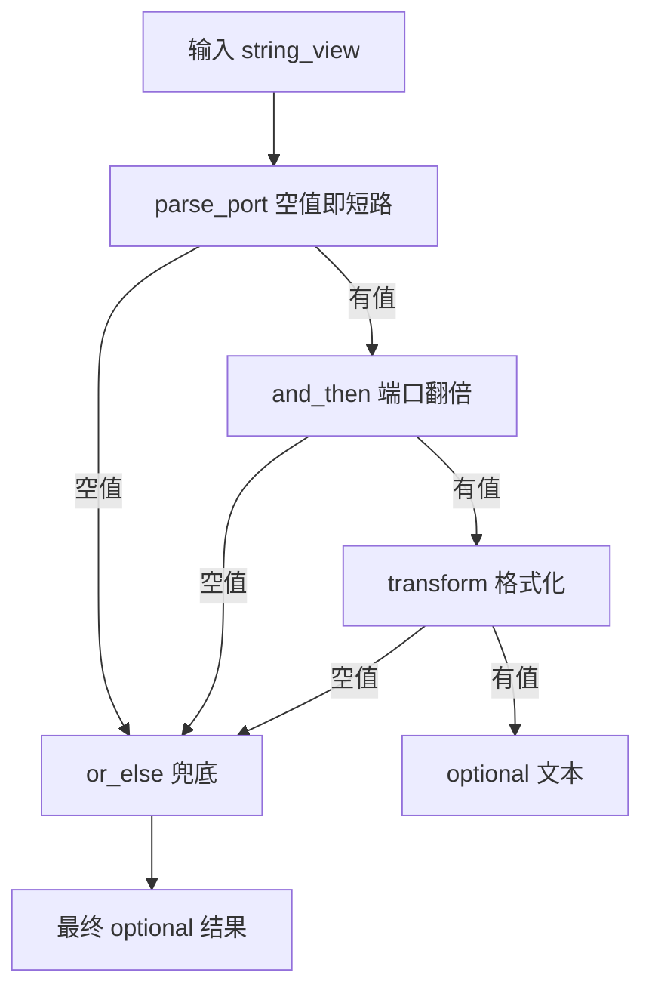

# optional 的单子操作：and_then / transform / or_else

`std::optional<T>` 回答的是"有没有值"。C++23 给它补了三个成员函数，回答的是另一个问题：**"有值就继续，没值就一路短路"这件事，能不能写成一条表达式，而不是一层套一层的 `if`。**

答案是能。三个函数分工很清楚：

- `and_then(f)`：把值交给一个**可能失败**的下一步，结果不嵌套。
- `transform(f)`：把值交给一个**不会失败**的转换，结果自动包回 `optional`。
- `or_else(f)`：只在"没有值"的时候才干活，提供一个兜底。

## 动机：嵌套的 `if` 与层层 `return std::nullopt`

假设要先从配置里取端口文本、解析、校验、再算出一个监听描述，中间任何一步都可能没有值。手写大概长这样：

```cpp
std::optional<std::string> listen_banner(const Config& cfg) {
    if (!cfg.has("port"))
        return std::nullopt;                       // 第 1 层
    const std::optional<int> port = parse_port(cfg.get("port"));
    if (!port)
        return std::nullopt;                       // 第 2 层
    if (*port > 32767)
        return std::nullopt;                       // 第 3 层，翻倍会越界
    return describe(*port * 2);
}
```

问题不在长度，而在读法：每读一步，都要在心里维护"现在到哪一层了、还剩下几步没检查"，这就是所谓的 arrow code。更糟的是失败原因全丢了——三层 `nullopt` 长得一模一样，调用方无法区分"没配置"和"配置写错了"。需要带理由的失败时该换 [std::expected](/cpp23/expected)，本页只解决"有没有"。

三个成员函数把上面的骨架压成一条链：

```cpp
std::optional<std::string> listen_banner(const Config& cfg) {
    return parse_port(cfg.get_or("port", ""))
        .and_then(double_port)                    // 可能失败：翻倍越界
        .transform([](int port) {                 // 不会失败：格式化
            return std::format("listen on {}", port);
        });
}
```

注意这**不是** ranges 的管道。没有 `operator|`，`|` 只是阅读时的比喻；真正发生的是一串成员函数调用，每一步都返回一个新的 `optional`。如果你已经熟悉 [ranges 与 views](/cpp20/ranges) 里"组合 view、惰性求值"的那套写法，要特别把两件事分开：ranges 的链是惰性的数据流，`optional` 的链是**立即执行的短路控制流**。

## 最小示例

下面这个程序把"解析端口 → 翻倍 → 生成描述"串成一条链，并且把每条失败路径停在哪儿都打印出来：

<<< @/snippets/cpp23/optional-monadic.cpp

本机 clang 23.1.4 + libc++ 23，无警告：

```powershell
clang++ -std=c++23 -Wall -Wextra -O0 docs/snippets/cpp23/optional-monadic.cpp -o $env:TEMP\optional-monadic.exe
```

输出值得逐段看：

1. **成功路径**：`8080 → 16160 → "port 16160 (listen ok)"`。`and_then` 的 lambda 形参写的是 `int`（内部从 `T&` 拷一份进来），`transform` 的 lambda 返回 `std::string`，外面自动包成 `optional<std::string>`。
2. **`and_then` 里失败**：`40000` 能通过 `parse_port` 的 1..65535 校验，但翻倍会溢出。`and_then` 返回空之后，`transform` 的 lambda **一次都没被调用**——输出里没有 `transform:` 那一行，这就是短路。
3. **`parse_port` 就失败**：`80ab` 带残余字符，`70000` 越界，两个 lambda 都没跑。程序只打印"`parse_port` 是空的"，因为 `optional` 本来就不携带原因。
4. **`or_else`**：空的时候 lambda 被调用一次，给出 `443`；有值的时候原样返回 `8080`，lambda 调用次数是 0。
5. **`value_or` 是急切的**：两行 `fallback_port() called` 都出现在结果之前，即使第一个 `optional` 明明有值。

页内其余代码块都是说明性片段，只有上面这份文件经过 `npm run verify` 的编译与输出比对。

## 机制与语义

### 三个操作的签名要点

| 操作 | `f` 被调用时收到 | `f` 必须返回 | 整体结果类型 | 空值时 |
| --- | --- | --- | --- | --- |
| `and_then(f)` | `T&` / `const T&` / `T&&` / `const T&&` | `std::optional<U>` | `std::optional<U>` | 不调用 `f`，直接返回空的 `optional<U>` |
| `transform(f)` | 同上 | 一个**对象**类型 `U` | `std::optional<U>` | 不调用 `f`，直接返回空的 `optional<U>` |
| `or_else(f)` | **没有参数** | 和当前**完全相同**的 `optional<T>` | `std::optional<T>` | 调用 `f`，用它的返回值 |

三个都是 `[[nodiscard]]`：本机实测，丢掉返回值会有 `-Wunused-result` 警告，接住它就行。

`and_then` 和 `transform` 各有 `&`、`const&`、`&&`、`const&&` 四个引用限定重载：左值链里 lambda 拿到 `T&`，可以就地修改容器里的对象；`std::move(opt).and_then(...)` 则把值移进下一步，避免拷贝。`or_else` 在标准里同样是四个，但本机 libc++ 23 只实现了 `const&` 和 `&&`，这个缺口的具体表现放在下面的「编译器支持」里说。

`or_else` 的 lambda **不带参数**，这一点常被记错。它拿不到"为什么空"，因为 `optional` 里根本没有这个信息。想要理由就得用带错误类型的 `expected`——而且 `expected` 的 `or_else` 恰好相反：lambda **会收到当前的错误值**，本机实测 `[](const std::string& err)` 能拿到 `"bad"`。把一段 `optional` 代码平移成 `expected` 时，忘记加这个形参是最常见的编译错误。

### 短路：空值直接穿过整条链



短路的实现非常朴素：`and_then` 里先看 `has_value()`，为假就直接 `return optional<U>{}`，lambda 连调用都不会发生；`transform` 同理。没有异常参与，也没有栈展开，代价就是一次判别位检查——和你手写 `if` 一样。

一条实用推论：**链上任何一步失败，后面的所有 lambda 都不会执行**，所以可以放心地把"只在成功时才有意义的副作用"放进 lambda，不必自己在外面再加一道 `if`。

### 为什么 `transform` 不能接"可能失败"的步骤

因为 `transform` 的约定是"`f` 返回 `U`，我把它包成 `optional<U>`"。如果 `f` 自己已经返回 `optional<U>`，那这一次的 `U` 本身就等于 `optional<U>`，结果成了 `optional<optional<U>>`。本机实测：这段**能编译**，`decltype` 确实是 `optional<optional<int>>`。

```cpp
std::optional<std::optional<int>> nested = parse_port("8080")
    .transform([](int port) { return parse_port(std::to_string(port)); });

if (nested) {          // 第一层：transform 成功了
    if (*nested) {     // 第二层：里面的解析也成功了
        use(**nested);
    }
}
```

编译能过，语义全错：两层 `optional` 各自表示一个"没有"，调用方要解两次，而且分不清是哪一层空的。这就是把 `transform` 用在失败步骤上的典型症状——**看到 `optional<optional<...>>`，就把那个 `transform` 换成 `and_then`。**

反过来，`and_then` 里返回裸值也编译不过。本机报的是：

```text
error: static assertion failed due to requirement 'std::__is_std_optional<int>::value':
       Result of f(value()) must be a specialization of std::optional
```

报错文字很直白，但位置常常在一屏 `no matching function` 之后，往上翻到 `static assertion` 这一行就行。

### 和 `std::expected` 的对应关系

两者是同一套单子操作，差别全在"失败分支带不带信息"：

| 需求 | `std::optional<T>` | `std::expected<T, E>` |
| --- | --- | --- |
| 有值就继续，下一步可能失败 | `and_then(f)`，`f` 返回 `optional<U>` | `and_then(f)`，`f` 返回 `expected<U, E2>`，`E2` 要能转成 `E` |
| 有值就变换，下一步不会失败 | `transform(f)`，`f` 返回 `U` | `transform(f)`，`f` 返回 `U` |
| 空/错时兜底 | `or_else(f)`，`f` 零参数、返回 `optional<T>`，**类型不变** | `or_else(f)`，`f` 收到错误 `E`、返回 `expected<T, G>`，**能换成新的错误类型 `G`** |
| 只改错误、不改值 | 没有对应物 | `transform_error(f)`，`f` 返回 `G` |

关键差异只有一个，但它很关键：**`expected` 的 `or_else` 可以换错误类型，`optional` 不行。** 因为 `optional` 没有错误类型可换，它的 `or_else` 只能返回同一个 `optional<T>`。本机实测，返回 `optional<long>` 会被拦下来：

```text
error: static assertion failed due to requirement
       'is_same_v<std::optional<long>, std::optional<int>>':
       Result of f() should be the same type as this optional
```

所以选型判据很直接：失败需要理由、需要分层转换错误类型的，用 `expected`（见 [std::expected](/cpp23/expected)）；只需要"有没有"的，`optional` 更轻，而且不会让调用方以为里面有原因可读。

## 常见坑

**1. `value_or(x)` 的 `x` 总会被求值。** 它是普通函数调用，实参先算完再进函数体，跟 `optional` 有没有值无关。示例里 `parse_port("8080").value_or(fallback_port())` 明明有值，`fallback_port()` 照样被调用、照样打印。兜底逻辑贵（查数据库、读环境变量、分配内存）时，用 `or_else` 让它在空值时才跑：

```cpp
const int port = parse_port(text).or_else([] { return read_port_from_env(); }).value_or(8080);
```

**2. 空的 `optional` 上 `operator*` 是 UB，不是抛异常。** `*opt` 和 `opt->` 不做任何检查，读的是未构造的存储；只有 `value()` 会抛 `std::bad_optional_access`（本机实测捕获到 `what() == "bad_optional_access"`）。本机默认构建（`-O0`，未开启 libc++ hardening）下，对一个空 `optional<int>` 求 `*` 既不报错也不中断，程序打印出一个垃圾值然后以退出码 0 结束——libc++ 的断言宏只在 hardening 模式下才生效。这类 bug 会一直沉默到换了优化等级或平台才现形。不确定非空就用 `if`、`value_or`，或者干脆把它接进链里。

**3. `optional<T&>` 在 C++23 里不合法。** 本机实测直接停在 `static_assert`：

```text
error: static assertion failed due to requirement '!is_reference_v<int &>':
       instantiation of optional with a reference type is ill-formed
```

要引用语义就存 `T*`（空指针表示"没有"）或 `std::optional<std::reference_wrapper<T>>`。顺带记一条：本机 `-std=c++26` 模式下 libc++ 已经接受了 `optional<int&>`（C++26 的新特性），所以同一个文件换个标准就可能编过——写 C++23 页面时别依赖它。

**4. `transform` 的 `f` 不能返回引用，也不能返回 `void`。** 两种都是编译期错误，本机报的是同一句 `static_assert`：

```text
error: static assertion failed due to requirement '__is_valid_optional_contained_type<int &>':
       Result of f(value()) should be a valid contained type for optional
```

`void` 版本额外报一条 `instantiation of optional with a non-object type is undefined behavior`。也就是说，`transform` 不能拿来表达"有值就执行一个副作用"。要副作用就写 `if (o) f(*o);`，或者让 `f` 返回一个 `std::optional<std::monostate>` 再用 `and_then` 串起来——后者只是为了链式写法统一，可读性未必更好。

**5. `and_then` 的 lambda 返回"临时对象的引用"会悬垂。** 下面这种写法不会被拦住：

```cpp
auto bad = opt.and_then([](int v) -> const std::optional<int>& {
    return std::optional<int>{v * 2};   // 返回的是临时对象的引用
});
```

本机 clang 23 只给一条 `warning: returning reference to local temporary object [-Wreturn-stack-address]`，然后**编译通过**。运行结果看起来一切正常（`has_value()` 打印出 1），但那次拷贝读的是 lambda 返回时就已经析构的临时对象，是货真价实的 UB。真正的修法很简单：`and_then` 的 lambda 一律**按值返回 `optional`**，让编译器去做移动。

**6. 不要用 `optional` 表示三种以上状态。** `optional` 只有"有 / 没有"两个分支。想要"解析成功 / 格式非法 / 越界"三种情况，用 [std::expected](/cpp23/expected)（值 + 错误）或 `std::variant`（多个互斥状态）。把状态塞进一个 `int` 的魔法值里，再包一层 `optional`，是这条规则最典型被违反的方式。

**7. 链上丢返回值不会有任何运行期报错。** 三个函数都是 `[[nodiscard]]`，漏接返回值只有一条 `-Wunused-result` 警告；如果你没开 `-Wall -Wextra`，这一步会被静默吞掉，整条链白算。自己的封装函数也记得补 `[[nodiscard]]`。

**8. lambda 的形参类型决定要不要拷贝。** `[](int v)` 会拷一份；`[](const int& v)` 在左值链上省一次拷贝；想在 `&&` 链上移动，就写 `[](int&& v)` 再配合 `std::move(opt).and_then(...)`。`std::string` 这类大对象在链上多拷几次，开销比短路的收益还大。

## 编译器支持

本机实测环境：

| 项目 | 值 |
| --- | --- |
| 编译器 | clang 23.1.4（msys2 clang64） |
| 标准库 | libc++ 23 |
| `-std=c++23` | `__cpp_lib_optional == 202110` |
| `-std=c++20` | `__cpp_lib_optional == 202106` |

结论：

- **C++23 模式下三个操作全部可用**，本页的 snippet 就是在这个模式下编译运行通过的。
- **C++20 模式下没有这三个成员。** 同一个 `o.transform(...)` 在 `-std=c++20` 下报 `no member named 'transform' in 'std::optional<int>'`，`__cpp_lib_optional` 停在 `202106`（那个值对应"完全 constexpr 化"，被 libc++ 当作 DR 提前打开了；单子操作仍然是 C++23 才出现）。
- 判断依据用 `__cpp_lib_optional`：`202110` 是引入单子操作的那次修订，比它小就说明只有基础接口。

还有一处**本机确有的实现缺口**，值得单独记：

- **`or_else` 的引用限定重载不全。** 标准的 `optional::or_else` 有 `const&`、`&`、`&&`、`const&&` 四个重载，libc++ 23 只实现了 `const&` 和 `&&`（`<optional>` 里就只有这两处声明）。后果很具体：对一个**非 const 左值**的 `optional<std::unique_ptr<int>>` 调 `or_else`，本机报 `no matching member function for call to 'or_else'`——能绑定的只剩 `const&` 版本，而它要求 `T` 可拷贝，`unique_ptr` 不满足。绕开办法有两个，都实测过：`std::move(o).or_else(...)` 走 `&&` 重载；或者干脆 `if (!o) o = make_fallback();` 绕开链式写法。`and_then` 和 `transform` 的四个重载在本机齐全，不受影响。

```cpp
#include <version>

#if defined(__cpp_lib_optional) && __cpp_lib_optional >= 202110L
    // and_then / transform / or_else 可用
#else
    // 退回手写 if：语义等价，只是长一点
#endif
```

没有单子操作时的等价写法：

```cpp
const std::optional<int> port = parse_port(text);
if (!port)
    return std::nullopt;                       // 等价于 and_then 的短路
const std::optional<int> doubled = double_port(*port);
if (!doubled)
    return std::nullopt;
return describe(*doubled);                     // 等价于 transform
```

本机只装了 clang + libc++，GCC 与 MSVC 的门槛未验证；写可移植代码时以特性宏为准，别背版本号。更细的版本矩阵见 [编译器支持矩阵](/reference/compiler-support)。如果你在写泛型封装、需要用 `std::invocable` 这类约束把 `f` 卡在编译期，[concepts](/cpp20/concepts) 那一页的写法可以直接套过来——libc++ 内部就是用约束加 `static_assert` 双重把关的。

## 与 learncpp 的关系

learncpp 讲 `std::optional` 的那一课覆盖的是 C++17 的基础面：`has_value()`、`value()`、`value_or()`、`operator*`、空 `optional` 的行为，以及"用返回值表示可能没有结果"这个设计动机。这些在本页依然成立，一个字都没过时。

差别只有一个：`and_then`、`transform`、`or_else` 是 C++23 新增的成员函数，learncpp 按 C++17 写的那一课里不存在它们，示例代码也全是手写 `if`。你从 learncpp 学到的"用 `optional` 替代哨兵值 / 输出参数"的判断依然正确，本页只是在那之上把多层检查折叠成链。

还有一条 learncpp 没展开、但在真实代码里很快会撞上的分界：`optional` 只带"有没有"，不带"为什么"。一旦你开始想打印失败原因，就该换 `expected`——两者的单子操作形状几乎一样，迁移成本主要是给每层补上错误类型。

## 小练习

1. **把嵌套 `if` 改写成链。** 拿一段三层 `if (!x) return std::nullopt;` 的代码，改写成 `and_then` + `transform`，确认失败时后续 lambda 一次都不执行（在 lambda 里加计数或打印验证）。
2. **故意用错 `transform`。** 把 `and_then(double_port)` 换成 `transform(double_port)`，观察 `decltype` 变成 `optional<optional<int>>`，然后写出能正确处理两层嵌套的调用方代码，体会它有多别扭。
3. **同一段逻辑用 `expected` 重写。** 给 `parse_port` 加一个错误码枚举，用 `expected<int, parse_error>` 表达"空串 / 非数字 / 越界"三种失败，再对比 `or_else` 在两边的能力差异。
4. **验证 `value_or` 的急切求值。** 把示例里的 `fallback_port()` 换成一个会打印日志、会计数、还会分配内存的函数，在有值的 `optional` 上调用 `value_or`，确认它照样被完整执行了一遍；再改用 `or_else`，让这段兜底逻辑只在真的空值时才跑。
