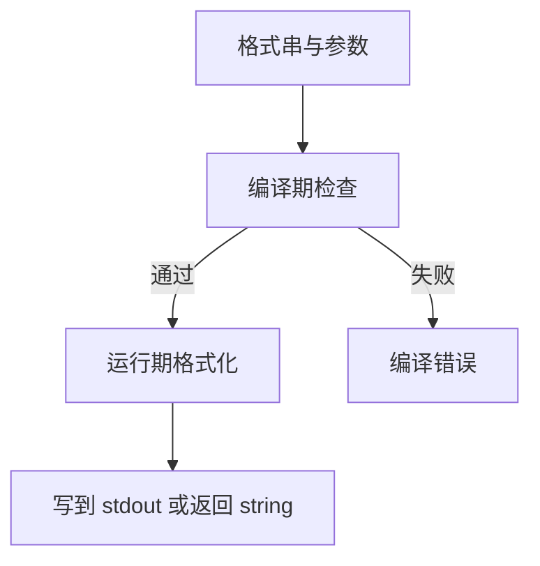
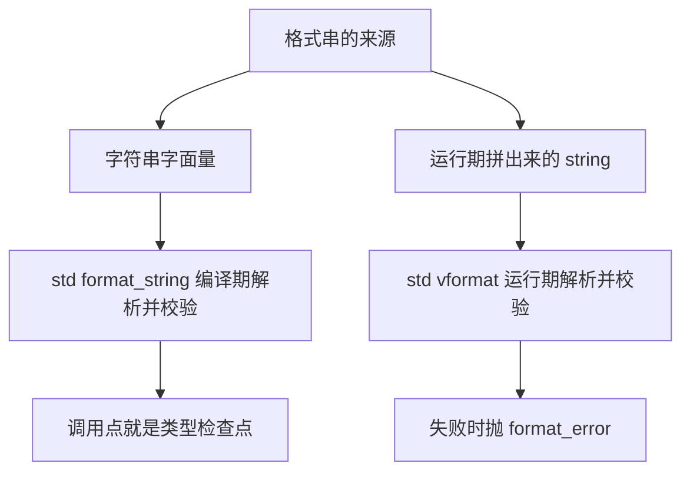

# std::format 与 std::print：类型安全的格式化

`printf` 的错误要等到输出跑飞才看得见，`std::cout` 的格式则是一串粘在流上的状态。C++20 的 `<format>` 换成 `{}` 占位符：格式串和实参在**编译期**就一起被检查，输出只是返回一个 `std::string`。C++23 的 `<print>` 把同一个格式串引擎直接接到 `stdout` 上。

这一页讲三件事：`std::format` 的语法、编译期检查到底检查了什么、以及 ranges / tuple / chrono 这些 C++23 新格式化支持的边界在哪。

## 动机：三种写法，三种失败方式

同一件事——把一个数打成 `0x` 开头的四位十六进制——三种流派：

```cpp
printf("%#06x\n", 255);                                     // 0x00ff

std::cout << std::showbase << std::hex << std::setw(6)
          << std::setfill('0') << 255 << '\n';              // 0x00ff

std::println("{:#06x}", 255);                               // 0x00ff
```

看起来只是长短差别，实际上是三种**错误模型**：

- **`printf` 把类型信息丢了。** 变参函数里没有类型，`%d` 配 `double` 不是编译错误，是未定义行为；`%s` 配 `std::string` 直接把对象首地址当字符指针读。编译器只能对字面量格式串做很有限的 `-Wformat` 检查，而且 `printf` 认不出自定义类型。
- **iostream 把格式存成了流的状态。** `std::hex`、`std::setfill`、`std::setprecision` 一旦设上就一直生效，`std::setw` 却只作用于下一个输出——两种生命周期混在同一个流里，这就是「循环里第二行开始全变十六进制」的经典 bug。
- **`std::format` 把格式串当成数据和代码的混合体。** 它是一次函数调用的实参，不是持续状态；用完即弃，不会漏到下一次调用。

三种写法的对照：

| 需求 | `printf` | iostream | `std::format` |
| --- | --- | --- | --- |
| 类型错误 | 运行期 UB | 编译错误 | 编译错误 |
| 自定义类型 | 不支持 | 重载 `operator<<` | 特化 `std::formatter` |
| 格式串能否存进变量 / 资源文件 | 能（但无检查） | 不能 | 经 `std::vformat` |
| 状态残留 | 无 | 有 | 无 |
| 返回值 | `int` | 流引用 | `std::string` |
| 本地化 | `%'d` 依赖 locale 全局状态 | `imbue` | 显式传 `std::locale`（见后文「坑」） |

::: tip 一句话版本
`std::format` = `printf` 的紧凑语法 + 编译期的类型检查 + iostream 的可扩展性，并且没有两者的副作用。
:::

## 最小示例

下面这个程序把 `std::format` 的日常用法走了一遍：数值的宽度 / 进制 / 精度、字符串对齐、C++23 的 ranges / tuple / chrono 格式化，最后用 `std::vformat` 处理运行期才拿到的格式串。

<<< @/snippets/cpp23/print-format.cpp

编译并运行（本机 clang 23.1.4 + libc++ 23，`-std=c++23`，无警告）：

```powershell
clang++ -std=c++23 -Wall -Wextra -O0 docs/snippets/cpp23/print-format.cpp -o $env:TEMP\print-format.exe
```

输出里有几处值得停下来看：

1. `width=    42` 右对齐，而 `|left    |` 左对齐。**数字默认右对齐，字符串默认左对齐**，这跟 Python 的 `format` 一致，跟 `printf` 不一致。
2. `each_hex=[0x0001, ...]` 里那个双冒号：外层是 ranges 的说明符，冒号后面 `#06x` 是**逐个元素**的说明符。
3. `1970-01-01 was a Thursday` 是 chrono 格式化，格式串里的 `%Y` `%m` `%d` 是 `strftime` 的写法，和 `{}` 占位符共存于同一个字符串。

一次调用走完的四步是这样的：



前后两半是分开的：左边发生在编译期（`consteval` 构造函数里解析格式串），右边发生在运行期（真正取实参、算宽度、写字符）。`std::print` 和 `std::format` 只差最后一步的出口，前两步完全共用。

## 格式说明符

`{}` 里冒号后面的部分叫 **format spec**，语法是固定的几段，顺序不能乱：

```text
[[fill]align][sign]["#"][0][width][".precision"]["L"][type]
```

| 片段 | 写法 | 例子 | 输出 |
| --- | --- | --- | --- |
| fill + align | `{:*<8}` / `{:*>8}` / `{:*^8}` | `"ab"` | `ab******` / `******ab` / `***ab***` |
| sign | `{:+}` / `{: }` | `42` | `+42` / ` 42` |
| `#` 前缀 | `{:#x}` `{:#b}` `{:#o}` | `42` | `0x2a` / `0b101010` / `052` |
| `0` 补零 | `{:06}` | `42` | `000042` |
| width | `{:6}` | `42` | `    42` |
| precision | `{:.2f}` / `{:.4}` | `3.14159` / `"formatting"` | `3.14` / `form` |
| `L` 本地化 | `{:L}` | `1234567` | 默认 locale 下不变 |
| type | `{:d}` `{:f}` `{:e}` `{:x}` `{:b}` `{:c}` `{:s}` `{:?}` | 见下 | |

几个容易记混的点：

- **precision 对整数无效。** 只能用在浮点和字符串上；字符串的 precision 是「最多取几个字符」（按图形簇切，不是按字节）。
- **`0` 和 align 同时出现时 `0` 被忽略。** `{:<06}` 得到 `42    `，不是 `420000`。
- **`#` 只对 `b` / `o` / `x` / `X` 和浮点有意义**，`{:#d}` 不是错误但没有效果。
- **type 可以不写。** 对整数等价于 `{:d}`；对浮点则不写 precision 时输出**能原样读回的最短表示**（`1234567.0` → `1234567`，而不是 `{:g}` 的 `1.23457e+06`），写了 precision 才等价于 `{:g}`。

宽度和精度都可以是**嵌套字段**，从实参里取：

```cpp
std::format("{:>{}.{}f}", 3.14159, 10, 3);   // "     3.142"
```

顺序是关键：值在前，宽度和精度在后，按占位符里出现的顺序从左到右消费实参。宽度 / 精度那个实参必须是整数，给个 `double` 会在运行期抛 `std::format_error`。

## `std::print` 和 `std::format` 是什么关系

一句话：**同一套格式串语法，同一个编译期检查，只是出口不同。**

| | `std::format` | `std::print` / `std::println` |
| --- | --- | --- |
| 头文件 | `<format>` | `<print>` |
| 标准 | C++20 | C++23 |
| 返回 | `std::string` | `void` |
| 去哪里 | 你手上 | `stdout`，或指定的 `std::FILE*` |
| 换行 | 你需要自己加 | `println` 自动加一个 `\n` |

```cpp
#include <cstdio>
#include <print>

std::print("hello {}\n", "world");        // 不自动换行，\n 得自己写
std::println("hello {}", "world");        // 结尾自动换行
std::println(stderr, "bad: {}", 42);      // 写到标准错误
```

`print` 的价值不只是省一次 `std::string` 分配：格式化结果是**一整块**写进 `FILE` 缓冲的，而不是像 `std::cout` 那样每个 `<<` 各自触发一次写入。这也顺带解释了为什么多线程各自 `println` 一整行时，不容易出现两行字符互相穿插的情况；不过这不是「可以代替互斥量」的理由，输出顺序真要可控，还是得自己同步。

::: warning `print` 不会自动 flush
`print` 写的是 C 流的缓冲区，`\n` 不等于 flush。需要立刻看到输出（比如崩溃前的日志）时用 `std::fflush(stdout)`。
:::

## 编译期检查：`format_string` 与 `vformat`

这是 `std::format` 相对 `printf` 最实质的改进，也是最容易被误解的地方——**不是所有格式串都能在编译期检查**，取决于你用哪个入口。



具体机制：

- `std::format(fmt, args...)` 的第一个形参类型是 `std::format_string<Args...>`（即 `std::basic_format_string<char, std::type_identity_t<Args>...>`）。它的构造函数是 **`consteval`**，所以**只要传的是字面量，解析和校验就在编译期完成**：占位符个数、类型能不能对上、说明符是否合法，全在编译期报错。
- `std::vformat(std::string_view, std::format_args)` 接的是运行期的字符串，检查一路推迟到运行期，不合法就抛 `std::format_error`。

两者能做的事完全一样，区别只在**检查时机**和**能否直接接变量**：

```cpp
std::string user_fmt = read_from_config();          // 运行期才有
auto s1 = std::format(user_fmt, 42);                // 编译错误：不是常量表达式
auto s2 = std::vformat(user_fmt, std::make_format_args(42));  // 编译错误：make_format_args 不收右值

int value = 42;
auto s3 = std::vformat(user_fmt, std::make_format_args(value));  // 正确
```

注意上面第二行：`std::make_format_args` 的参数是 `Args&...`，**只接受左值**。这是它最常见的编译错误来源，临时量必须先落到变量里。

自己写包装函数时，用 `std::format_string<Args...>` 把检查能力传下去：

```cpp
template <class... Args>
void log_info(std::format_string<Args...> fmt, Args&&... args) {
    std::println("[info] {}", std::format(fmt, std::forward<Args>(args)...));
}

log_info("port={}", 8080);     // OK
log_info("port={:d}", 3.14);   // 编译期报错，错在调用点，不是在 log_info 里
```

`Args...` 由实参推导，`format_string<Args...>` 因此知道每个位置该是什么类型——**报错落在调用者那一行**，这是模板里传 `std::string_view` 拿不到的效果。

编译期的错误长这样（libc++ 23 + clang 23）：

```text
error: call to consteval function 'std::basic_format_string<char, int, int>::basic_format_string<char[7]>'
       is not a constant expression
```

"not a constant expression" 读起来像语言错误，实际意思是「`consteval` 构造函数里 `throw` 了，所以这不是一个合法的常量表达式」，真正的诊断信息在下面几层的 note 里。看到这个错误先回去检查格式串，别怀疑生命周期。

::: tip 什么时候不得不放弃编译期检查
格式串来自翻译文件、配置文件、日志系统里拼出来的模板时，只能用 `vformat`。C++26 补了 `std::runtime_format(fmt)` 显式标注「这是运行期串」，让 `std::format` 也能接变量；本机 libc++ 23 **还没有**这个函数（`__cpp_lib_runtime_format` 未定义），只能继续用 `vformat`。
:::

## C++23：ranges、tuple、chrono

这三块是 C++23 补上的格式化能力，也是 `std::format` 真正拉开与 `printf` 差距的地方。

### ranges

```cpp
std::vector<int> v{1, 2, 3};
std::format("{}",  v);    // "[1, 2, 3]"
std::format("{:n}", v);   // "1, 2, 3"，去掉方括号
std::format("{::#06x}", v);  // "[0x0001, 0x0002, 0x0003]"，冒号后是元素说明符
```

规则：

- 默认输出 `[elem, elem, ...]`，元素之间是 `", "`。
- `n` 去掉外层方括号，适合往句子里塞。
- `{::<元素spec>}` 里**第二个冒号之后的部分逐个元素生效**，这是 ranges 独有的一层：外层管整个容器，内层管每个元素。写错了在编译期就报错。
- 字符串容器会带引号：`std::vector<std::string>{"a","b"}` → `["a", "b"]`。这不是 bug，是给调试用的——能一眼看出空串和缺失元素的区别。
- map 输出成 `{1: "one", 2: "two"}`，嵌套容器 `std::vector<std::vector<int>>` 也能递归打印。

本机 `__cpp_lib_format_ranges == 202207L`，上面这些**全部实测可用**。

### tuple 与 pair

```cpp
std::format("{}", std::tuple{1, std::string{"x"}, 2.5});   // "(1, \"x\", 2.5)"
std::format("{}", std::pair{1, 'a'});          // "(1, 'a')"
```

括号是 `()`，和 ranges 的 `[]` 区分开；空元组输出 `()`。外层 spec 作用于整个括号块（`{:>10}` 把 `(1, 2)` 整体右对齐到 10 列）。

::: warning 本机限制：tuple 的逐元素说明符不可用
标准允许 tuple 像 ranges 一样写 `{::#x}` 让说明符作用于每个元素，但**本机 libc++ 23 不接受**：`std::format("{::#x}", std::tuple{1, 2})` 在编译期就报 "not a constant expression"。要逐元素控制格式，先手动循环拼，或者把 tuple 拆开单独格式化。
:::

### chrono

`<chrono>` 和 `<format>` 合作，把日历类型按 `strftime` 风格的指令打印出来：

```cpp
using namespace std::chrono;
sys_days epoch{1970y / January / 1d};
std::format("{:%Y-%m-%d}", epoch);            // "1970-01-01"
std::format("{:%A}", weekday{epoch});         // "Thursday"
std::format("{:%H:%M:%S}", seconds{3661});    // "01:01:01"
```

本机实测可用，但有个细节：**特性宏没跟上**。`__cpp_lib_chrono` 在这里仍报 `201611L`（C++17 的值），可 `sys_days`、`year_month_day`、`weekday` 和 chrono 格式化都能编能跑。所以判断 chrono 能不能用时，别只看 `__cpp_lib_chrono`，直接编一个最小例子更可靠。

## 常见坑

### 1. `std::format` 不做本地化

默认用的是 **C locale**：小数点永远是 `.`，千分位永远没有，月份永远是英文。

```cpp
std::format("{:L}", 1234567);                          // "1234567"，没有逗号
std::format(std::locale("de_DE.UTF-8"), "{:L}", 1234.5);  // 才可能得到 "1.234,5"
```

`L` 是标准里的选项，能不能生效取决于你传进去的 locale。而 libc++ 在 Windows 上的 locale 支持本来就有限，`std::locale("...")` 很可能直接抛 `std::runtime_error`。**要保证输出可复现（日志、测试、协议），就别用 `L`，也别用 locale 重载。**

### 2. 只有常量表达式才享受编译期检查

`std::format` 接变量 = 编译错误，不是「悄悄退化成运行期检查」。这条设计很硬，但对写日志库的人是好事：想清楚哪条路径需要动态格式串，就在那里显式用 `vformat`。

### 3. `{}` 和 `{0}` 不能混用

```cpp
std::format("{} {}", 1, 2);      // "1 2"，自动递增
std::format("{0} {0}", 1, 2);    // "1 1"，显式下标，可以重复
std::format("{0} {}", 1, 2);     // 编译错误：自动索引和手动索引混用
```

规则是二选一：要么全用 `{}`，要么全用 `{n}`。混用在编译期（字面量）或运行期（`vformat`，抛 `format_error`）都会被抓到。`{0}` 的实际用途就两个：重复使用同一个实参，或者重排顺序（写国际化模板时常见）。

### 4. `%` 百分比不是标准的一部分

`{:.1%}` 是 `{fmt}` 库的扩展，**标准 format spec 里没有 `%` 这个 type**。本机 libc++ 23 会直接在编译期拒绝它，报的还是一个很绕的 "not a constant expression"。自己乘 100 再拼：

```cpp
std::format("{:.1f}%", 25.0);    // "25.0%"
```

### 5. `std::format` 会分配

每次调用都构造一个新的 `std::string`。热路径上或者要往已有缓冲里追加时，用 `std::format_to`（写迭代器）或 `std::format_to_n`（带上限），只想算长度用 `std::formatted_size`：

```cpp
std::string buf;
std::format_to(std::back_inserter(buf), "{}-{}", 1, 2);   // 追加到已有串
auto n = std::formatted_size("{}", 42);                   // 2，不分配
```

### 6. `char` 当数字用要小心

```cpp
std::format("{}", 'A');     // "A"
std::format("{:d}", 'A');   // "65"
```

`char` 的默认 type 是字符，`{:d}` 才按整数打。C++20 的原始措辞允许把 `char` 当成越界的无符号数格式化（未定义行为），由 P2909R4 改成先转对应的无符号类型；在没打这个补丁的老标准库上见到怪异输出，先怀疑这里。

### 7. 别把 `printf` 的格式串直接搬过来

`"%06.2f"` 要改成 `"{:06.2f}"`——`%` 换成 `{}`，其余照抄。但 `%s`、`%d` 这些 type 字母不能留：`"{:s}"` 对整数是错误，`"{:d}"` 对字符串也是错误。这种「搬一半」是迁移时最常见的编译错误。

### 最佳实践

- 能用 `std::format` 就不用 `printf`；只有在必须对接 C 接口或者需要 `printf` 那套精确定位时才例外。
- 自己的日志 / 错误类型，形参用 `std::format_string<Args...>`，把编译期检查传给调用者。
- 输出到屏幕用 `std::println`，需要拼字符串再处理才用 `std::format`。
- 热路径用 `format_to` + 复用缓冲。
- 别用 `L`，除非你真的有 locale 需求并且测过目标平台。

## 编译器支持

本机实测环境：

| 项目 | 值 |
| --- | --- |
| 编译器 | clang 23.1.4（msys2 clang64） |
| 标准库 | libc++ 23（`_LIBCPP_VERSION == 230104`） |
| 标准 | `-std=c++23` |
| `__cpp_lib_format` | `202110L` |
| `__cpp_lib_format_ranges` | `202207L` |
| `__cpp_lib_print` | `202207L` |
| `__cpp_lib_runtime_format` | 未定义 |

逐项实测结果：

| 功能 | 本机状态 | 备注 |
| --- | --- | --- |
| `std::format` 基础 + 全部数值 / 字符串说明符 | 可用 | 宽度、精度、进制、对齐、填充、`#`、`0`、`+`、空格都对 |
| `std::format` 返回 `std::string` | 可用 | |
| `format_string` 编译期检查 | 可用 | 报错文案是 "not a constant expression" |
| `std::vformat` + `make_format_args` | 可用 | 只收左值 |
| `std::print` / `std::println` / `println(stderr, ...)` | 可用 | `__cpp_lib_print == 202207L` |
| `std::formatter<std::range>`（`{}` / `{:n}` / 逐元素 spec） | 可用 | `__cpp_lib_format_ranges == 202207L` |
| `std::formatter` 的 tuple / pair 特化 | 可用 | |
| chrono 格式化（`%Y` `%m` `%d` `%A`） | 可用 | `__cpp_lib_chrono` 仍报 `201611L`，宏滞后于实现 |
| `{:?}` 转义字符串 / 字符 | 可用 | |
| `{:L}` 本地化分组 | 语法接受，C locale 下无效果 | 换 locale 才有意义 |
| `{:.1%}` 百分比 type | **不可用** | 标准里没这个 type，libc++ 编译期拒绝 |
| `std::runtime_format` | **不可用** | C++26 特性，本机没有 |

其他实现的大致门槛（写代码时以特性宏为准，别背版本号）：

- **libc++**：`<format>` 自 LLVM 14 起，`<print>` 自 LLVM 18 起；ranges formatter 到 LLVM 18 之后才齐。
- **libstdc++**：`<format>` 自 GCC 13 起，`<print>` 自 GCC 14 起；range formatter 还要更晚，用 `__cpp_lib_format_ranges` 判断。
- **MSVC STL**：`<format>` 自 VS 2022 17.4 起，`<print>` 自 17.7 起；同样以宏为准。

用宏把自己挡住，比在文档里记版本号可靠：

```cpp
#include <version>

#if defined(__cpp_lib_format) && __cpp_lib_format >= 202110L
    // 可以用 std::format
#else
    // 退回 std::ostringstream
#endif

#if defined(__cpp_lib_format_ranges) && __cpp_lib_format_ranges >= 202207L
    // 可以直接打印 std::vector
#else
    // 手写循环拼字符串
#endif
```

完整的编译器 / 标准库版本对照见 [编译器支持矩阵](/reference/compiler-support)；想知道 `-std=` 档位怎么影响头文件可见性，见 [本机工具链与标准选择](/guide/toolchain)。

## 与 learncpp 的关系

learncpp 第 28 章讲 iostream（28.1–28.3 的流、istream、ostream），附录 B.4 / B.5 用一页纸列了 C++20 与 C++23。本页是把 28.3 的 `setw` / `setfill` / `hex` 那一套状态机，换成一次调用的 `{}` 语法；`<<` 运算符重载（13.5、21.4）仍然是自定义类型接 iostream 的正路，两者不冲突。

## 小练习

**练习 1：把 printf 表格改写成对齐输出**

写一个程序打印五行数据（名字、数量、单价、小计），要求名字左对齐、数字右对齐、价格两位小数，列宽固定。用 `{:<12}` / `{:>8}` / `{:>10.2f}` 拼出表头和数据行，比较一下这和 `printf` 的 `%-12s%8d%10.2f` 哪个更容易看出「第几个字段」。

::: details 提示
表头和数据行用同一个格式串常量，这样列宽只有一处定义。想把表做成函数，形参用 `std::format_string<...>`，让调用点保留编译期检查。
:::

**练习 2：观察编译期检查的边界**

写一个 `template <class... Args> void log_line(std::format_string<Args...> fmt, Args&&...)`，然后分别尝试：传正确的格式串、传类型不匹配的格式串、传一个 `std::string` 变量。记下三次报错分别落在哪一行，再想想第三种情况该怎么改（`vformat`）才合法。

::: details 提示
`make_format_args` 只接受左值，所以 `vformat` 那条路要先把实参落到具名变量里。这一步是有意设计的：运行期格式串无法保证实参还活着，所以要求调用者自己保证生命周期。
:::

**练习 3：给自定义类型写 formatter**

给 `struct Point { int x, y; };` 特化 `std::formatter<Point, char>`，输出 `(x, y)`，并且支持 `{:10}` 这样的宽度（先解析出宽度，再借 `std::format_to` 做对齐）。然后试试 `{:>10}`——你会在编译期得到一个错误。

::: details 提示
`parse` 只需要消费自己支持的字符，遇到不认识的 spec 就 `throw std::format_error(...)`；因为 `parse` 在 `consteval` 上下文里被调用，这个 `throw` 会变成编译错误，正好是「不支持的说明符在编译期就报错」的来源。`format` 里先 `std::format("({}, {})", p.x, p.y)` 拼出字符串，再 `std::format_to(ctx.out(), "{:>{}}", s, width)`。
:::

## 小结

- `std::format` 用 `{}` + 编译期检查替掉 `printf` 的变参 UB 和 iostream 的状态操纵符，返回 `std::string`，用完即弃。
- format spec 是 `[[fill]align][sign]["#"][0][width][".precision"]["L"][type]`；数字默认右对齐，字符串默认左对齐，`0` 会被 align 覆盖。
- `std::print` / `std::println` 共用同一个格式串引擎，只是出口是 `stdout`；`println` 加换行，`print` 不加也不 flush。
- `std::format_string` 的 `consteval` 构造函数负责编译期检查，`std::vformat` 负责运行期格式串；`make_format_args` 只收左值。
- C++23 让容器、tuple、chrono 都能直接进格式串：ranges 有 `{}` / `{:n}` / `{::spec}` 三档，本机 libc++ 23 全部可用；tuple 只有外层 spec，`{::spec}` 还没实现。
- 页面上验证过的坑：`%` 不是标准 type、`L` 在 C locale 下没有效果、`{}` 与 `{0}` 不能混用。

格式化只是把数据变成文本；把「可能失败」变成返回值，是另一套工具的事，见 [std::expected](/cpp23/expected)。如果你更习惯先构造视图再惰性取值，`std::format` 的 ranges 支持正好能和 [ranges](/cpp20/ranges) 一起用。
