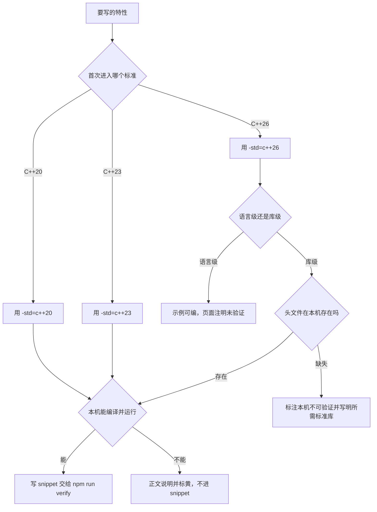
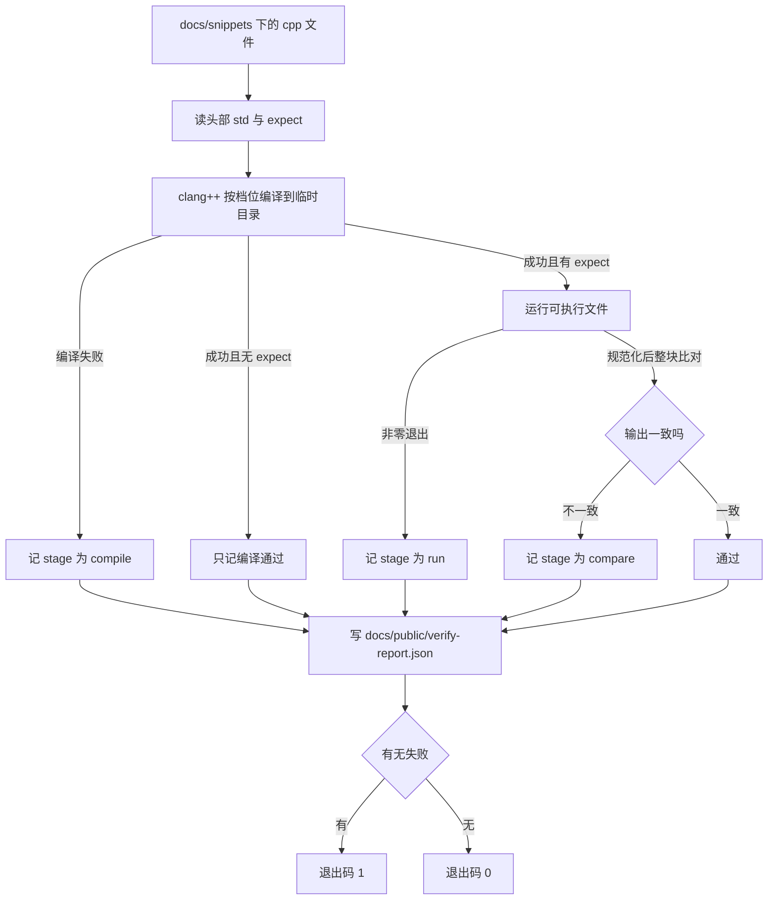

# 本机工具链与标准选择

本站每个特性卡片上都有一个"本机可验证 / 本机不可验证"的标记。那不是编辑时的感觉，而是由一台具体机器上的一套具体版本决定的：编译器 clang 23.1.4、标准库 libc++ 23、验证脚本 `npm run verify`。

所以这一页不讲"如何安装编译器"，而是把底牌摊开：这台机器能编译什么、能运行什么、缺哪些头文件，以及为什么有些 C++26 页面只能读、不能亲手跑。

## 为什么先看工具链

现代 C++ 的坑有一半不在语言里，而在"你的标准库到哪一步了"。同一个 `-std=c++23`，在 libc++ 23 上 `std::expected` 能用、`std::generator` 不能用；换一个标准库，结论可能正好相反。离开版本谈"支持情况"是空话。

这也是本站存在的前提：learncpp 停在了现代 C++ 的门口，而门后每一样东西的可用性都取决于工具链。为什么只做"补齐"而不是重写一遍基础，见 [为什么需要 LearnC++ Plus](/guide/why)；每个特性的逐条支持状态，集中在 [编译器支持矩阵](/reference/compiler-support)。

## 实测环境

| 组件 | 版本 | 说明 |
| --- | --- | --- |
| Node | v24.22.1 | VitePress 的运行时，`npm run verify` 也跑在它上面 |
| VitePress | 1.6.4 | 站点构建，开启 `cleanUrls`，所以内部链接不带 `.html` |
| Pele | 1.13.0 | 图由 Pele 在客户端渲染，不使用 mermaid.js |
| clang | 23.1.4 | MSYS2 `CLANG64` 环境，target 为 `x86_64-w64-windows-gnu` |
| libc++ | 23 | CLANG64 默认标准库，不是 libstdc++；版本宏 `_LIBCPP_VERSION` 为 `230104` |

本机**没有 `cl.exe`**。所以本站所有命令、所有截图文字、所有"你可以自己试一下"的提示，统一使用 `clang++`。看到 `cl /std:c++latest` 之类的写法，那是别的机器的经验，照抄到这里的 PowerShell 里只会得到 "无法将 cl 项识别为 cmdlet"。

复核这几行版本信息：

```powershell
node -v
npm ls vitepress pele
clang++ --version
```

（别用 `npx vitepress --version`：它不认这个参数，会直接把 dev server 拉起来。）

`clang++ --version` 的第二行 `Target: x86_64-w64-windows-gnu` 值得留意：它决定了链接的是 MinGW 风格的运行库，也决定了 `$env:TEMP\xxx.exe` 这种"编译到临时目录再直接执行"的流程没有任何额外步骤。

想确认标准库版本，最省事的是问 `<version>` 宏：

```cpp
#include <cstdio>
#include <version>

int main() {
  std::printf("libc++ %ld\n", static_cast<long>(_LIBCPP_VERSION));
}
```

```
libc++ 230104
```

## 三个档位：c++20、c++23、c++26

`-std=` 不是一个"越新越好"的旋钮。它同时控制两件事：编译器接受哪些语法，以及标准库头文件里哪些声明可见。后者经常被忽略——`<print>` 这个头文件在 `-std=c++20` 下也能被 `#include`，但 `std::println` 会直接报 "no member named 'println'"。头文件存在 ≠ 功能可用。

| 档位 | 语言侧要点 | libc++ 23 的库侧 | 本站怎么用 |
| --- | --- | --- | --- |
| `c++20` | concepts / `requires`、ranges、三路比较、协程、`consteval` / `constinit` | `<span>` `<ranges>` `<format>` 的核心 | 讲基础语义时的默认档位 |
| `c++23` | deducing this、多维下标 `m[i, j]`、`static operator()`、`#elifdef`、`uz` 字面量后缀 | `<expected>` `<print>` `<flat_map>` `<mdspan>`，ranges 的 `zip` / `enumerate` / `to` | 讲"日常工具"时的默认档位 |
| `c++26` | pack indexing、`= delete("reason")`、`[[assume]]`；contracts 与 reflection 未实现 | `<hive>` `<inplace_vector>` `<simd>` 缺失，`<generator>` 也缺 | 只做语言级实验，不进入 snippet 体系 |

### 选择建议

1. **用特性"首次进入标准"的最低档位讲它。** 讲 ranges 与 concepts 就写 `-std=c++20`，讲 `std::expected`、`std::print` 就写 `-std=c++23`。降档能编过，说明示例没有偷偷依赖更新的东西，读者用旧编译器的成功率会高很多。
2. **snippet 的 `// std:` 只允许 `c++20` 与 `c++23`。** 这是验证协议的一部分（下一节展开），不是风格偏好：C++26 在本机缺口太大，"跑通"这个断言撑不住。
3. **C++26 的语言特性可以写，但要标黄。** pack indexing 在本机能编过并运行，`= delete("reason")` 的报错信息也真的带上了原因；但它们没有对应的 snippet 通道，页面必须说明"示例未经过 `npm run verify`"。
4. **不要为了"显得现代"统一抬到最高档。** 一个只需要 `std::span` 的例子写成 `-std=c++26`，等于把读者的门槛从"任何 C++20 编译器"提高到"装了最新工具链"。

## 本机支持矩阵

下表是实测结果，也是各页"支持情况"表格的唯一依据。凡是标为"缺失"的，页面上就不能出现"编译并运行"的承诺。

| 设施 | 形态 | 本机状态 | 实测标记 |
| --- | --- | --- | --- |
| `print` | 头文件 | 有 | `__cpp_lib_print = 202207` |
| `format` | 头文件 | 有 | `__cpp_lib_format = 202110` |
| `expected` | 头文件 | 有 | `__cpp_lib_expected = 202211` |
| `mdspan` | 头文件 | 有 | `__cpp_lib_mdspan = 202406` |
| `flat_map` | 头文件 | 有 | `__cpp_lib_flat_map = 202511` |
| `ranges` | 头文件 | 有 | `__cpp_lib_ranges = 202406` |
| `span` | 头文件 | 有 | `__cpp_lib_span = 202002` |
| `execution` | 头文件 | 有，但内容被关掉 | 头能 include；`_LIBCPP_HAS_EXPERIMENTAL_PSTL` 未开启，`std::execution::par` 不存在，`__cpp_lib_execution` 未定义 |
| `generator` | 头文件 | **缺失** | `__cpp_lib_generator` 未定义 |
| `hive` | 头文件 | **缺失** | `__cpp_lib_hive` 未定义 |
| `inplace_vector` | 头文件 | **缺失** | `__cpp_lib_inplace_vector` 未定义 |
| `simd` | 头文件 | **缺失** | `__cpp_lib_simd` 未定义 |
| reflection | 语言 | **无实现** | `^^` 语法不认，`-freflection` 只被当成未使用参数 |
| contracts | 语言 | **不支持** | `-fcontracts` 直接报 "unknown argument"，`__cpp_contracts` 未定义 |
| deducing this | 语言 | 可用 | `__cpp_explicit_this_parameter = 202110` |
| pack indexing | 语言 | 可用 | `__cpp_pack_indexing = 202311` |
| 协程语法 | 语言 | 可用 | `__cpp_impl_coroutine = 201902` |

注意这张表里有一处很容易被误读的组合：**`generator` 是 C++23 的设施，而本机缺失**。也就是说"`c++23` 档位可用"并不等于"所有 C++23 库设施可用"。要写协程示例又不碰 `std::generator`，只能手写 `promise_type`，或者干脆换成 ranges 的惰性 view 来讲同一个想法。

自己复核这张表，用不着逐个写程序——`-fsyntax-only` 足够判断头文件存不存在：

```powershell
$headers = 'print','format','expected','mdspan','flat_map','ranges','span','execution',
           'generator','hive','inplace_vector','simd'
foreach ($h in $headers) {
  $src = Join-Path $env:TEMP "h_$h.cpp"
  "#include <$h>`nint main(){}" | Set-Content $src -Encoding ascii
  clang++ -std=c++26 -fsyntax-only $src 2>$null
  '{0,-16} {1}' -f $h, $(if ($LASTEXITCODE -eq 0) { 'OK' } else { 'MISSING' })
}
```

判断语言特性时不要用命令行退出码当依据，用 feature test macro。`-freflection` 在本机只产生一条 "argument unused during compilation" 警告，退出码甚至可能是 0——"编译器没报错"和"编译器支持"是两件事。

## 如何验证：`npm run verify` 做什么

`package.json` 里的 `verify` 指向 `scripts/verify-snippets.mjs`。它只做三件事，但这三件都必须真实发生，页面上那句"示例可编译"才有意义：

1. **编译**：递归扫描 `docs/snippets/` 下的 `.cpp`，读头部的 `// std:` 决定档位，用 `clang++ -std=<档位> -Wall -Wextra -O0 -fno-diagnostics-color` 编到 `tmp/outputs/verify/<时间戳>/`。
2. **运行**：只有头部带了 `expect` 块（且没有 `// skip-run`）的 snippet 才会被执行；可执行文件单独跑一次，30 秒超时。
3. **比对 stdout**：把 `expect` 块里每行去掉 `// ` 前缀，和程序的真实输出一起规范化（换行统一成 `\n`、行尾空白去掉、末尾空行去掉）后整块比较；不一致、或者程序非零退出，都算失败。

每一轮结束后它会打印 `PASS  <文件>  (<档位>, <毫秒>)` 或 `FAIL  <文件>  [compile|run|compare]`，并把完整结果写成 `docs/public/verify-report.json`——这份报告就是站点上"本机可验证"标记的来源。有任何一个失败，脚本以退出码 1 结束，`npm run verify` 也就整体失败。

编译失败给的是编译器诊断，比对失败给的是 `--- expected ---` 与 `--- actual ---` 两段全文（不是行号指引），所以读失败日志时先看是哪一段、差在哪一行有意义的内容。

### snippet 协议

协议本身就是一个注释头，放在文件最前面：

```cpp
// std: c++23
// expect:
// hello
// 42
// /expect

#include <print>

int main() {
  std::println("hello");
  std::println("{}", 42);
}
```

| 字段 | 取值 | 含义 |
| --- | --- | --- |
| `// std:` | `c++20` 或 `c++23` | 编译档位；省略时脚本按 `c++23` 处理 |
| `// expect:` … `// /expect` | 每行 `// ` 后接一行期望输出 | 省略则只编译不运行 |
| `// skip-run` | 标记 | 强制只编译：用于故意崩溃、需要交互或时间不确定的例子 |

几条容易被忽略的细节：

- 脚本并不会校验 `std` 的取值是否在白名单里——它只是把字符串拼进 `-std=`。所以"只允许 `c++20` / `c++23`"是**协议约束**，靠作者遵守，而不是工具兜底。写 `c++26` 大概率也能编过，但那就脱离了本文约定的可验证范围，页面上的标记也就失去意义。
- `expect` 块的内容按整块规范化后比较：行尾空格不算差异，末尾空行会被忽略，中间的空行照样算。
- stdout 只允许 ASCII。想打印中文解释就去翻注释，别放进输出——编码差异会让比对结果随终端变化。
- `std` 写"能编过的最低档位"。写高了不算错，但会误导用 C++20 的读者。

手动复核单个 snippet，等价于脚本做的前两步：

```powershell
clang++ -std=c++23 -Wall -Wextra -O0 docs/snippets/xxx.cpp -o $env:TEMP\xxx.exe
& $env:TEMP\xxx.exe
```

拿到源码之后，先看 `// std:`，再看 `expect`，再看代码——如果这段代码在别的档位才编得过，那就是页面写错了，不是读者环境有问题。

## 一张图：从特性到档位



## 验证流水线长什么样



## 陷阱与最佳实践

- **头文件存在，成员可能被标准档位裁掉。** `#include <print>` 在 `-std=c++20` 下能过，`std::println` 过不了。判断一个设施能不能讲，要看档位下的实际声明，而不是头文件名。
- **`<execution>` 是最会骗人的一个。** 头文件在、也能 include，但里面的执行策略被 `_LIBCPP_HAS_EXPERIMENTAL_PSTL` 关着：`std::execution::par` 根本不存在，`__cpp_lib_execution` 也没定义。看到"能 include"就写"支持并行算法"，是本站最容易犯的错。
- **`std::generator` 是 C++23 却不在本机。** 讲协程时不要顺手写 `std::generator<int>`，那会把一个可验证的页面变成不可验证的。手写 `promise_type` 麻烦，但它在 c++20 下就能跑；用 `views` 讲的惰性求值则完全绕开了标准库缺口。
- **多维下标是语言级，`std::flat_map` 是库级。** `m[i, j]` 在 `-std=c++20` 下报 "overloaded 'operator[]' cannot have more than one parameter before C++23"，这是语言版本不够；`std::flat_map` 在 `-std=c++20` 下报 "no member named 'flat_map' in namespace 'std'"，这是 libc++ 按 `__cplusplus` 把成员裁掉了。两者要分开归因，否则读者会去升编译器解决一个库的问题。
- **别用命令行的沉默证明支持。** `-freflection` 只给警告，`-fcontracts` 直接报未知参数——同一个"没有 reflection/contracts"的结论，两种表现。判据永远是 `__cpp_*` 宏和一段真能编过的代码。
- **`-Wall -Wextra` 保持干净。** 脚本编译期确实带着这两个开关，但警告不会让退出码非零、也不会让 `npm run verify` 失败——所以"零警告"是作者的自律，不是工具的保证。用 `#pragma` 压掉警告，等于把坑埋进读者那里。
- **当前协议只认 C++20 / C++23。** 想给 C++26 示例开绿灯，得先扩展协议（档位白名单、缺失头文件的降级策略），而不是把 `c++26` 写进 `// std:` 蒙混过关。
- **临时产物别留在仓库里。** 手动验证的产物放 `$env:TEMP`；`npm run verify` 自己的产物落在 `tmp/outputs/verify/`（已被忽略），`docs/snippets/` 里只放源码。

## 为什么 C++26 页面会标"本机不可验证"

原因有三层，缺一层都不行：

1. **语言级实现缺失。** reflection（`^^`）在本机根本没有解析器支持；contracts 没有 `-fcontracts`，也就没有 `[[pre: ...]]` 这套属性。这两样不是"标准库没跟上"，是编译器没实现。
2. **标准库缺口大。** `generator`、`hive`、`inplace_vector`、`simd` 四个头全缺，恰好覆盖了 C++23/C++26 里最想写的几样（惰性生成器、开放寻址容器、栈上定长容器、数据并行）。
3. **验证协议只定义到 `c++23`。** snippet 的 `// std:` 只有两个约定取值。即便某段 C++26 代码在本机能编过——比如 pack indexing、`= delete("reason")`、`[[assume]]`——它也不在协议覆盖的范围内，页面上不能出现"已验证"的口气。

要真正验证这些内容，需要的是：

| 缺的东西 | 需要的工具链 |
| --- | --- |
| `generator` / `hive` / `inplace_vector` / `simd` | 一个已经实现这些 paper 的标准库，加上 `-std=c++26`；以 `<version>` 里的 `__cpp_lib_*` 为准 |
| contracts | 带 `-fcontracts` 的 clang 构建，或其它已实现契约的编译器前端 |
| reflection | 已实现静态反射的编译器前端，且语法可能仍在演进 |

这张表的关键在"以 `__cpp_lib_*` 为准"这半句：标准库对 C++26 的补齐是按 paper 落地的，跟版本号不是线性关系。libc++ 23 有 `flat_map`（较新的 paper）却没有 `generator`（更早的 paper），就是活例子。查表看宏，别看到版本号就下结论。

所以本站对 C++26 的处理是分状态的：语言级设施给出可编译的示例并注明"本机未验证输出"；库级设施则在正文里讲清语义，同时把"需要什么才能自己跑"写在同一段里。想确认某个具体条目现在标的是哪种颜色，去 [编译器支持矩阵](/reference/compiler-support)。

## 小练习

1. 用 `<version>` 打印一组 `__cpp_lib_*` 宏，找出本机"有 `flat_map` 但没 `generator`"的证据，并解释为什么这两个不能互相推断。
2. 把一段 `-std=c++23` 的代码降到 `-std=c++20` 编译，记录第一条报错，判断它属于语言级还是库级。
3. 写一个只带 `// std: c++23`、没有 `expect` 的 snippet，想清楚 `npm run verify` 会对它做什么、不会做什么。
4. 针对 `std::generator` 的缺失给出两条绕法（手写 `promise_type` 与改用 ranges 惰性 view），各写一句代价。
5. 故意写一段输出中文的 snippet，预测比对结果，再解释协议为什么只允许 ASCII。

## 相关

- [编译器支持矩阵](/reference/compiler-support)
- [为什么需要 LearnC++ Plus](/guide/why)
- [C++23 的 print 与 format](/cpp23/print-format)
- [C++23 的 deducing this](/cpp23/deducing-this)
