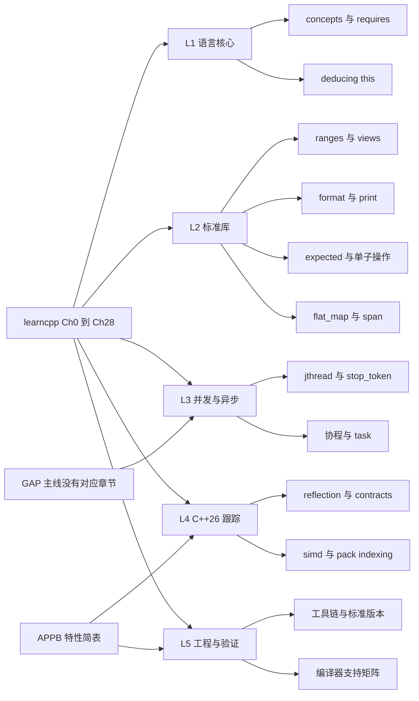
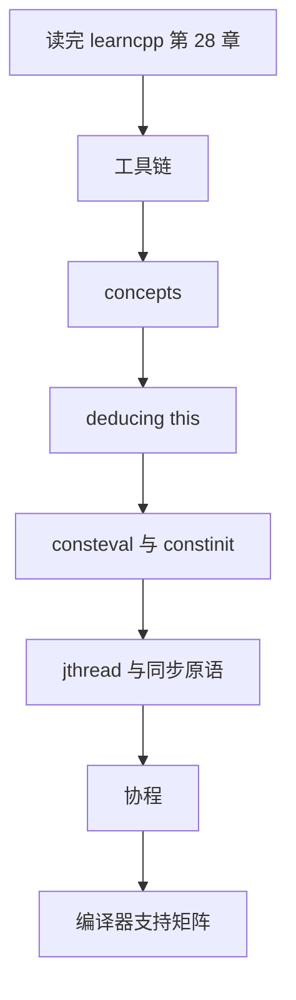
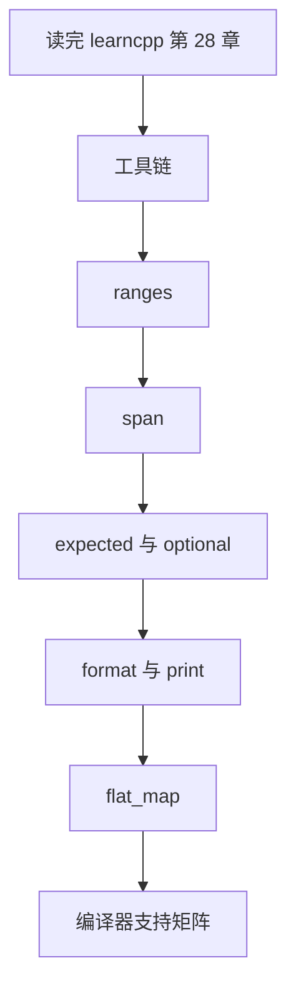

# 为什么需要 LearnC++ Plus

你已经把 learncpp 从第 0 章读到第 28 章：会写类、会写模板、知道 RAII 和 move semantics，也知道异常该怎么抛。然后你打开一份 C++20 的代码，看到 `std::ranges::sort(v)`、`requires`、`std::format`、`std::expected`，发现自己一个都不认识。

这不是你的问题。learncpp 是一条设计得很好的主线，但它确实有终点。这一页把终点之后的地图画出来：缺了什么、本站怎么补、按什么顺序读。

## learncpp 的覆盖边界

learncpp 的优点和局限是同一件事：它把"从零到能写程序"这条路修得很平，但修到某个位置就收工了。

- **主线到第 28 章**。第 28 章讲 iostream，之后没有第 29 章。并发、协程、标准库专题都没有位置。
- **第 18、19 章仍是 under construction**。迭代器与算法、动态内存这两块长期挂着"未完成"的标记，`<ranges>` 和 views 自然也不在其中。
- **Appendix B 只是 C++11–23 简介**。一页纸列出特性名加一句话解释，够你认得出，不够你写得出。
- **C++26 完全没有涉及**。语言和库的更新停在 C++23 之前，reflection、contracts 这些连名字都不会出现。

所以"读完 learncpp"不等于"会现代 C++"。它给的是地基和承重墙，装修和后续加建要另找图纸。

## 缺口表

下表按 learncpp 的章节位置列出缺口。"本站对应"一列里，已经写好的页面直接给链接，还没写的写模块名。

| learncpp 位置 | 已经讲了 | 没讲或只提到名字 | 本站对应 |
| --- | --- | --- | --- |
| Ch18 迭代器与算法 | 迭代器分类、少量 `<algorithm>` 调用 | `<ranges>`、views、管道写法、惰性求值、ranges 版算法 | [ranges 与 views](/cpp20/ranges) |
| Ch11、Ch26 模板 | 函数模板、类模板、特化、非类型模板参数 | concepts、`requires`、简写模板、constrained `auto` | [concepts 与 requires](/cpp20/concepts) |
| Ch5、附录 F | `constexpr` 变量、`constexpr` 函数、as-if 规则；F.3 初识 `consteval` | `consteval` 的限制与边界、`constinit`、`if consteval` | [consteval、constinit 与 if consteval](/cpp20/consteval) |
| 全站 | 头文件与 `#include` 模型 | modules、`import std;`、模块分区、CMake 集成 | （未写）语言核心 |
| Ch18、Ch19 之后 | 无对应章节 | 协程、`co_await`、手写 task、`<generator>` | [协程：手写一个惰性 task](/cpp20/coroutines) |
| 全站 | 无对应章节 | `std::thread` / `jthread`、`stop_token`、`latch` / `barrier` / `semaphore`、atomic 进阶 | [jthread 与 stop_token](/concurrency/jthread)、[latch / barrier / semaphore](/concurrency/sync-primitives) |
| Ch28 iostream | `std::cout`、格式化操纵符、`iomanip` | `<format>`、`<print>`、`std::format_to`、编译期格式串检查 | [std::format 与 std::print](/cpp23/print-format) |
| Ch17 array | `std::array`、C 数组、指针与退化 | `<span>`、`<mdspan>`、连续区间视图、越界检查 | [span 与 mdspan](/stdlib/span) |
| Ch27 异常 | `throw` / `try` / `catch`、异常安全、`noexcept` | `<expected>`、`optional` 的单子操作、不用异常的错误处理 | [std::expected](/cpp23/expected)、[optional 的单子操作](/cpp23/optional-monadic) |
| Ch21 运算符重载 | 成员与非成员重载、`==`、`<`、流运算符 | `<=>`、多维下标、`= delete` 带原因 | [三路比较 <=>](/cpp20/spaceship) |
| Ch15.1 this 指针、Ch26 类模板 | 隐式 `this`、成员函数重载、CRTP | 显式对象参数（deducing this）、CRTP 的替代写法 | [deducing this](/cpp23/deducing-this) |
| Appendix B | C++11–23 特性名一览 | `flat_map` / `flat_set`、`inplace_vector`、`hive`、`simd`、pack indexing | [flat_map 与 flat_set](/stdlib/flat-map) |

一句话总结这张表：**learncpp 缺的不是语法细节，而是 2020 年之后标准库和语言设施的组织方式**。你缺的是 ranges 这种"换一种写法"的东西，不是再多背几个关键字。

## 一个最小对照

缺口听起来抽象，落到代码上就是下面这样。同样是从一堆数里取出偶数并求平方，按 learncpp 第 18 章的写法，你得手动管理迭代器和中间容器：

```cpp
// 示意片段，不参与站点编译验证
std::vector<int> evens;
std::copy_if(v.begin(), v.end(), std::back_inserter(evens),
             [](int x) { return x % 2 == 0; });
std::vector<int> squares;
std::transform(evens.begin(), evens.end(), std::back_inserter(squares),
               [](int x) { return x * x; });
```

而 C++20 之后，同一件事可以写成一条管道：

```cpp
// 示意片段，不参与站点编译验证
auto squares = v
             | std::views::filter([](int x) { return x % 2 == 0; })
             | std::views::transform([](int x) { return x * x; });
```

区别不只是少写几行：第二版是惰性求值，没有中间 `vector`，也可以直接接 `std::ranges::to` 材料化。learncpp 没有讲这套东西，因为它连第 18 章都还没写完，而 ranges 恰好建立在这一章之上。[ranges 与 views](/cpp20/ranges) 就是从这里接着讲。

## 本站的五条主线

本站不重讲 learncpp 已经讲清楚的内容，只补它没讲的部分，按五条线组织：

1. **语言核心**：concepts 与 `requires`、modules、`consteval` / `constinit` / `if consteval`、deducing this、`<=>`、designated initializers、lambda 进阶。这些是写库的人和读标准库源码的人必须过的关。
2. **标准库**：ranges 与 views、`<span>` / `<mdspan>`、`<format>` / `<print>`、`<expected>` 与单子操作、`flat_map` / `inplace_vector` 这类新容器，以及 `chrono`、`filesystem`、`bit`、`source_location` 的补充。
3. **并发与异步**：`jthread` 与 `stop_token`、`latch` / `barrier` / `semaphore`、atomic 的 wait/notify、协程基础，最后才谈 execution 与 senders/receivers。
4. **C++26 跟踪**：reflection、contracts、`std::simd`、pack indexing、`#embed`。这部分本机工具链大多还验证不了，写法会明确区分"标准已定"和"实现可用"。
5. **工程与验证**：编译器支持矩阵、feature-test macro 速查、CMake 与 modules、把 learncpp 风格的项目迁到 C++23。读任何一篇之前，先看 [本机工具链与标准选择](/guide/toolchain) 把你的环境对齐。

## 从 learncpp 章节到补充模块

下面这张图把 learncpp 主线和本站五条主线（L1–L5）对应起来：左边是已经读过的地方，右边是接着要读的地方。逐章的对应关系看上面的缺口表。



图里最要紧的是 `GAP` 和 `APPB` 两个节点：前者说明并发这块在 learncpp 里根本没有入口，后者说明 C++23/26 的库在附录里只有名字。本站的大部分篇幅都花在这两条边上。

## 建议阅读顺序

先完成 [本机工具链与标准选择](/guide/toolchain)，确认你的 `clang++` 版本、标准库版本和 `-std` 选项能跑到 C++23。然后按你的痛点选一条路径，两条可以交叉读。

**路径 A：补语言。** 适合"看得懂语法但读不懂标准库源码和错误信息"的人。



- [concepts 与 requires](/cpp20/concepts)：先把约束写法吃透，后面读 ranges 的 CPO 和标准库的 `requires` 子句都靠它。
- [deducing this](/cpp23/deducing-this)：显式对象参数，也是 CRTP 的现代替代。
- [consteval、constinit 与 if consteval](/cpp20/consteval)：把"编译期算"从 `constexpr` 的"可以"变成 `consteval` 的"必须"。
- [jthread 与 stop_token](/concurrency/jthread) 与 [latch / barrier / semaphore](/concurrency/sync-primitives)：从会自己收尾的线程起步，不要一上来就啃 senders/receivers。
- [协程：手写一个惰性 task](/cpp20/coroutines)：先手写一个 task，才知道调度器到底在替你做什么。

**路径 B：补标准库。** 适合"会写类但一写业务就手写循环"的人。



- [ranges 与 views](/cpp20/ranges)：从 `views::filter` / `views::transform` 的管道写法开始，再回头对照 Ch18 的手写循环。
- [span 与 mdspan](/stdlib/span)：Ch17 的数组与指针之后最自然的下一步，先解决"传数组不退化"。
- [std::expected](/cpp23/expected) 与 [optional 的单子操作](/cpp23/optional-monadic)：Ch27 的异常讲完之后，看两种不抛异常的错误处理风格。
- [std::format 与 std::print](/cpp23/print-format)：替掉 `iomanip` 那套状态机式格式化。
- [flat_map 与 flat_set](/stdlib/flat-map)：`std::map` 用久了，看看把节点压回连续内存换来什么。
- 最后用 [编译器支持矩阵](/reference/compiler-support) 核对每个特性在你的工具链上到底能不能用。

## 本站的内容原则

学新标准最怕遇到"看起来能跑"的示例。本站用三条规则约束自己：

1. **示例可编译**。完整示例都放在 `docs/snippets/` 下，由 `clang++` 实际编译、运行并比对 stdout，页面只引入验证过的那份文件。讲思路的片段会明确标成示意，不冒充已验证代码。
2. **版本标注**。每篇都会写明需要的 `-std`、编译器版本和标准库版本；不确定的地方写明"需要 clang 某版本以上"，而不是含糊地说"较新编译器支持"。
3. **不伪造验证结果**。本机编译不了的内容（例如 reflection、`<simd>`）会标成"本机不可验证"，写清缺的是头文件还是编译器特性，并给出可以自己复现的检查方式，绝不放一段没跑过的输出来充数。支持情况统一在 [编译器支持矩阵](/reference/compiler-support) 汇总。

## 编译器支持

本站的"支持 / 不支持"不是凭印象写的，而是在真实的工具链上跑出来的。当前验证环境是 clang 23 + libc++ 23（`_LIBCPP_VERSION 230104`），`-std=c++20 / c++23 / c++26` 都能接受；`<ranges>`、concepts、`<expected>`、`<format>` 可以编译并运行，而 `<generator>`、`<hive>`、`<inplace_vector>`、`<simd>` 缺头文件，reflection 和 contracts 缺编译器实现。

这些差异逐项列在 [编译器支持矩阵](/reference/compiler-support)，环境怎么装、标准版本怎么切见 [本机工具链与标准选择](/guide/toolchain)。你的编译器版本很可能和本站不同，所以页面上的标注只是参照，最终以你自己跑出来的结果为准。

## 小练习

不用写代码，先做三件事：

1. 打开 learncpp 的目录页，从 Ch0 到 Ch28 快速扫一遍，标出你"读过但没在实际项目里用过"的章节。这些章节对应的缺口，就是你的第一优先级。
2. 在本机跑一次 `"#include <version>" | clang++ -std=c++23 -dM -E -x c++ - | rg "__cpp_lib_(ranges|expected|format)"`，看这三个宏有没有定义。没有定义的那些，说明你的标准库还没跟上，先去 [本机工具链与标准选择](/guide/toolchain) 对齐环境。
3. 按路径 A 或路径 B 挑第一篇开始读，读完回来对一下缺口表：那张表里还有没有你没意识到的空白。
