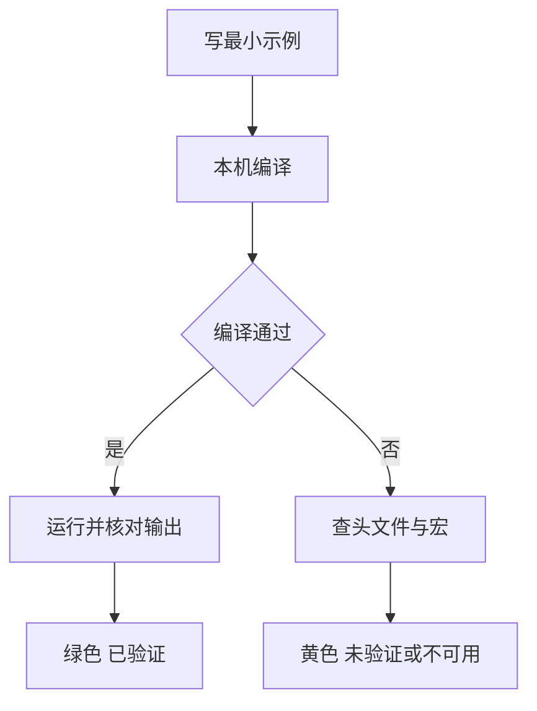

# 编译器支持矩阵

这是一张长期维护的速查表：写代码之前先在这里查一眼，比踩了编译错误再回头翻 cppreference 快得多。

所有状态都是在本机真实执行 `clang++` 得到的结果，不是抄来的表格。复核日期：2026-11-05。

## 本机指纹

```text
clang version 23.1.4 (msys2)
Target: x86_64-w64-windows-gnu
InstalledDir: D:/msys64/clang64/bin
标准库: libc++ 23（D:/msys64/clang64/include/c++/v1）
```

`__cplusplus` 的取值：C++20 模式 `202002L`，C++23 模式 `202302L`，C++26 模式 `202400L`。

工具链本身的安装与切换看 [本机工具链与标准选择](/guide/toolchain)；如果查表时想顺手复习语言特性，ranges 见 [ranges 与 views](/cpp20/ranges)，`<expected>` 见 [std::expected](/cpp23/expected)，`<span>` 见 [span 与 mdspan](/stdlib/span)，协程见 [协程：手写一个惰性 task](/cpp20/coroutines)。

## 状态标记

本页只用四种状态，含义固定：

| 标记 | 含义 |
| --- | --- |
| `✅ 已验证` | 本机写了最小示例，编译通过并且程序跑出了预期的输出 |
| `✅ 头文件可用` | `__has_include` 为真，头文件存在，但没有逐项验证每个 API |
| `⚠️ 未验证` | 存在但本机没有实际验证，或者受编译选项、平台限制没跑通 |
| `❌ 本机不可用` | 头文件缺失、宏未定义，或语言特性直接编译失败 |

一张图说清这张表是怎么得出的：



## 怎么读一行

以 `<expected>` 这一行为例：

```text
| <expected> | <expected> | __cpp_lib_expected = 202211 | ✅ 已验证 | and_then/transform/or_else 齐全 |
```

从左往右读四件事：要写哪个头、用哪个宏做 `#if` 判断、本机到底行不行、有没有坑。想动手复核就照着这一行写代码：

```cpp
#include <expected>
#include <string>

std::expected<int, std::string> parse(bool ok) {
  if (!ok) return std::unexpected("bad input");
  return 7;
}

int main() {
  auto r = parse(true).transform([](int v) { return v * 2; });
  return r.value_or(-1) == 14 ? 0 : 1;
}
```

这段是说明性片段，不作为本站的已验证示例；`<expected>` 的完整讲解见 [std::expected](/cpp23/expected)。

## C++20

| 特性 | 头文件/关键字 | feature-test macro | 本机状态 | 备注 |
| --- | --- | --- | --- | --- |
| concepts | `<concepts>` / `concept` `requires` | `__cpp_concepts` = `202002` | ✅ 已验证 | 约束、`requires` 表达式、简写形式都可用 |
| ranges | `<ranges>` | `__cpp_lib_ranges` = `202110`（C++20 模式） | ✅ 已验证 | `filter`/`transform`/`views::iota` 正常；C++23 模式升到 `202406` |
| `<format>` | `<format>` | `__cpp_lib_format` = `202110` | ✅ 已验证 | 基本格式化可用；容器/范围格式化在 C++23 模式下也成立 |
| `<span>` | `<span>` | `__cpp_lib_span` = `202002` | ✅ 已验证 | 固定/动态 extent 均可；`at()` 只在 C++26 模式可用，静态 extent 的 span 在 libc++ 里只存指针（`sizeof` = 8） |
| 协程 | `<coroutine>` | `__cpp_impl_coroutine` = `201902`、`__cpp_lib_coroutine` = `201902` | ✅ 已验证 | 语言与 `<coroutine>` 完整；标准库只有 `coroutine_handle` / `suspend_always`，没有 `task` |
| 三路比较 | `<compare>` / `<=>` | `__cpp_impl_three_way_comparison` = `201907`、`__cpp_lib_three_way_comparison` = `201907` | ✅ 已验证 | `<=>` 与 `std::strong_ordering` 可用；语言和库是两个宏 |
| designated initializers | 语言特性 | `__cpp_designated_initializers` = `201707` | ✅ 已验证 | 必须按声明顺序、不能跳过成员 |
| `consteval` | `consteval` | `__cpp_consteval` = `202211` | ✅ 已验证 | 立即函数，非法调用直接编译错误 |
| `constinit` | `constinit` | `__cpp_constinit` = `201907` | ✅ 已验证 | 只保证静态初始化，不是 `const` |
| `if consteval` | `if consteval` | `__cpp_if_consteval` = `202106` | ✅ 已验证 | 严格说是 C++23 特性；C++20 模式下 clang 会报 `-Wc++23-extensions` |
| jthread | `<thread>` / `std::jthread` | `__cpp_lib_jthread` = `201911` | ✅ 已验证 | 析构自动 join，`stop_token` 可用 |
| latch / barrier / semaphore | `<latch>` `<barrier>` `<semaphore>` | `__cpp_lib_latch` `__cpp_lib_barrier` `__cpp_lib_semaphore` = `201907` | ✅ 已验证 | `std::counting_semaphore<>` 与 `std::barrier<>` 都能实例化 |
| `source_location` | `<source_location>` | `__cpp_lib_source_location` = `201907` | ✅ 已验证 | `std::source_location::current()` 在 `consteval` 里取行号正常 |
| `bit_cast` | `<bit>` | `__cpp_lib_bit_cast` = `201806` | ✅ 已验证 | 要求 `sizeof` 相等、目标可平凡复制 |

C++20 这一组在本机是完整的，写示例基本不会卡在编译器上。

## C++23

| 特性 | 头文件/关键字 | feature-test macro | 本机状态 | 备注 |
| --- | --- | --- | --- | --- |
| `<print>` | `<print>` | `__cpp_lib_print` = `202207` | ✅ 已验证 | `std::println("{}", x)` 正常输出到 stdout |
| `<expected>` | `<expected>` | `__cpp_lib_expected` = `202211` | ✅ 已验证 | `and_then`/`transform`/`or_else` 单子操作齐全 |
| `<mdspan>` | `<mdspan>` | `__cpp_lib_mdspan` = `202207`（C++23）/ `202406`（C++26） | ✅ 已验证 | `m[i, j]` 多维下标可用；取底层指针用 `data_handle()`，没有 `data()`；`submdspan` 连 C++26 模式也没有 |
| `optional` 单子操作 | `<optional>` | `__cpp_lib_optional` = `202110`（C++23） | ✅ 已验证 | `and_then` / `transform` / `or_else` 齐全，但 libc++ 的 `or_else` 只有 `const&` 与 `&&` 重载，非 const 左值 + move-only 类型会匹配失败 |
| `<flat_map>` | `<flat_map>` | `__cpp_lib_flat_map` = `202511`、`__cpp_lib_flat_set` = `202511` | ✅ 已验证 | 宏值是 C++26 修订号，但 C++23 模式即可使用；`extract` / `replace` / `keys` / `values` 都在，`nth()` 不存在（C++26 模式也没有） |
| `<generator>` | `<generator>` | 无（`__cpp_lib_generator` 未定义） | ❌ 本机不可用 | 头文件不存在；先自己写 coroutine generator，或用 `views::iota` + `take` 顶替 |
| deducing this | `this Self&&` | `__cpp_explicit_this_parameter` = `202110` | ✅ 已验证 | 显式对象参数，`template<class Self> void f(this Self&&)` 可用 |
| 多维下标 | `operator[](a, b)` | `__cpp_multidimensional_subscript` = `202211` | ✅ 已验证 | 自定义类也能声明多参数 `operator[]` |
| `views::chunk` | `<ranges>` | `__cpp_lib_ranges_chunk` 未定义 | ❌ 本机不可用 | `std::views::chunk` 不存在；用 `views::chunk_by` 或 `views::stride` 手工切 |
| `views::zip` | `<ranges>` | `__cpp_lib_ranges_zip` = `202110` | ✅ 已验证 | `views::zip` 与结构化绑定配合正常 |
| `views::join_with` | `<ranges>` | `__cpp_lib_ranges_join_with` = `202202` | ✅ 已验证 | 分隔符必须是 range，传 `char` 会推导失败 |
| `ranges::to` | `<ranges>` | `__cpp_lib_ranges_to_container` = `202202` | ✅ 已验证 | `v \| std::ranges::to<std::vector>()` 可用 |
| `move_only_function` | `<functional>` | `__cpp_lib_move_only_function` 未定义 | ❌ 本机不可用 | 头文件里定义被注释掉；用 `std::function` 包 `shared_ptr`，或自己写类型擦除 |
| `stacktrace` | `<stacktrace>` | `__cpp_lib_stacktrace` 未定义 | ❌ 本机不可用 | 头文件不存在；需要回溯就用 `cpptrace` 一类的第三方库 |
| `to_underlying` | `<utility>` | `__cpp_lib_to_underlying` = `202102` | ✅ 已验证 | 注意返回的是底层整型，`std::byte` 会按整数打印 |
| `unreachable` | `<utility>` | `__cpp_lib_unreachable` = `202202` | ✅ 已验证 | 走到即 UB，只用来给优化器承诺 |
| `byteswap` | `<bit>` | `__cpp_lib_byteswap` = `202110` | ✅ 已验证 | 默认字节序，不做条件交换 |

本机这一组是“大部分有、少数硬缺”。缺的四个（`<generator>`、`views::chunk`、`move_only_function`、`<stacktrace>`）都是 libc++ 23 明确没实现的，不是编译选项问题——`<version>` 里对应的宏整行被注释掉了。

顺带记录两个同样缺失、但不在必查清单里的东西：`std::ranges::starts_with` 和 `std::copyable_function` 都没有，别写出依赖它们的示例。

## C++26

| 特性 | 头文件/关键字 | feature-test macro | 本机状态 | 备注 |
| --- | --- | --- | --- | --- |
| reflection | `^^` / `<meta>` | 无（`__cpp_reflection` 未定义） | ❌ 本机不可用 | clang 23.1.4 没有 `-freflection` 选项，`<meta>` 头文件也不存在 |
| contracts | `[[pre: ...]]` `[[post: ...]]` `contract_assert` | 无（`__cpp_contracts` 未定义） | ❌ 本机不可用 | 会被当成普通 attribute 解析，直接报 `expected ','`；也没有 `-fcontracts` |
| `<simd>` | `<simd>` | 无（`__cpp_lib_simd` 未定义） | ❌ 本机不可用 | 本机无头文件，靠 `std::experimental::simd` 或手写 intrinsics |
| `<hive>` | `<hive>` | 无（`__cpp_lib_hive` 未定义） | ❌ 本机不可用 | 本机无头文件，需要稳定地址容器就用 `std::deque` + 空闲链表自己管 |
| `<inplace_vector>` | `<inplace_vector>` | 无（`__cpp_lib_inplace_vector` 未定义） | ❌ 本机不可用 | 本机无头文件，替代品是 `std::array` + 手动 size 或 `boost::static_vector` |
| pack indexing | `ts...[i]` | `__cpp_pack_indexing` = `202311` | ✅ 已验证 | 参数包直接下标，`ts...[2]` 能取到第三个实参 |
| `#embed` | `#embed` | 无宏；`__has_embed` 可用 | ✅ 已验证 | 能嵌入二进制并逐字节读出；clang 仍报 `-Wc23-extensions` 警告，说明按扩展实现 |
| senders / receivers | `<execution>` / `std::execution` | 无（`__cpp_lib_senders` 未定义） | ❌ 本机不可用 | `<execution>` 里只有 C++17 的并行策略，没有 P2300 的 `sender`/`receiver`/`schedule` |

需要特别记住的一句话：

> `<generator>`、`<hive>`、`<inplace_vector>`、`<simd>` 在本机没有头文件；reflection 与 contracts 在本机不支持。

C++26 在本机基本处于“语言特性零散可用、标准库大面积缺席”的状态：表里 C++26 有 8 行，其中 6 行是本机不可用。除了 pack indexing 和 `#embed`，其余都要等工具链升级；别在文档里写“C++26 已支持”，会误导读者。

## 怎么自己确认

表格会过期，命令不会。以下命令都在 PowerShell 里跑（工作目录任意）。

**第一步：看语言特性宏。** 这一步只给编译器内置宏，`__cpp_lib_*` 一个都不会出现：

```powershell
clang++ -std=c++26 -dM -E -x c++ NUL | Select-String __cpp_
```

**第二步：看标准库宏。** 必须把 `<version>` 一起预处理进去，否则什么也搜不到：

```powershell
# C++26 语言宏 + 库宏一起看
clang++ -std=c++26 -dM -E -include version -x c++ NUL | Select-String __cpp_lib_

# 只关心某几个，比如 print / expected
clang++ -std=c++23 -dM -E -include version -x c++ NUL | Select-String "__cpp_lib_print|__cpp_lib_expected"
```

**第三步：头文件到底在不在。** 检查 `#include` 能否解析，`-E` 只预处理、不链接，最快：

```powershell
'#include <print>'   | clang++ -std=c++23 -E -x c++ -   # 存在：退出码 0
'#include <generator>' | clang++ -std=c++23 -E -x c++ - # 缺失：退出码 1
```

判断依据是退出码和 `fatal error`：存在时输出里只有一堆 `# 1 "<stdin>"` 行标记；缺失时打印 `<stdin>:1:10: fatal error: 'generator' file not found`。想少看噪音就接 `Select-String "fatal"`。（`-` 表示从标准输入读；`<<<` 是 bash 的 here-string，PowerShell 里用管道或 `Get-Content`。）

**第四步：写 `__has_include` 探测程序。** 一次问一批头文件，顺便验证运行环境：

```powershell
@'
#include <cstdio>
int main() {
#if __has_include(<generator>)
  std::puts("generator: yes");
#else
  std::puts("generator: no");
#endif
#if __has_include(<hive>)
  std::puts("hive: yes");
#else
  std::puts("hive: no");
#endif
}
'@ | clang++ -std=c++23 -x c++ - -o $env:TEMP\hasinc.exe
& $env:TEMP\hasinc.exe
```

本机输出：

```text
generator: no
hive: no
```

**第五步：真正编译一次。** 前四步只能回答“有没有”，不能回答“能不能用、行为对不对”。最终以实际编译 + 运行结果为准：

```powershell
clang++ -std=c++23 -Wall -Wextra -O0 demo.cpp -o $env:TEMP\demo.exe
& $env:TEMP\demo.exe
```

## 陷阱：宏存在不等于实现完整

这是这张表最容易被误读的地方，单独说清楚：

- **`__cpp_lib_ranges` = `202406` 不代表 ranges 全齐。** 本机 `views::chunk`、`views::slide`、`views::concat`、`views::cartesian_product` 全都编译不过，宏却照样报到 C++26 的修订号。聚合宏值大，只说明主体框架新。
- **宏被注释掉才是死刑。** 打开 `<version>` 能看到 `__cpp_lib_move_only_function`、`__cpp_lib_ranges_chunk`、`__cpp_lib_stacktrace` 这三行是 `// # define ...`，libc++ 用注释明确表示“未实现”。看到 `#ifdef` 为假，就不用再试了。
- **语言宏和库宏是两套东西。** `__cpp_pack_indexing` 有值只能说明编译器认得语法，不代表 `<ranges>` 之类配套库跟上了。
- **`__cplusplus` 只到 `202400L`。** 别用 `>= 202600L` 判断“是不是 C++26”，会永远为假。
- **`__has_include` 为真不等于能用。** 头文件可能只提供前置声明，或者相关 API 被 `_LIBCPP_STD_VER` 挡住。
- **C++20 模式下的 C++23 语法会“半通”。** 比如 `if consteval` 能编译，但 clang 给出 `-Wc++23-extensions` 警告；加上 `-Werror` 就会失败。跨模式写示例时把这条记牢。
- **“有这个 API”和“API 完整”是两件事。** 本机 `optional::or_else` 少了 `&` 与 `const&&` 重载，`span::at` 只在 C++26 模式出现，`mdspan` 只有 `data_handle()` 没有 `data()`。查到功能存在之后，还要按你实际要用的重载再编一次。

判断顺序建议固定成：**头文件在不在 → 宏有没有 → 最小示例能不能编译 → 跑出来的输出对不对**。四步都过了才标 `✅ 已验证`，只过前三步就标 `✅ 头文件可用`。

## 小练习

1. 用上面第二步的命令，把本机 `__cpp_lib_*` 全部导出，找出三个宏值最高（年份最新）的库特性，逐个写最小示例验证，看看有几个真能用。
2. 写一个程序，用 `__has_include` 同时探测 `<flat_map>`、`<print>`、`<generator>`，并按结果选择不同的实现路径（比如没有 `<generator>` 时退回手写迭代器）。
3. 把 `views::chunk` 的缺失绕过去：用 `views::chunk_by` 或 `views::stride` 实现“每 N 个元素一组”，写完后对照 [ranges 与 views](/cpp20/ranges) 里 view 的组合规则，确认没有多算一次遍历。
4. 用 `__cpp_lib_expected` 做条件编译，写一份在“有 `<expected>`”和“没有 `<expected>`”两种环境下都能编译的错误处理代码，后者退回 `std::optional` + 错误码。
5. 给这张表补两行你实际踩到坑的特性，写清宏值、报错原文和绕开方式——速查表的价值就在这些细节里。
