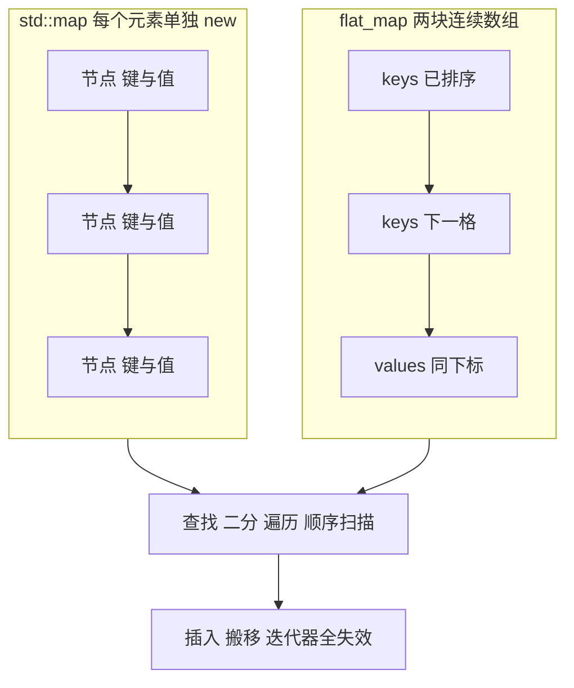

# flat_map 与 flat_set：把有序容器压平成数组

`std::flat_map` 和 `std::flat_set` 是 C++23 加进标准的有序关联容器。它们满足和 `std::map` / `std::set` 相同的语义契约——按键有序、键唯一、`find` 走二分——但底层不是红黑树，而是两块排好序的连续数组。

这次交换可以一句话概括：用 `O(n)` 的插入和更严格的失效规则，换掉每个元素的独立分配和遍历时的指针追逐。

这一页分三块：这笔交换到底换掉了什么（动机）、接口和不变量怎么落地（机制与语义）、从 `map` 迁过来会在哪儿坏（常见坑）。第三块最难，因为失败往往发生在运行期而不是编译期，所以篇幅也最长。

## 动机

这一节算一笔账：`map` 的优势和代价都来自节点。先看节点带来什么，再看 `flat_map` 拿什么换。

`std::map` 通常实现成一棵红黑树。为了保证插入 `O(log n)` 且迭代器永远稳定，它必须为每一个元素单独分配一个节点（这是实现层面的选择，标准只要求有序关联容器的接口与复杂度）：

```cpp
// 说明性片段：两者在内存里的形态差别，不是完整程序
std::map<int, Item> tree;        // 每个元素一个节点：左/右/父指针 + 颜色 + 键 + 值
std::flat_map<int, Item> flat;   // 内部是 vector<int> keys 和 vector<Item> values
```

节点分散在堆上，带来两个代价：

1. **遍历是随机跳转。** `++it` 不是 `ptr += sizeof(node)`，而是读当前节点的指针、跳到另一块内存。每个元素都可能是一次 cache miss，而预取器几乎帮不上忙。
2. **每个元素的固定开销大。** 64 位平台上，一个 `map` 节点至少 3 个指针加颜色位，典型 32 字节起步，外加分配器的对齐和簿记；`flat_map` 的每元素开销只有两块数组的容量余量（`vector` 的 1.5~2 倍扩容）。

`unordered_map` 解决了查找常数项，却仍然是"桶数组 + 节点"的混合体：每个元素照旧一次分配，遍历顺序还不可预期。

`flat_map` 换一个做法：把键和值分别塞进两个 `vector`，始终保持按键升序且无重复。于是在同一块内存上同时得到两件事——遍历是顺序扫描，查找是对着连续内存做二分。对"构建一次、查询很多次"的表尤其合算；代价集中在插入上，后面「查找是二分，插入是搬移」一节算这笔账。

## 最小示例

先跑一遍，把七段输出和七个 API 对上号，再读源码。

下面这个程序把常用操作按主题分开演示：排序遍历、`find`、`try_emplace` 的不覆盖语义、`operator[]` 的读写、`erase` 的两个重载、批量构建，以及 `flat_set` 的去重。

<<< @/snippets/stdlib/flat-map.cpp

编译并运行（本机 clang 23.1.4 + libc++ 23，`-std=c++23`，`-Wall -Wextra` 无警告）：

```powershell
clang++ -std=c++23 -Wall -Wextra -O0 -fno-diagnostics-color docs/snippets/stdlib/flat-map.cpp -o $env:TEMP\flat-map.exe
```

输出对应七个段落，按输出顺序读比按源码读快：

1. `[1]` 插入顺序是 pear、apple、kiwi……，但遍历出来是 `apple, banana, cherry, date, kiwi, pear`。顺序由排序决定，与插入顺序无关，这一点和 `map` 一致。
2. `[2]` `find` 命中返回迭代器，未命中返回 `end()`。别忘了 `find` 是 `O(log n)` 而不是 `O(1)`——它不是哈希表。
3. `[3]` `try_emplace("apple", 999)` 返回 `{迭代器, false}`，值仍是 `3`。想覆盖请用 `insert_or_assign` 或 `operator[]`。
4. `[4]` `operator[]` 对已存在的键只写值，对新键则插入——插入会重排后面的元素，这一点在"常见坑"里还会提。
5. `[5]` `erase("date")` 按键删除，返回删掉的个数；`erase(begin())` 按迭代器删除，返回下一个位置的迭代器。两者返回值类型不同。
6. `[6]` 把 `vector<pair>` 先排序去重，再用 `std::sorted_unique` 一次性构造；随后的"不给标签"版本会自己排序去重，结果与逐条插入一致。
7. `[7]` `flat_set` 插入时自动去重，遍历即升序。

页内其余代码块都是说明性片段，只有上面这份文件经过 `npm run verify` 的编译与输出比对。

## 机制与语义

这一节拆五块：存储模型、批量接口、查找与插入、复杂度、失效规则。前两块讲接口，后三块讲代价。

### 存储模型：两块并行数组

标准把 `flat_map` 定义为容器适配器（和 `stack`、`queue` 同一类东西），它不拥有自己的节点，而是适配两个序列容器：

```cpp
template<class Key, class T, class Compare = std::less<Key>,
         class KeyContainer = std::vector<Key>,
         class MappedContainer = std::vector<T>>
class flat_map;
```

适配两个容器这个决定，改写了四个类型事实：

| 名字 | `std::map` | `std::flat_map` |
| --- | --- | --- |
| `value_type` | `std::pair<const Key, T>` | `std::pair<Key, T>`（**没有** `const`） |
| `reference` | `value_type&` | `std::pair<const Key&, T&>`（代理） |
| `key_container_type` | 无 | `KeyContainer`，默认 `std::vector<Key>` |
| 迭代器类别 | 双向 | 随机访问（libc++ 实现为代理迭代器） |

`reference` 是代理而不是真正的 `pair` 引用，这解释了两件看起来很怪的事：

- `for (auto& [k, v] : flat_map)` **编译不过**，因为 `auto&` 要绑定一个左值引用，而解引用迭代器给你的是临时 `pair<const Key&, T&>`。写 `for (const auto& [k, v] : m)` 或 `for (auto&& [k, v] : m)`。
- 迭代器不是连续迭代器。`it->first` 是 `const Key&` 的代理：当可写的 `Key*` 用不行（键是 const），当只读指针用可以，但一次插入就可能失效。真正连续的是 `keys()` 返回的那个容器。

### `keys()` / `values()` / `extract()` / `replace()`

这四个成员分两组：`keys()` / `values()` 是只读的窗口，`extract()` / `replace()` 是整块存储的进出。它们既是"适配器"身份的体现，也是 `flat_map` 最好用、最容易被忽略的部分：

```cpp
const auto& ks = m.keys();      // const KeyContainer&，升序且与 values 同下标
const auto& vs = m.values();    // const MappedContainer&，只能读
auto cs = std::move(m).extract();  // 交出 {keys, values} 两块容器，m 被掏空
m2.replace(std::move(cs.keys), std::move(cs.values));  // 直接换掉整块存储
```

注意 `extract()` 是 **rvalue 限定**的，必须先 `std::move`。它和 `map::extract(key)` 完全是两回事——后者返回的是节点句柄，`flat_map` 没有节点，所以也没有按 key 的 `extract`。

因为 `keys()` / `values()` 只给 `const` 引用，你没法绕过排序不变量去改键。想整体替换存储，只能走 `replace()`，由容器重新校验。

### 查找是二分，插入是搬移

这一节把两件事放在一起讲，因为它们的代价来自同一个设计：数据躺在连续数组里，位置就是下标。先看图，再看查找为什么便宜、插入为什么贵。



`find` / `count` / `contains`、以及 `lower_bound` / `upper_bound` / `equal_range`，全部是对 `keys()` 做的二分查找：比较次数 `O(log n)`，但每次比较都落在同一两条 cache line 附近，常数项远小于沿树下行。

插入则是"先二分定位，再把后面所有元素整体右移一格"：

- 挪动的是**真实的键和值**，不是指针。`flat_map<int, BigObject>` 中间插入一次，就要移动一串 `BigObject`，代价被移动成本放大。
- 挪到末尾时不需要移动任何元素，这和 `vector::push_back` 一样便宜；所以**按升序追加**（新键总是落在末尾）是最廉价的插入模式，配合指向 `end()` 的正确 hint 效果最好。反过来说，按降序插入会让每次插入都落在开头，`O(n)` 一次都跑不掉。
- `flat_map` **没有 `capacity()` / `reserve()`**。想预留容量，就自己造两个 `vector`、留好容量、填好内容，再 `replace()` 或直接用 `sorted_unique` 构造。

### 复杂度对照

先把三种容器的代价并排放好，再说这张表该怎么读。

| 操作 | `flat_map` | `map` | `unordered_map` |
| --- | --- | --- | --- |
| `find` / `count` / `contains` | `O(log n)`，缓存友好 | `O(log n)` | 平均 `O(1)` |
| 单次 `insert` | `O(n)`（搬移） | `O(log n)` | 平均 `O(1)` |
| 批量 / 区间插入 | `O(n log n)`（排序）或 `O(n)`（已有序） | `O(n log n)` | 平均 `O(n)` |
| `erase(key)` | `O(n)` | 摊还 `O(log n)` | 平均 `O(1)` |
| 遍历 | `O(n)`，顺序内存 | `O(n)`，指针追逐 | `O(n)`，桶加节点 |
| 每元素额外开销 | 接近 0（只有容量余量） | 3 指针 + 颜色位 | 节点 + 桶 + 哈希缓存 |
| 迭代器类别 | 随机访问 | 双向 | 前向 |
| 插入后迭代器 / 引用 | **可能全部失效** | 稳定 | 引用稳定，迭代器可能因 rehash 失效 |

复杂度只看渐进阶会得出"永远用 `map`"的错误结论。实际常数差别很大：几千个以内、读多写少时，`flat_map` 的 `O(log n)` 通常跑赢 `map` 的 `O(log n)`，因为前者是内存带宽受限、后者是指针跳转受限。唯一诚实的判断方式是**用你自己的数据量测一次**。

### 迭代器与引用失效规则

这是从 `map` 迁过来最容易踩的地方，也是整页最难的一块：难在规则不由操作本身决定，而是取决于运行期是否触发扩容。`map` 的插入从不让任何迭代器失效，`flat_map` 恰恰相反：

| 操作 | 受影响范围 |
| --- | --- |
| `insert` / `emplace` / `try_emplace` / `operator[]`（键不存在） | 插入点**及之后**的迭代器和引用失效；若触发扩容，**全部**失效 |
| `replace` / `extract` | 全部失效 |
| `erase(key)` / `erase(it)` | 被删元素**之后**的迭代器和引用失效 |
| `operator[]` 命中已存在的键 | 不失效 |

保守写法：**任何时候调用了插入，把之前拿到的一切迭代器、指针、引用都当成作废。** 想跨插入持有元素，就存 key 本身，插入后再 `find` 一次。

## 常见坑

八条坑按来源分三组：1、2 是失效规则的具体形态，3、4、5 是接口语义容易记错的地方，6、7、8 是构建、选型和错误处理上的判断。

**1. `operator[]` 插入会重排，之前保存的引用全废。**

```cpp
int& a = m["apple"];   // 引用指向 keys[0] / values[0]
m["fig"] = 1;          // 可能扩容 + 搬移：a 现在是悬垂引用
a = 42;                // 未定义行为
```

正确的顺序是先插完、再取引用；或者每次都用 `m.at("apple")` 重新取。

**2. 保存 key 的指针，插入后继续用。** 和上一条同源：`&m.keys()[0]`、`&it->first`、`m.values().data()` 全都是**借用**，一次插入就可能全部作废。这类 bug 往往在 `-O0` 下"看起来正常"，开了优化或者换了 STL 实现就崩。

**3. `erase` 有两个重载，返回值不是同一个东西。**

```cpp
auto a = m.erase("date");    // size_type：删掉了几个（0 或 1）
auto b = m.erase(m.begin()); // iterator：被删元素的下一个位置
```

`auto n = m.erase(it); ++n;` 这样的代码能编译、能跑，但语义完全不是你想要的。写 `erase` 时明确一下自己给的是 key 还是迭代器。

**4. `flat_set` 的 key 就是 value。** `value_type == key_type`，没有 `pair`，所以 `*it` 就是元素本身。它同样是排好序的连续数组，因此**不能通过迭代器修改元素**（`iterator` 与 `const_iterator` 解引用后都不可写，改了就破坏排序）。想改元素只能先 `erase` 再 `insert`。`extract()` 在 `flat_set` 上直接返回那个 `key_container_type`。

**5. `sorted_unique` 是承诺，不是请求。** 这个标签告诉容器"我给你的数据已经按 key 升序且无重复"，容器**不检查**。传进去乱序或带重复的数据，就是违反前置条件（未定义行为）：实测中容器会原样保留你给的顺序，随后所有 `find` / `lower_bound` 的结果都不可信。用之前一定先 `sort` + `unique`。

**6. `value_type` 不是 `pair<const Key, T>`，两容器构造也没法直接吃 `vector<pair>`。**

```cpp
std::vector<std::pair<K, V>> rows = /* ... */;
flat_map<K, V> a(rows.begin(), rows.end());          // OK：迭代器构造，会自己排序去重
flat_map<K, V> b(std::sorted_unique, rows.begin(), rows.end()); // OK：需先排好序去重

std::vector<K> ks = /* ... */;
std::vector<V> vs = /* ... */;   // 与 ks 同序、同长度
flat_map<K, V> c(std::sorted_unique, std::move(ks), std::move(vs)); // OK：两容器
```

`sorted_unique` 加两容器的写法要求你**自己拆成 `vector<K>` 和 `vector<V>`**，这是批量构建时唯一需要注意的机械步骤。

**7. 别把重的对象塞进会频繁插入的 `flat_map`。** 移动成本直接乘进 `O(n)` 的搬移里。元素大、又要频繁插入删除，`map` 只搬指针，反而更快。想让对象地址稳定（比如别处存了指向它的指针），`flat_map` 和 `vector` 一样做不到——那正是 `map` 的强项。

**8. 查找失败别只会 `!= end()`。** `find` 返回迭代器，调用方很容易忘检查或者把 `end()` 解引用。需要把"查不到"当正常分支往上传递时，用 [std::expected](/cpp23/expected) 包一层，让失败在类型上可见。

## 编译器支持

这一节把"本机能不能用"落成可复核的记录：环境与特性宏、实测可用与缺失、跨编译器的判断。

本机实测环境：

| 项目 | 值 |
| --- | --- |
| 编译器 | clang 23.1.4（msys2 clang64） |
| 标准库 | libc++ 23（`_LIBCPP_VERSION == 230104`） |
| 标准 | `-std=c++23`（`-std=c++26` 也能编译本页代码） |
| 特性宏 | `__cpp_lib_flat_map == 202511L`、`__cpp_lib_flat_set == 202511L` |

特性宏的值比 C++23 里公布的值（`202207L`）更新，这是 libc++ 跟进后续缺陷报告的结果。写条件编译分支时用 `>= 202207L` 判断即可，不要写等号：

```cpp
#include <version>

#if defined(__cpp_lib_flat_map) && __cpp_lib_flat_map >= 202207L
    // C++23 flat_map 可用
#else
    // 退回 std::map，接口层用别名隔离
#endif
```

本机实测**可用**并已跑通：`std::flat_map` / `std::flat_set` 本体、`try_emplace`、`insert_or_assign`、`operator[]`、`find`、`contains`、`keys()`、`values()`、`extract()`（rvalue 限定）、`replace()`、`std::sorted_unique` 构造（两容器 / 迭代器区间两种）、迭代器区间构造、`std::from_range` 构造、`erase(key)` 与 `erase(iterator)` 两个重载、`flat_set` 的 `insert` / `contains` / `extract`。

本机实测**缺失**：

- `nth(pos)`——C++26 新增的"按下标访问"，在 `-std=c++26` 下依然不存在（按类型探测为假）。
- 按 key 的 `extract` 节点句柄——标准里本来就没有，`flat_map` 没有节点。
- `<hive>` 与 `<inplace_vector>`（C++26）——两个头文件在本机 `-std=c++23` 和 `-std=c++26` 下都用 `__has_include` 探测为**不存在**。

关于 C++26 的那两个容器，只做定位，本机没有头文件就不给示例。它们各自补上 `flat_map` 做不到的一件事：

- **`std::inplace_vector<T, N>`**：容量在编译期固定、元素直接存在对象内部、完全不碰堆的"vector"。它是 `flat_map` 最自然的底层容器——当上限已知（比如嵌入式、固定大小的路由表），用它替换默认的 `vector` 就能让整个映射零分配。
- **`std::hive`**：元素存在分段池里，插入删除 `O(1)` 且**元素地址稳定**，是"节点式"和"连续式"之间的折中。要同时满足"频繁插入"和"引用稳定"时它才是正确答案，`flat_map` 不行。

`libstdc++` 和 MSVC STL 的版本门槛**本机未验证**（这台机器只有 libc++）。跨编译器时一律用上面的特性宏判断，别背版本号。更细的版本矩阵见 [编译器支持矩阵](/reference/compiler-support)。

## 与 learncpp 的关系

这一节只做迁移对照：learncpp 默认成立、换到 `flat_map` 上不成立的是什么，以及要改哪几行。

learncpp 的《STL containers overview》只做了分类：序列容器、关联容器、容器适配器，并说明关联容器按 `operator<` 自动排序。它没有给实现细节，也没有 flat 版本（C++23 才加进来）；这篇文章现在已经收进附录 D，标为弃用。

真正要注意的是它没写的那部分：`map` "节点独立分配、迭代器稳定"是常见实现的默认假设，而 `flat_map` 把这两条同时推翻：

| 你从 `map` 带过来的习惯 | 在 `flat_map` 上 |
| --- | --- |
| 迭代器用完 `operator[]`、`insert` 之后还能接着用 | **不成立**：插入可能触发 `vector` 扩容，所有迭代器、指针、引用一起失效 |
| `std::map` 的接口（`operator[]`、`insert`、`erase`、`find`） | 几乎照抄就能用，只是 `value_type` 和 `reference` 变了 |
| 容器适配器（`stack` / `queue` / `priority_queue`）的概念 | `flat_map` 也是适配器，只不过适配的是**两个**容器 |
| `std::vector` 的 `O(n)` 中间插入 | 同样的代价，只是藏在了 `erase` / `insert` 后面 |
| 迭代器类别（双向 vs 随机访问） | `flat_map` 是随机访问，和 `map` 不同 |

一个实用的迁移姿势：把 `std::map` 换成 `std::flat_map` 通常**一行都不用改**，能编译过；要改的是那些依赖"迭代器永远稳定"或"元素地址不变"的地方。先用 alias 把类型抽出来，再决定哪些容器值得换：

```cpp
template<class K, class V>
using table = std::flat_map<K, V>;   // 换成 std::map<K, V> 即可回退
```

把 `keys()` 当普通连续区间用，还可以直接喂给 [span 与 mdspan](/stdlib/span) 交给 C 风格接口；把 `flat_map` 当 range 用，则可以直接接上 [ranges 与 views](/cpp20/ranges) 的 `filter` / `transform`，而且因为是顺序内存，pipeline 的效率比在 `map` 上跑高得多。

## 小练习

五道练习对应三个难点：代价量化（1）、批量构建路径（2）、失效规则（3、4、5）。

1. **量一次再下结论。** 造 100、1000、10000 三个规模，分别用 `std::map` 和 `std::flat_map` 存同样的键值，先全部插入再各做 10 万次随机 `find`，打印两边耗时。找出你这台机器上的交叉点大概在哪里。
2. **批量构建的三条路。** 用同一份 `vector<pair<string, int>>`（含重复键），分别用：迭代器构造、`sorted_unique` 加迭代器构造、拆成两个 `vector` 再加 `sorted_unique` 构造。用 `keys()` 打印三者结果，确认内容一致，并解释为什么第三种最快。
3. **故意制造悬垂引用。** 写一个函数返回 `int&` 指向 `flat_map` 里的某个值，调用方拿住之后又插入了 100 个新元素，然后通过那个引用写值。分别在 `-O0` 和 `-O2` 下运行，观察结果差异；再用 `map` 做同样的事，确认只有 `flat_map` 会坏。
4. **给 `flat_set` 加一个稳定身份。** `flat_set` 的元素不能被修改。把它换成 `std::flat_map<int, Node>`，用自增整数当 key 充当身份，`Node` 里放会被修改的字段，重写"查找 → 修改 → 再查"的流程，体会为什么很多代码宁可用 `map<int, T>` 而不是 `set<T>`。
5. **接上 `expected`。** 写 `std::expected<V, std::string> lookup(const flat_map<K, V>&, const K&)`，找不到时返回带 key 文本的错误，让调用方不需要再碰 `end()`。注意 `expected` 的 `T` 不能是引用类型，所以按值返回或返回 `const V*`。参考 [std::expected](/cpp23/expected) 的写法。
