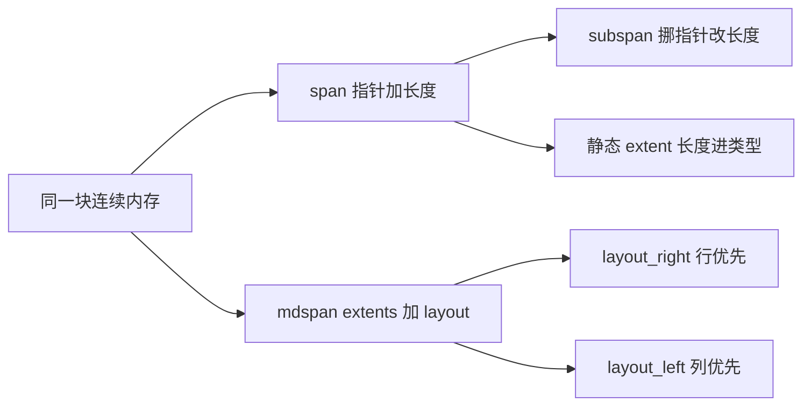
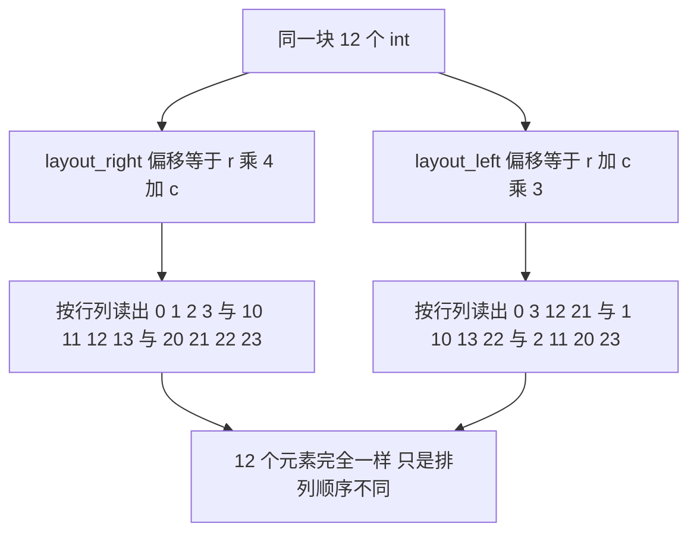

# std::span 与 std::mdspan：不拥有数据的视图

如果你想写一个函数把一段 `int` 求和，C++ 长期以来只给两个都不顺手的选项：`sum(const int* p, int n)`，或者 `sum(const std::vector<int>& v)`。前者让指针和长度各走各的，后者把函数绑死在某一个容器类型上。C++20 的 `std::span` 补上中间这层：一个指针加一个长度，谁传进来都行，**不复制、不拥有、不检查**。

C++23 的 `std::mdspan` 把同一个模型推广到多维：它还是"指针 + 形状"，只是形状变成 `extents`，并且明确写出"多维下标怎么换算成内存偏移"这件事——这就是 `layout`。

这一页讲三件事：span 到底存了什么、静态 extent 与子视图的取舍、mdspan 的 layout 为什么会改变你读到的数据。完整可编译的例子是 `docs/snippets/stdlib/span-mdspan.cpp`，下面引进来的就是它；其余代码块都是示意片段。

## 动机

先看三种传参方式的差别。它们都能把"一段 `int`"交出去，代价完全不同：

| 方式 | 函数签名 | 长度 | 容器类型 | 子区间 |
| --- | --- | --- | --- | --- |
| 指针 + 长度 | `sum(const int* p, std::size_t n)` | 单独一个参数，容易和别的 `n` 配错 | 不绑 | 需要算 `p + off` 和 `n - off` |
| 容器引用 | `sum(const std::vector<int>& v)` | 自带 | 绑死在 `vector` | 要临时构造或改成迭代器版本 |
| 模板 | `template <class C> sum(const C& c)` | 靠 `c.size()` | 不绑 | 同上，还得写约束 |
| `span` | `sum(std::span<const int> s)` | 自带 | 不绑 | `s.subspan(off, n)` |

具体三个痛点：

1. **两个参数会走散。** `sum(buf, n)` 里 `buf` 和 `n` 来自哪里，编译器完全不查。把 `n` 传成字节数、传成另一个数组的长度、传成元素个数的两倍，都能编过。C 风格接口里这类 bug 只能靠人眼和 ASan 抓。
2. **C 数组一进函数就丢长度。** 数组退化成指针是第 17 章的核心内容：`void f(int a[])` 里的 `a` 就是个 `int*`，`sizeof(a)` 是指针大小。长度只能由调用方额外传，于是回到第 1 点。
3. **容器引用把函数焊死在容器上。** `const std::vector<int>&` 收不了 `std::array`、收不了 C 数组、收不了 `vector` 的一段前缀，也收不了 `vector<short>`（即便每个元素都能转成 `int`）。为每种来源写一个重载，最后会变成一堆一行函数。

`std::span<const int>` 一个参数解决三条：长度跟着指针一起走，任何连续存储都能隐式转进来，子区间是 O(1) 的视图。

## 最小示例

<<< @/snippets/stdlib/span-mdspan.cpp

编译并运行（本机 clang 23.1.4 + libc++ 23，`-std=c++23`，零警告）：

```powershell
clang++ -std=c++23 -Wall -Wextra -O0 -fno-diagnostics-color docs/snippets/stdlib/span-mdspan.cpp -o $env:TEMP\span-mdspan.exe
```

输出分四段，每段对应代码里一个编号：

| 输出段 | 演示的内容 | 值得注意的地方 |
| --- | --- | --- |
| `one function, three sources` | 一个 `sum(std::span<const int>)` 同时收 C 数组、`std::array`、`std::vector` | 三行都是隐式转换，没有一处写容器类型 |
| `forwarding to a C api` | `fill(std::span<int>)` 转发给 `fill_c(int*, size_t)` | 长度从 `s.size()` 来，不会和指针走散 |
| `subviews` | `first` / `last` / 运行期 `subspan` / 编译期 `subspan<1, 3>` | `static 3` 与 `static 2` 两行的 span 类型里带着长度 |
| `mdspan 3x4` | 同一块 12 个 `int` 用 `layout_right` 写、用 `layout_left` 读 | 两次求和都是 138，但读出来的矩阵完全不同 |

最后一段是这一页的重点。两个 mdspan 指向同一块 `storage`：

- `layout_right` 的行优先步长是 `4 1`，`right[1, 0]` 落在偏移 4 上，值是 10。
- `layout_left` 的列优先步长是 `1 3`，`left[0, 1]` 落在偏移 3 上，值是 3。

它们读的是同一块内存，`left[0, 1]` 和 `right[1, 0]` 却拿到不同的元素——**换 layout 换的是索引到偏移的公式，不是数据**。

页内其余代码块都是说明性片段，只有上面这份文件经过 `npm run verify` 的编译与输出比对。

## 机制与语义

### span 就是指针加长度

`std::span<T, Extent>` 的全部状态就是"指向首元素的指针 + 长度"（静态 extent 时长度在类型里，见下）。它没有所有权，析构函数什么都不做：

- **拷贝是浅拷贝**：复制一个 span 只是复制指针和长度，两个 span 指着同一块内存，`s1[0] = 5` 会让 `s2[0]` 也变成 5。
- **不延长生命周期**：span 指向的容器析构了，span 还在，它就是一段悬垂的视图。
- **`size()` 不是 `sizeof`**：`s.size()` 是元素个数，`s.size_bytes()` 才是字节数；`sizeof(s)` 是 span 对象本身的大小。最小示例里那两行 `true` 就是在确认这件事：`sizeof(std::span<int>)` 等于指针加 `size_t`，跟元素个数无关。
- **`span<const T>` 是只读视图**：从 `span<int>` 转过去是隐式的，反过来不行。本机实测 `std::span<int> back = cs;`（`cs` 是 `span<const int>`）的报错是：

  ```text
  error: no viable conversion from 'span<const int>' to 'span<int>'
  ```

- **它同时是 range**：`span` 满足 `contiguous_range` 和 `sized_range`，所以能直接进 [ranges 管道](/cpp20/ranges)，也能被 `std::ranges::sort` 之类接受。视图加视图可以叠加，代价还是一层指针。

### 构造来源

`span` 的构造函数覆盖了所有"连续 + 长度已知"的东西：

| 来源 | 写法 | 得到的 extent |
| --- | --- | --- |
| C 数组 | `std::span<int> s{raw};` | 动态（数组长度在运行期转进去） |
| C 数组，静态 | `std::span<int, 4> s{raw};` | 静态，`4` |
| `std::array` | `std::span<int, 4> s{arr};` | 静态，`4` |
| `std::vector` | `std::span<int> s{vec};` | 动态 |
| 指针 + 长度 | `std::span<int> s{ptr, n};` | 动态 |
| 一对迭代器 | `std::span<int> s{v.begin(), v.end()};` | 动态 |
| 另一个 span | `std::span<const int> cs{s};` | 沿用源 span 的 extent，或显式要求动态 |

两个容易卡住的细节：

- **从容器隐式转换只在 extent 是动态时才成立**。`std::span<int, 4> s{vec}` 的构造函数是 `explicit` 的，所以 `f(vec)` 这种隐式转换不成立（本机报 `no known conversion from 'std::vector<int>' to 'std::span<int, 4>'`），得写 `f(std::span<int, 4>{vec})`。长度是否正好 4，默认编译期**没人检查**，只有开了 hardening 才在构造处断言。
- **迭代器对那个构造函数在 C++20 里要求 `contiguous_iterator`**。`std::list`、`std::deque` 的前后两个迭代器塞不进去，这是好事：span 的前提就是内存必须连续。

### `dynamic_extent` 与静态 extent

`std::span<int>` 的全名是 `std::span<int, std::dynamic_extent>`，`dynamic_extent` 是一个哨兵值，意思是"长度是运行期数据"。反过来，`std::span<int, 4>` 把 4 写进了类型。

| | `std::span<int>` | `std::span<int, 4>` |
| --- | --- | --- |
| 长度存在哪 | 对象里（一个 `size_t`） | 类型里（编译期常量） |
| 能接多长 | 任意 | 必须正好 4 |
| `size()` | 运行期读 | 编译期常量，可 `static_assert` |
| 能不能定义重载 | 和任何长度都区分不开 | 每个长度一个独立类型 |
| 本机 `sizeof` | 16 | 8 |

最后一行的 8 是本机 libc++ 的实现细节：静态 extent 的 span 不存长度，只存指针，所以 `sizeof(std::span<int, 2>)` 是 8，动态的是 16。标准不要求这么做，别把这两个数字写进代码逻辑，但它是"长度真的进了类型"的直接证据。

静态 extent 的收益有两类。一是**编译期信息**：`s.size()` 是常量，循环可以展开，取子视图时长度不合规能在编译期直接报错——本机对 `std::span<int, 2>` 调 `first<3>()` 的结果是：

```text
error: static assertion failed due to requirement '3ULL <= 2ULL': span<T, N>::first<Count>(): Count out of range
```

二是**重载**：可以给"3 个元素"和"4 个元素"写不同的函数。代价也在重载上，见「常见坑」里那条歧义。

### 子视图：`first` / `last` / `subspan`

这几个成员都是 O(1)：它们只调整指针和长度，不复制元素，返回的 span 和源共享内存。

| 调用 | 返回 | 说明 |
| --- | --- | --- |
| `s.first(n)` / `s.first<N>()` | `span<T>` / `span<T, N>` | 前 n 个 |
| `s.last(n)` / `s.last<N>()` | `span<T>` / `span<T, N>` | 后 n 个 |
| `s.subspan(off, n)` | `span<T>` | 从 off 起取 n 个；省略 n 就到末尾 |
| `s.subspan<Off, N>()` | `span<T, N>` | 偏移和长度都进类型，越界在编译期报错 |

`subspan<Off, N>()` 里的 `Off` 和 `N` 必须是常量表达式，好处是编译期就能用 `static_assert` 挡住"从 3 个元素里取 5 个"。本机实测返回类型确实带静态 extent：`decltype(s.subspan<1, 2>())` 就是 `std::span<int, 2>`。

指向 `const` 的 span 再取子视图，得到的还是 `span<const T>`，只读性一路传下去。

### mdspan：形状与布局分开写

`std::mdspan<T, Extents, Layout, Accessor>` 比 span 多两样东西：

- **`Extents`** 描述形状。`std::extents<std::size_t, 3, 4>` 是编译期固定的 3 行 4 列；`std::dextents<std::size_t, 2>` 只固定"两维"，每维长度在构造时给。
- **`Layout`** 描述"多维下标怎么换算成偏移"。默认 `std::layout_right`（行优先，最后一维步长 1）；`std::layout_left` 是列优先（第一维步长 1）；`std::layout_stride` 让你自己给每维步长。



左边那条路是"同一块内存、换个说法看"：`span` 只记首地址和长度；`subspan` 挪一下首地址、改一下长度；静态 extent 则把长度搬进类型，编译期就知道有多少个。右边那条路换了问法：不再是"从头数第几个"，而是"第几行第几列"，于是需要 extents（每维多长）和 layout（哪个维度挨着）。

`mdspan` 的日常接口：

| 调用 | 作用 | 示例里的值 |
| --- | --- | --- |
| `m.rank()` | 维数 | `2` |
| `m.extent(i)` | 第 i 维长度 | `3`、`4` |
| `m.size()` | 所有维度乘起来，总元素个数 | `12` |
| `m[r, c]` | C++23 的多维下标 | `right[1, 0]` 是 10 |
| `m.mapping()` | 拿到布局映射对象 | 可以问步长 |
| `mapping().stride(i)` | 第 i 维的步长 | 行优先 `4 1`，列优先 `1 3` |
| `mapping().required_span_size()` | 这块内存至少要多少元素 | `12` |
| `m.data_handle()` | 底层数据句柄（构造时传进去的那个指针） | 和 `storage.data()` 相同 |

最后一行有个改名史要注意：C++23 定稿里这个成员叫 `data_handle()`，不叫 `data()`。本机写 `m.data()` 会得到 `error: no member named 'data' in 'std::mdspan<...>'`，从旧提案或早期博客上抄代码的人基本都会撞一次。

构造要注意**参数顺序**：先是数据指针，然后按维度从小到大给长度。

```cpp
// 示意片段，不参与站点编译验证
std::array<int, 12> storage{};
std::mdspan<int, std::dextents<std::size_t, 2>> m{storage.data(), 3, 4};  // 3 行 4 列
```

写成 `{3, 4, storage.data()}` 不行。另外 `std::mdspan` 的下标是多参数的 `operator[]`（C++23），不是 `operator()`：那是提案早期的写法，定稿换成了 `operator[]`，本机 libc++ 23 连 `-std=c++26` 都不提供 `operator()`（`error: type ... does not provide a call operator`）。从旧文章抄 `m(i, j)` 会卡在这里。

同一块内存上换 layout，映射关系是这样的：



示例里两段求和的 138 就是这张图的注脚：无论用哪个 layout，覆盖的 12 个偏移都一样，所以总和必然相同。如果你看到的不是这个结果，说明有元素被重复读或被漏掉。

::: warning `std::submdspan` 是 C++26，本机不可用
取子块（`submdspan(m, ...)`）能让你从一个大 mdspan 里切出一个小视图，但它属于 C++26。本机 libc++ 23 里 `std::submdspan` 这个名字根本不存在（`-std=c++26` 也一样，报 `no member named 'submdspan' in namespace 'std'`）。C++23 想取子块，只能自己算偏移，在子区间的起点上重新构造一个 mdspan。
:::

## 常见坑

### 1. 返回指向局部的 span

span 不拥有数据，所以它的生命周期完全取决于它指向的那块内存。

```cpp
// 示意片段，不参与站点编译验证 —— 这段是错的
std::span<const int> bad() {
    std::vector<int> local{1, 2, 3};
    return local;            // 返回时 local 析构
}
```

本机 clang 会给一条警告，但**照样编过**：

```text
warning: address of stack memory associated with local variable 'local' returned [-Wreturn-stack-address]
```

修法有两条：让调用方把容器传进来（`void fill(std::span<int>)` 这种签名天生安全，因为数据是调用方的），或者返回容器本身（`std::vector<int> make()` / `std::array`）。返回 span 只有在数据明显比调用点活得久时才成立，例如指向静态表、全局缓冲、或者 `this` 的成员。

### 2. 从临时容器构造 span

```cpp
// 示意片段，不参与站点编译验证 —— 长度还在，数据已经没了
std::span<const int> s = std::vector<int>{1, 2, 3};
std::printf("%zu\n", s.size());   // 3：长度是对的，内存已经释放
```

这一行能编过，因为 `span<const T>` 允许从不拥有所有权的右值 range 构造——标准默认"你只是想立刻用完"。本机 clang 会警告：

```text
warning: object backing the pointer will be destroyed at the end of the full-expression [-Wdangling-gsl]
```

`-Wdangling-gsl` 这个名字来自 C++ Core Guidelines 的 `gsl::span`：C++20 之前大家用的就是那个库，编译器把这条诊断沿用了下来。看到这个警告，说明 span 比它指向的临时量活得长，一定要改。

正确写法是把临时量落到具名变量，或者干脆在函数调用内部用完再走：

```cpp
// 示意片段，不参与站点编译验证
std::vector<int> v{1, 2, 3};
std::span<const int> s{v};        // v 活着，s 就安全
```

### 3. 不检查边界，也没有 `at()`

`span::operator[]` 不做边界检查，标准里 C++23 的 `std::span` 也没有 `at()`。本机实测：

```text
error: no member named 'at' in 'std::span<int>'
```

`at()` 是 C++26 补上的，本机加 `-std=c++26` 就能用（`span::at` 在 libc++ 里被 `_LIBCPP_STD_VER >= 26` 挡住）。在那之前，越界只能靠 hardening 兜：

```powershell
clang++ -std=c++23 -Wall -Wextra -O0 -D_LIBCPP_HARDENING_MODE=_LIBCPP_HARDENING_MODE_EXTENSIVE docs/snippets/stdlib/span-mdspan.cpp -o $env:TEMP\span-h.exe
```

本机实测差别很直接：默认编译下，对一个 3 元素的 span 调 `s.first(5)` 什么都不说，`s[3]` 读出一个垃圾值然后继续跑；换成上面那条 hardening 命令，进程直接被 trap 掉（退出码 `0xC000001D`）。所以**不要靠 span 保边界**，要长度就自己先 `if (n > s.size())` 判断。

### 4. `sizeof(span)` 不是元素个数

`sizeof(s)` 是 span 这个对象本身的大小，本机是 16 字节（指针加 `size_t`）；`sizeof(s[0])` 是一个元素的大小。想要元素个数用 `s.size()`，想要字节数用 `s.size_bytes()`。三者混用是刚接触 span 时最常见的错，尤其是从 C 数组过来的读者——那里 `sizeof(arr) / sizeof(arr[0])` 恰好是对的，对 span 就完全不对了。

### 5. extent 进类型，重载会歧义

既然 `std::span<int>` 和 `std::span<int, 4>` 是两个类型，就能写两个重载。但 `std::array<int, 4>` 同时能转成这两个类型，调用点直接歧义：

```cpp
// 示意片段，不参与站点编译验证 —— 这段编不过
void show(std::span<int> s);
void show(std::span<int, 4> s);

std::array<int, 4> a{1, 2, 3, 4};
show(a);        // error: call to 'show' is ambiguous
```

本机报错就是上面这行。原因是"数组转动态 span"和"数组转静态 span"都是用户定义转换，没有哪个更优。想让这种重载可用，通常得写成模板再自己按 `Extent` 分派，或者干脆只留一个动态版本。传 `std::vector` 时不会歧义（只有动态版本可行），所以这个坑往往在换数据源时才炸出来。

### 6. mdspan 的存储顺序与索引顺序不一致

这是 mdspan 最容易静默错的地方。`m[r, c]` 的两个参数含义不变（第一维、第二维），但换成 `layout_left` 之后，`m[0, 1]` 不再指向"第一行第二个元素"，而是指向偏移 3。示例里 `right[1, 0]` 是 10、`left[0, 1]` 是 3，就是这个区别。

实际后果：

- 从文件里读进来的是行优先数据，却用 `layout_left` 解释，你得到的是**转置过的**矩阵，而且不会报错。
- 把 mdspan 传给按行优先写的外部库（BLAS、图像库），layout 不匹配就是错的。

标准自带三种 layout：`layout_right`、`layout_left`、`layout_stride`。前两个是行优先 / 列优先，第三个让你自己给每维的步长（做 padding、取子块、对接外部库时用）。本机三种都实测可用，更特殊的布局才需要自己写 mapping。选 layout 时唯一要回答的问题是：**这块内存是谁按什么顺序写进去的**。

判断标准很简单：**layout 描述的是内存，不是你的数学直觉**。数据是你自己按某种顺序写进去的，就必须用同样的 layout 读，或者显式地按 layout 做转置。

### 7. 别把 span 当成员长期持有

`std::span` 成员和一个裸指针成员一样危险：容器 `push_back` 触发重新分配、`vector` 被移动、`std::array` 被重新赋值，span 都会悬垂。函数参数里用 span 几乎总是对的（调用期间数据一定活着）；结构体成员里存 span 则要能说清"谁保证它活着"。

::: tip 一条简单的判据
span 适合出现在**参数表和返回值的边界**上，不适合出现在**长期存储**里。需要长期持有就别用 span，用容器或者 `shared_ptr`。
:::

## 编译器支持

本机实测环境：

| 项目 | 值 |
| --- | --- |
| 编译器 | clang 23.1.4（msys2 clang64，`x86_64-w64-windows-gnu`） |
| 标准库 | libc++ 23（`_LIBCPP_VERSION == 230104`） |
| 标准 | `-std=c++23`（mdspan 需要） |
| `__cpp_lib_span` | `202002L` |
| `__cpp_lib_mdspan` | `202207L` |
| `__cpp_lib_submdspan` | 未定义 |

逐项实测：

| 功能 | 本机状态 | 备注 |
| --- | --- | --- |
| `std::span` 的数组 / `array` / `vector` / 指针加长度 / 迭代器对构造 | 可用 | 迭代器对要求 contiguous |
| `span<const T>` 与 `span<T>` 的转换 | 可用 | `span<const T>` 转回 `span<T>` 编译失败 |
| `first` / `last` / `subspan` 的运行期与编译期重载 | 可用 | `subspan<1, 2>()` 返回 `span<T, 2>` |
| 静态 extent span 不存长度 | 本机如此 | `sizeof(span<int, 2>)` 为 8，动态版为 16 |
| `span::at` | **C++23 不可用** | C++26 才有；本机 `-std=c++26` 下可用 |
| 越界断言 | 需手动开启 | 默认不检查，`_LIBCPP_HARDENING_MODE_EXTENSIVE` 下 trap |
| `std::mdspan` 3×4 静态 extents | 可用 | 构造参数是 `data` 后跟各维长度 |
| `std::dextents` 运行期 extents | 可用 | 同一套 `operator[]` |
| `layout_right` / `layout_left` | 可用 | 步长实测 `4 1` / `1 3` |
| `layout_stride` | 可用 | 自己给每维步长 |
| `mapping().stride(i)`、`mapping().required_span_size()` | 可用 | 用来验证 layout 与总元素数 |
| `m.size()` / `m.rank()` / `m.extent(i)` | 可用 | 3×4 上分别得到 12、2、3 和 4 |
| `m.data_handle()` | 可用 | C++23 定稿的名字；`m.data()` 不存在 |
| `std::mdspan::operator()` | **不可用** | 提案早期写法，本机 `-std=c++26` 仍报 does not provide a call operator |
| `std::submdspan` | **不可用** | C++26 特性，本机 `-std=c++26` 也没有 |

想自己复核宏，一条命令就够：

```powershell
"#include <span>`n#include <mdspan>" | Set-Content m.cpp
clang++ -std=c++23 -dM -E m.cpp | rg "__cpp_lib_(span|mdspan|submdspan)"
```

本机输出只有 `__cpp_lib_mdspan 202207L` 和 `__cpp_lib_span 202002L`——`submdspan` 连宏都没有，说明这个标准库版本完全没实现它。

其他实现的门槛以宏为准，别背版本号：用 `__cpp_lib_span >= 202002L` 判断 span，用 `__cpp_lib_mdspan >= 202207L` 判断 mdspan，比记"某个编译器某个版本"可靠。其他标准库我本机没有，无法给出实测门槛，请到 [编译器支持矩阵](/reference/compiler-support) 核对，或者在自己的工具链上跑一遍上面那条宏检查。工具链档位怎么影响头文件可见性，见 [本机工具链与标准选择](/guide/toolchain)。

## 与 learncpp 的关系

learncpp 第 17 章讲数组与指针，第 18 章讲迭代器。这两章加起来有"一段内存"的全部零件，但缺一个把零件装起来的类型：

| 你学过的 | 它解决了什么 | 它没解决什么 |
| --- | --- | --- |
| 第 17 章：C 数组、指针算术、数组退化 | 连续内存怎么访问、`&arr[i]` 等于 `arr + i` | 函数里拿不到长度；长度和指针是两个参数 |
| 第 18 章：迭代器、`begin()` / `end()` | 算法不用知道容器；一对迭代器描述一段 | 迭代器说得清"从哪到哪"，但没有 `size()`，也不能随机跳 |
| 第 16 / 19 章：`std::vector`、`new` / `delete` | 谁拥有内存、怎么释放 | 所有权和"视图"是两件事，混在一起写就难说清 |
| 这一页：`span` / `mdspan` | 不拥有的视图，长度和形状跟着一起走 | 不查边界、不管生命周期 |

一个具体的对照：第 17 章教你写 `void print(int* a, int n)`，并提醒"数组传进函数就丢了长度，得自己补 `n`"。这一页的写法是 `void print(std::span<const int> a)`，`n` 由 `a.size()` 提供，调用点不用写。两者在汇编层面几乎一样（都退化成指针加长度），区别在于类型系统知道这俩是一伙的。

读的顺序建议：先过第 17 章（数组退化、指针算术），再读第 18 章前几节（迭代器类别、`begin` / `end`），然后回来读这一页。接着去 [ranges 与 views](/cpp20/ranges) 看视图怎么接成管道——`span` 本身就是一个 range，`s | std::views::reverse` 这类写法在那边是日常。如果你想让函数只接受"连续的 range"而不是随便什么容器，用 [concepts 与 requires](/cpp20/concepts) 里的 concept 写约束，比手写 `static_assert` 清楚。

还有一处联系容易被忽略：第 17 章讲的"数组名在大多数语境下退化成首元素指针"，正是 span 想避免的东西——`span` 是把长度和指针焊在同一个值里的标准类型，传参、取子视图、返回都不会只剩一根指针。C++20 之前，这件事由 C++ Core Guidelines 的 `gsl::span` 承担，编译器诊断 `-Wdangling-gsl` 的名字就是那段历史的痕迹。

## 小练习

**练习 1：把老接口换成 span。** 找一个你写过的 `void f(T* p, int n)`，改成 `void f(std::span<T>)`，然后让调用点分别传 C 数组、`std::array`、`std::vector`，确认三处都不需要改函数体。再想一个问题：原来 `n` 是 `int`，现在 `size()` 是 `size_t`，哪里会出现有符号 / 无符号混用的警告？

**练习 2：静态 extent 的边界。** 写 `void show(std::span<int> s)` 和 `void show(std::span<int, 4> s)` 两个重载，然后分别用 `std::vector<int>`、`std::array<int, 4>`、`std::span<int>`、`std::span<int, 4>` 去调，记下四次分别选中哪个、哪一次直接编译失败。想清楚为什么 `std::array` 那次是歧义，而 `std::span<int, 4>` 变量那次不是。

::: details 练习 2 的提示
`std::vector` 只能进动态版（`span<int, 4>` 的构造函数是 `explicit`，`vector` 也不带长度承诺）。`std::array<int, 4>` 两个版本都要经过一次用户定义转换，没有哪个更优，于是歧义。已经是 `std::span<int, 4>` 的变量进静态版是精确匹配，不需要任何转换，所以选中静态版；`std::span<int>` 变量同理进动态版。结论：静态 extent 的重载对"容器"不友好，对"已经是静态 span"的代码才友好。
:::

**练习 3：换 layout 读同一块内存。** 把示例里的 3×4 换成 4×3，用 `layout_right` 写入 `r * 10 + c`，再用 `layout_left` 读。先手算 `left[1, 2]` 应该等于 `right` 的哪个元素，再跑程序验证。然后加一个 5×7 的矩阵（12 个元素不够了，换成 `std::vector<int>(35)`），确认 `extent(0)` / `extent(1)` 和 `stride(0)` 的乘积关系：`extent(0) * stride(0)` 等于总元素数吗？

::: details 练习 3 的提示
行优先下 `stride(0) == extent(1)`、`stride(1) == 1`；列优先下 `stride(0) == 1`、`stride(1) == extent(0)`。`extent(0) * stride(0)` 只在行优先时等于总数，列优先时等于 `extent(0)`——想拿到总数，用 `m.mapping().required_span_size()` 或者在 C++23 里直接算 `extent(0) * extent(1)`。
:::

**练习 4：制造一次悬垂并观察诊断。** 写一个返回局部 `std::vector` 的 `std::span` 的函数，先不加任何检查跑一遍（多半"正常"），再看编译器给的 `-Wreturn-stack-address` 警告。然后改成返回 `std::vector`、让调用方自己持有，对比两种写法在调用点上的差别。如果工具链支持，加 `-fsanitize=address` 重跑原始版本，看它是否报 use-after-free。

这一页讲的是"不拥有数据的视图"；把可能失败的计算也变成视图一样轻的值，是 [std::expected](/cpp23/expected) 的话题；挑容器而不是挑视图时，[flat_map 与 flat_set](/stdlib/flat-map) 讨论的是关联容器的另一种取舍；而要把 span 的内容打出来，[std::format 与 std::print](/cpp23/print-format) 里的 ranges 格式化能直接吃 `std::span`——本机实测 `std::println("{}", s)` 输出 `[1, 2, 3]`。
